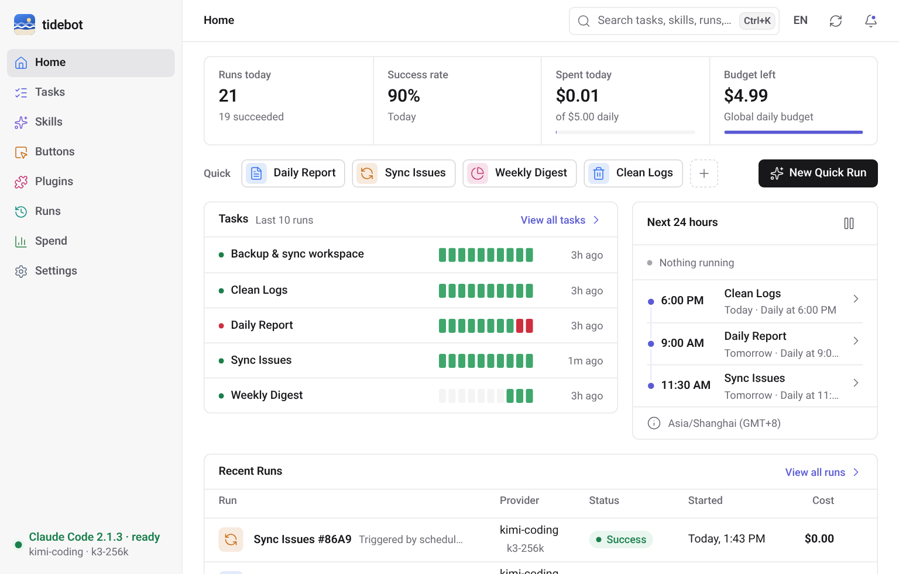
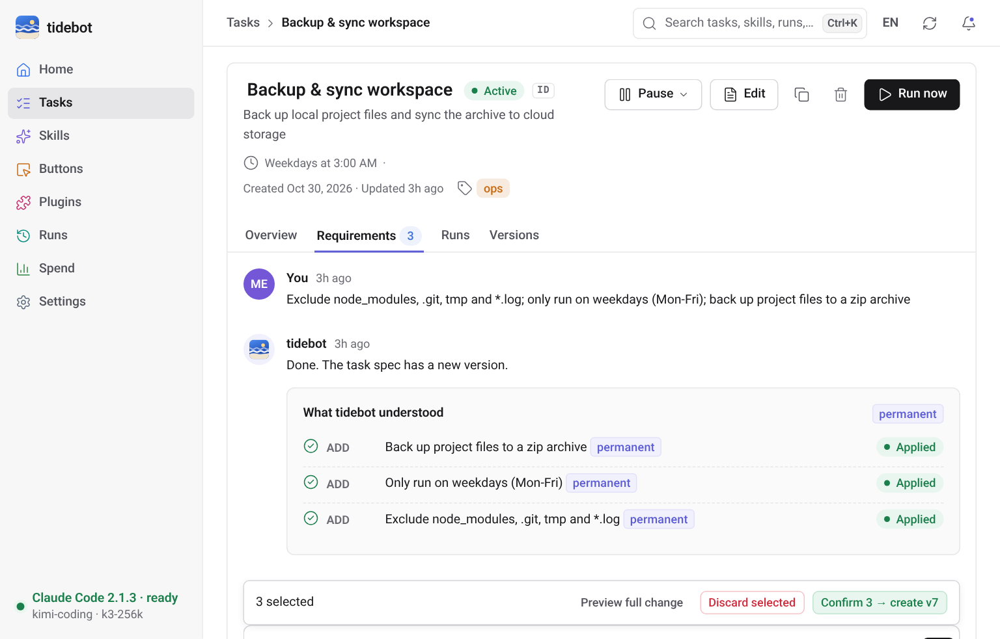
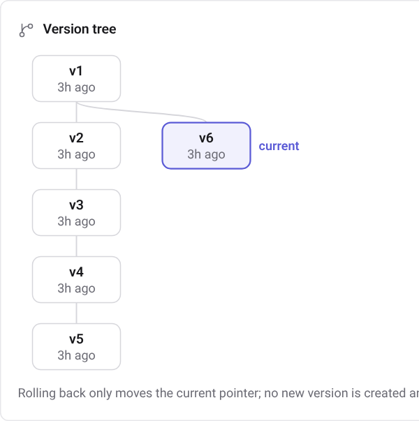
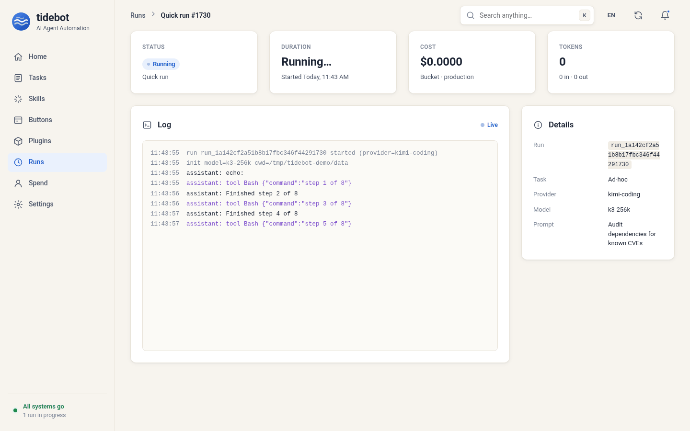
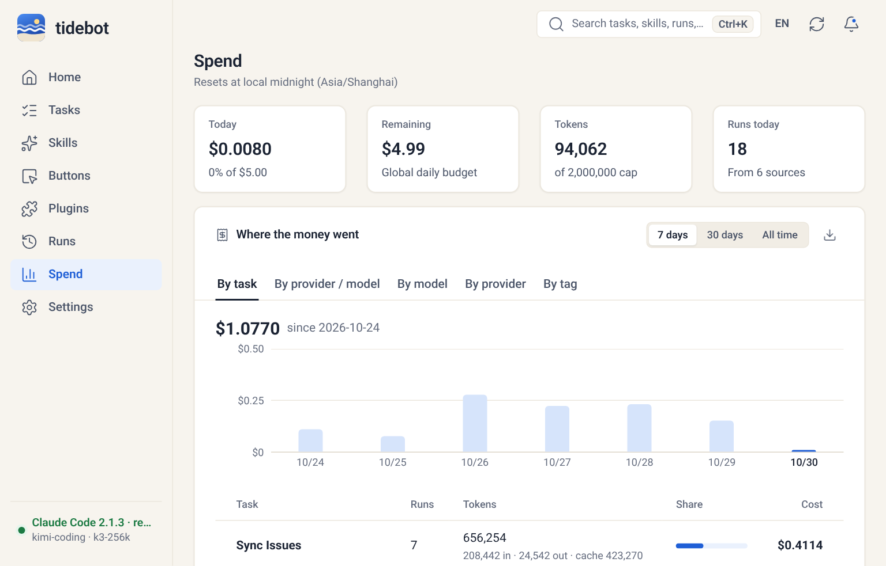
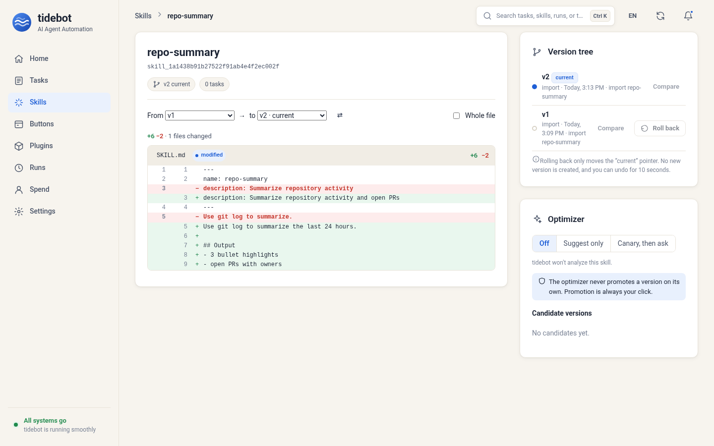
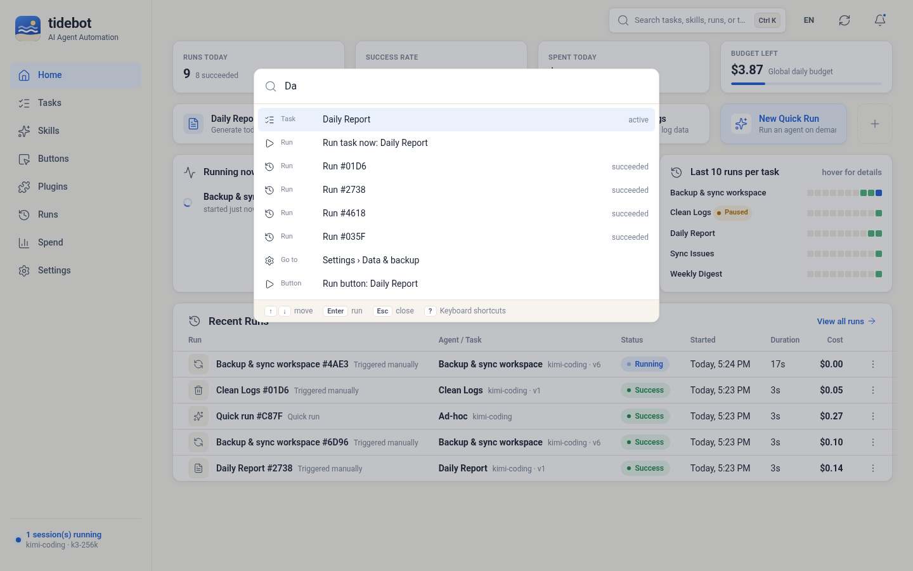
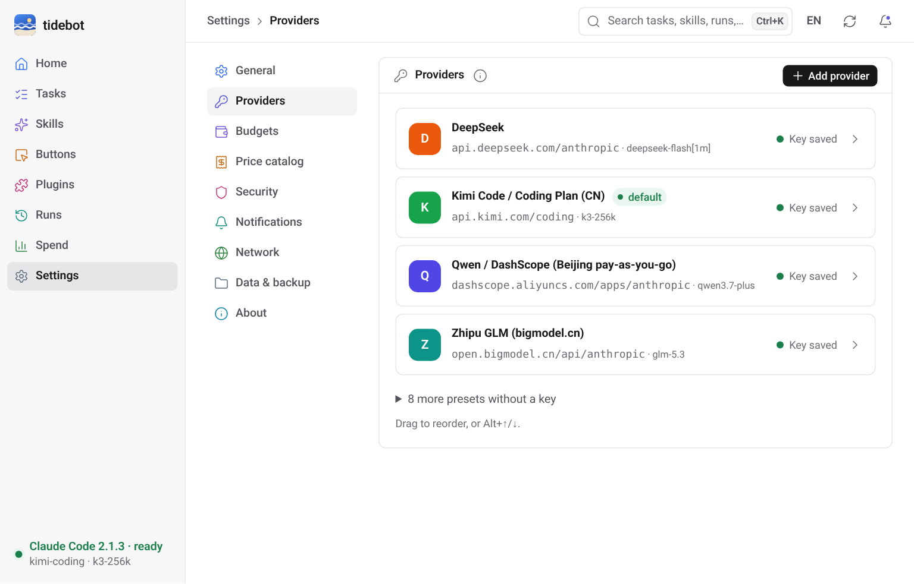
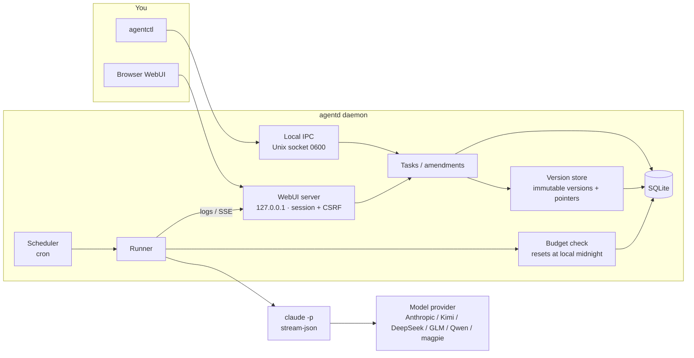

# tidebot

[中文](README.md) · [English](README.en.md)

tidebot is a small thing I built for myself. It's a background process on my machine that runs Claude Code on a schedule.

I had a pile of repetitive chores: skim the repo every morning and write a daily report, sync issues, clean up logs. `claude -p` handles each of these fine. The annoying parts were scheduling and changing requirements. cron plus a shell script works, but every tweak means digging through a prompt, and if I break it there's no going back.

So tidebot does a few simple things:

- Every morning at 9 it writes my daily report. If I want it to add year-over-year numbers, I just tell it on the task page: "add YoY from now on". It turns that into a requirement, I click confirm, and the task gets a new version.
- Broke something? Click an older version and you're back. History never goes away.
- Daily spend has a cap. When it's hit, things stop. No burning a month of credits overnight.

It's not a platform and doesn't want to become one. Single user, runs locally, one binary, about 13 MB of memory when idle.



## Screenshots

Task detail. The middle column is a conversation with the task. What you say gets split into individual requirements, and nothing changes until you confirm. Items from the same message can be confirmed together as a single version; uncheck the ones you don't want.



The version tree. Every confirmation is a new version. Rolling back just moves the "current" pointer; nothing is deleted.



Live run log, streamed over SSE. Secrets are masked before the log ever hits disk.



Spend. The daily budget resets at midnight in your own timezone (not UTC). Going over pauses the task and records an event.



Skill versions and diffs. Compare any two versions. Rollback only moves the pointer here too, and you have 10 seconds to undo it. On the right is the optimizer: it only proposes candidates, and promoting one is always your click.



Ctrl+K (⌘K on a Mac) opens a command palette. It searches tasks, skills and runs, and can run a task, run a button or switch language. You can do all of it from the keyboard; `?` lists the shortcuts.



Settings are split into General / Providers / Budgets / Security / Notifications / Data & backup / About, and every item has its own URL, e.g. `#/settings/security/2fa`. You can turn on two-factor sign-in there: scan, type one code, save the recovery codes. Nothing changes until a code checks out.



The UI speaks English and Simplified Chinese. It follows your browser by default and there's a switch in the top bar. Chinese screenshots are in [README.md](README.md).

## What it does

Scheduled tasks you can keep talking to. Tasks have a cron schedule or run on demand. You change requirements in plain language; tidebot splits them into add / modify / delete items and marks each as permanent or next-run-only. "Keep backups for 10 days this time" only affects the next run and leaves the task itself alone. If something conflicts with an existing requirement, it asks whether to replace or keep both.

Skills with versions and rollback. Import a Claude Code skill directory; every re-import is a new version. A task can pin a specific skill version, and you can roll back when a new one misbehaves.

Optional skill optimization (off by default). Three modes: off, suggest only, canary. Canary sends part of the runs to a candidate version and shows success rate, cost and duration side by side. It never promotes anything on its own; you confirm that.

Buttons and plugins. A button is a one-click preset bound to a task or a prompt. The home page shows them in the order you set, by drag or Alt+arrow keys. When you install a plugin you tick its permissions one by one (high-risk ones start unticked), and you can revoke a single one later. Plugins with settings get a form; password-type fields can't be read back once saved.

Cost caps. Daily limits per global / task / bucket (production, canary, optimization, assist). Checked before every run, with `--max-budget-usd` as a backstop during the run.

Any model provider. Anything with an Anthropic-compatible endpoint works. Built in: Anthropic, Kimi (including Coding Plan), DeepSeek, Zhipu GLM / Z.AI, Qwen DashScope, and the local magpie gateway. Keys are injected only into the `claude` child process environment. They never go into the database or the logs.

Tiny footprint. Measured on a Linux x86_64 box (Go 1.24, `make build`):

| What | Number |
|---|---|
| `agentd` binary (stripped) | 11.5 MB |
| `agentctl` binary | 3.1 MB |
| Idle RSS, WebUI off | ~13 MB |
| Idle RSS, WebUI on | ~13.3 MB |
| After a few runs and a WebUI login | ~20 MB |
| Peak during login (argon2id hash) | ~84 MB, released right after |
| WebUI frontend (JS + CSS, gzipped) | ~25 KB, no CDN, no framework |

## Architecture



## Download

[](https://github.com/Zhengmingming1/tidebot-releases/releases/latest/download/tidebot-desktop-macOS-AppleSilicon-Intel.dmg) [](https://github.com/Zhengmingming1/tidebot-releases/releases/latest/download/tidebot-desktop-Windows-x64-Setup.exe) [](https://github.com/Zhengmingming1/tidebot-releases/releases/latest/download/tidebot-desktop-Linux-x64.AppImage) [](https://github.com/Zhengmingming1/tidebot-releases/releases/latest/download/tidebot-desktop-Linux-x64.deb)

Pick your OS. On a Mac the chip doesn't matter: Apple Silicon and Intel use the same .dmg. Server builds, ARM and Docker are on the [Releases page](https://github.com/Zhengmingming1/tidebot-releases/releases/latest), which starts with a "Which file do I download?" table.
A GitHub README can't detect your OS, so this is a plain list. These links work from v0.1.1 on; for v0.1.0 use the Releases page.

Builds aren't signed yet: on macOS right-click → Open the first time (or `xattr -dr com.apple.quarantine /Applications/tidebot.app`); on Windows click "More info → Run anyway" in SmartScreen.

## Install

Prebuilt packages are on the [Releases](https://github.com/Zhengmingming1/tidebot-releases/releases) page, with sha256 sums in `checksums.txt`.
Whichever you pick, you still need the `claude` CLI installed to actually run tasks.

- **Server (agentd + agentctl)**: grab `tidebot-server_<version>_<os>_<arch>.tar.gz` (`.zip` on Windows) and put the two binaries on your PATH.
  On Debian/Ubuntu there's a `.deb`: `sudo apt install ./tidebot-server_0.1.0_amd64.deb`, then `systemctl --user enable --now tidebot`.
- **Desktop app**: `.dmg` on macOS (universal, Intel and Apple silicon), `_setup.exe` on Windows (per-user, no admin),
  `.deb` or `.AppImage` on Linux (the AppImage doesn't bundle WebKitGTK; you need `libwebkit2gtk-4.1` on the system).
  Unsigned builds: on macOS right-click → Open the first time; Windows shows a SmartScreen prompt.
- **Docker**: `docker pull ghcr.io/zhengmingming1/tidebot:0.1.0`. The image doesn't include the `claude` CLI; see [docs/release.md](docs/release.md) for adding it.

Once installed, `agentctl call update.check` looks for a newer release and `update.apply` swaps the binaries in place after checking the sha256 (the old ones stay as `.prev`).

## Quick start

You need Go 1.22+. Real runs need the `claude` CLI installed. If you just want to look around, the repo ships a fake `claude` that costs nothing.

```bash
git clone https://github.com/Zhengmingming1/tidebot.git
cd tidebot
make build                     # produces bin/agentd and bin/agentctl

export TIDEBOT_HOME=$HOME/.tidebot
./bin/agentd &                 # start the daemon
./bin/agentctl status
```

To see the UI right away, there's a demo script that starts an isolated instance with the fake claude and seeds demo data:

```bash
scripts/demo-webui.sh          # open http://127.0.0.1:17421, password demo-pass-99
```

To turn on the WebUI for your own instance:

```bash
./bin/agentctl auth set-password --password 'pick-your-own'
./bin/agentctl webui on        # listens on 127.0.0.1:7420 only, by default
```

## Providers

The easy way is Settings → Providers in the WebUI: pick a preset (Anthropic, Kimi, DeepSeek, Zhipu, Qwen, ...), paste the key, hit Test. The key is encrypted on this machine; the page only shows that it is set and its last 4 characters, and never sends it back.

Environment variables still work:

Keys live in environment variables, never in config files. The variable is `TIDEBOT_API_KEY_<PROVIDER_ID>`; Kimi Coding Plan also accepts `KIMI_API_KEY`.

```bash
export TIDEBOT_API_KEY_DEEPSEEK=...      # your own key
export TIDEBOT_DEFAULT_PROVIDER=deepseek
```

Built-in provider IDs: `anthropic`, `kimi`, `kimi-cn`, `kimi-coding`, `kimi-coding-intl`, `deepseek`, `zhipu`, `zai`, `qwen`, `qwen-coding`, `qwen-coding-intl`, `magpie`. Endpoints and sources are in [docs/providers.md](docs/providers.md).

To add another one, put it in `$TIDEBOT_HOME/providers.yaml`:

```yaml
providers:
  - name: my-gateway
    base_url: https://example.com/anthropic
    auth_env: ANTHROPIC_AUTH_TOKEN
    secret_env: MY_GATEWAY_KEY
    model: some-model
```

Other common settings go in `$TIDEBOT_HOME/config.yaml`:

```yaml
default_provider: kimi-coding
max_concurrency: 2
timezone: Asia/Shanghai      # used for displayed times and the daily budget reset; empty = system
webui_addr: 127.0.0.1:7420
shutdown_grace: 5s           # how long quitting waits for running runs before stopping them
```

Tasks, skills, buttons, plugins and triggers can all be created in the WebUI now. Drop a skill zip or folder on the import dialog; schedules come with presets (daily, weekdays, weekly) and show the next few runs in your timezone. The CLI below still works.

## CLI examples

```bash
# a task that runs every day at 9
agentctl tasks create --name "Daily report" --prompt "Summarize today's commits and issues" \
  --cron "0 9 * * *" --workspace ~/work/repo

# change requirements in plain language, then confirm the whole batch (one version)
agentctl amend propose --task <task_id> --text "add YoY numbers; put the table first"
agentctl amend confirm --batch <amendment_id>
agentctl amend confirm --batch <amendment_id> --only <req_id>   # just some of them

# versions and rollback
agentctl tasks versions --id <task_id>
agentctl tasks rollback --id <task_id> --version <version_id>

# skills
agentctl skills import --name weekly-report --dir ./skills/weekly-report
agentctl skills pin --task <task_id> --skill <skill_id> --version <version_id>

# budgets
agentctl spend summary
agentctl spend set-budget --scope global --max-usd 5

# run once now
agentctl tasks run --id <task_id>
```

CLI messages come in English and Chinese too. They follow your system locale, or set `TIDEBOT_LANG=en` / `TIDEBOT_LANG=zh-CN`.

## Desktop app (experimental)

`cmd/tidebot-desktop` is a tray app. The core runs in the same process and the window reads the WebUI through the webview's in-process asset handler, so no port is opened.
Closing the window just hides it to the tray; scheduled tasks keep running. The tray menu, top to bottom: a problems section that only shows up when something is wrong (core not responding, today's budget used up, failures in the last hour), how many tasks are running, your first 5 buttons, "Pause all schedules", LAN access, open, quit.
The icon has three states: idle, running, needs attention. If the core dies, the tray shows it within about 3 seconds.
You get native notifications when a run finishes, fails, needs approval or hits the budget. The menu language follows the WebUI language setting, or the OS if you never set one.

```bash
scripts/build-desktop.sh linux        # needs Go 1.25, libgtk-3-dev, libwebkit2gtk-4.1-dev
bin/tidebot-desktop --autostart enable --hidden   # start on login, hidden in the tray
```

Honest status: I've only really used it on Linux. The macOS and Windows builds compile and get packaged in CI, but I haven't run them on real machines.
It's built on Wails v3 beta, which still moves. It isn't light either: with WebKit it's 400 to 500 MB RSS (the core alone is ~14 MB). Numbers are in docs/phase0-results.md.

## Status

This is a personal project maintained by one person, and it's early.

Works today:

- Scheduling, manual runs, concurrency limit, timeouts; retries with backoff, a breaker after 3 failures in a row, catch-up after downtime, overlap rules
- Immutable task versions, rollback, version tree
- Plain-language amendments: structured items, conflict detection, batch confirm; it offers to consolidate once items pile up
- Skill import, versions, pinning, rollback; auto-optimization (off / suggest / canary), and a canary that does worse gets withdrawn automatically
- Daily spend caps at global / task / bucket level, reset at local midnight
- Execution guard: a workspace per task, tool allow-lists, dangerous commands held until you confirm, external input wrapped as data
- Plugins: separate processes speaking JSON-RPC over stdio, versioned installs, permissions approved item by item, a breaker after 3 crashes; they can add MCP tools and triggers
- Triggers: webhook (token or HMAC), file changes, email and IM (via plugins); workflow pack import/export
- Notifications: email, webhook, Feishu, DingTalk, WeCom, Telegram, with quiet hours and a daily digest
- Backups (`.agentbak`, secrets only with a passphrase) and restore (`agentd restore`), log cleanup, a health summary and Prometheus `/metrics`
- Sandbox dry-runs: runs against a copy of the workspace, billed to the dry_run bucket, and tells you which files changed
- WebUI in English and Chinese, with a CI check that both dictionaries have the same keys; command palette and shortcuts; notifications grouped into failed / needs me / other
- Optional two-factor sign-in (TOTP) with one-time recovery codes; after too many failed logins it tells you how long to wait
- A desktop app (tray + window)
- CI runs the tests on Linux, macOS and Windows; Windows uses a named pipe for local IPC

Not there yet:

- Requirement splitting uses a local rule by default (split on semicolons). Model-based splitting needs `TIDEBOT_AMEND_AI=1` and is still being tuned.
- No CPU limits for plugins; memory is only roughly capped with rlimit on Linux.
- Secrets live in a local encrypted file; OS keychain support isn't wired up.
- The guard's path checks assume Unix paths, so the write-outside-workspace check isn't reliable on Windows.
- I've only installed and run the Linux packages myself. The macOS .dmg and Windows installer come out of CI and nobody has clicked through them yet.
- Builds are unsigned by default.
- The repo is still private, so self-update can't see new releases yet.

## About Anthropic

tidebot drives the Claude Code CLI installed on your machine, with your own API key or subscription. It is not affiliated with, endorsed by, or sponsored by Anthropic. Please follow the terms of Anthropic and of whichever model provider you use. "Claude" and "Claude Code" are trademarks of Anthropic.

## Docs

- [Design plan](docs/final-plan.md)
- [Research report](docs/report.md)
- [Model providers](docs/providers.md)
- [Releases and packaging](docs/release.md)
- [Phase 0 measurements](docs/phase0-results.md)
