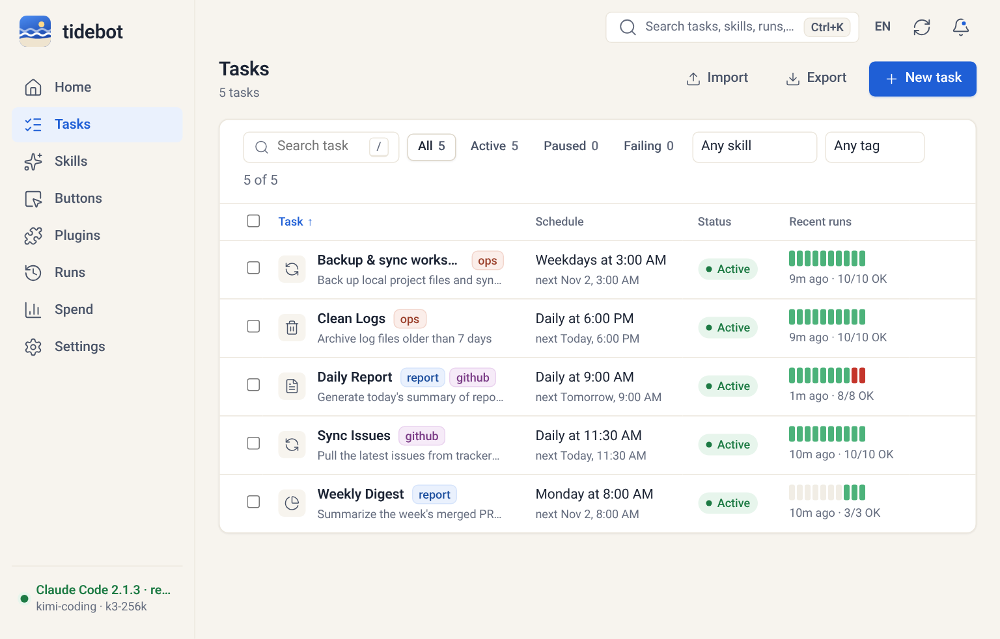
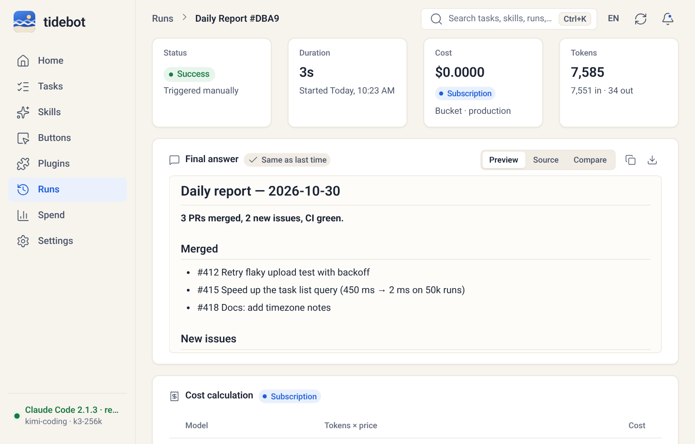
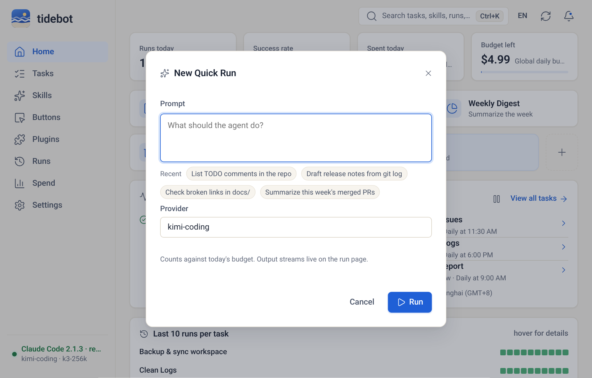
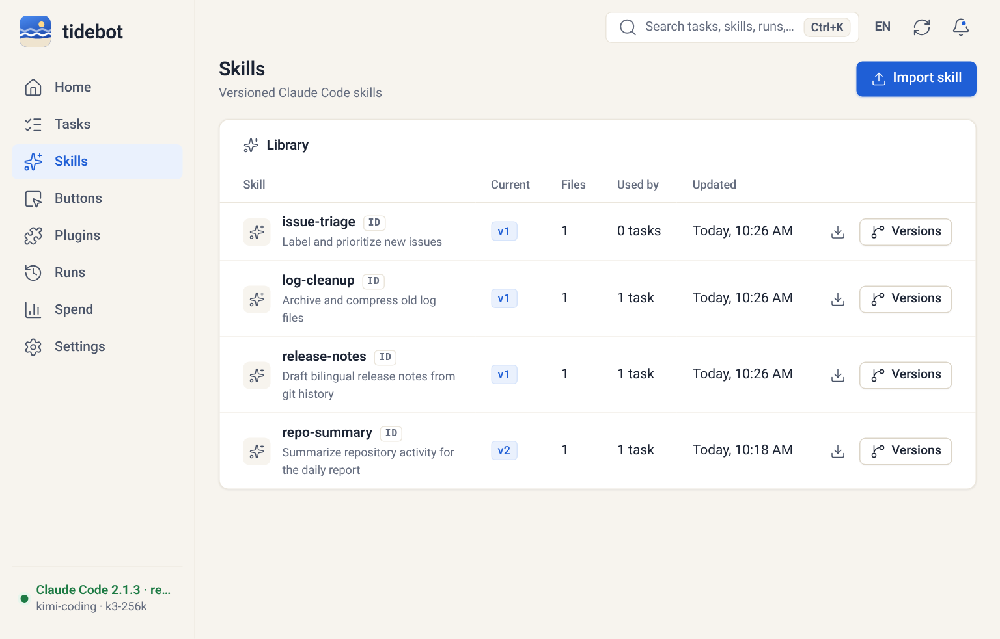
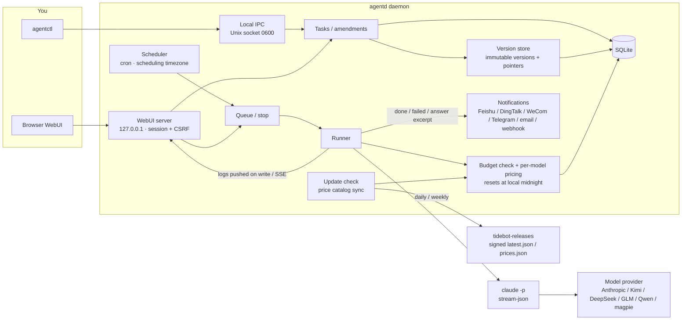
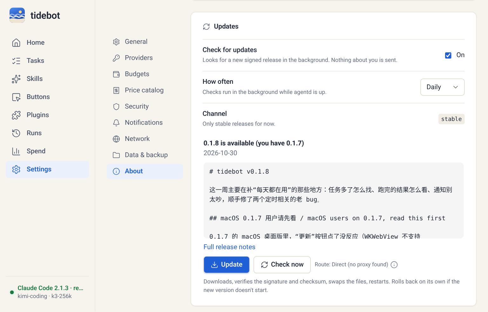

# tidebot

[](https://github.com/Zhengmingming1/tidebot/actions/workflows/ci.yml) [](LICENSE)

[中文](README.md) · [English](README.en.md)

tidebot is a small thing I built for myself. It's a background process on my machine that runs Claude Code on a schedule.

I had a pile of repetitive chores: skim the repo every morning and write a daily report, sync issues, clean up logs. `claude -p` handles each of these fine. The annoying parts were scheduling and changing requirements. cron plus a shell script works, but every tweak means digging through a prompt, and if I break it there's no going back.

So tidebot does a few simple things:

- Every morning at 9 it writes my daily report. If I want it to add year-over-year numbers, I just tell it on the task page: "add YoY from now on". It turns that into a requirement, I click confirm, and the task gets a new version.
- Broke something? Click an older version and you're back. History never goes away.
- Daily spend has a cap. When it's hit, things stop. No burning a month of credits overnight.

It's not a platform and doesn't want to become one. Single user, runs locally, one binary, about 30 MB of memory when idle.


## Screenshots

All screenshots are taken in a 1024×655 window, which is the size I actually keep it at on my Mac. The data comes from the demo script, not a real account.

The task list. Each row ends with a strip of the last 10 runs, tags sit next to the name, and clicking a tag filters by it; "Failing" picks out the tasks whose latest run didn't make it. It works from the keyboard too: `j`/`k` to move, Enter to open, `r` to run now.



Task detail. The conversation with the task lives in the Requirements tab. What you say gets split into individual requirements, and nothing changes until you confirm. Items from the same message can be confirmed together as a single version; uncheck the ones you don't want.


The version tree. Every confirmation is a new version. Rolling back just moves the "current" pointer; nothing is deleted.


Live run log. Output is pushed as soon as it's written, so new lines show up almost instantly. Copy, download and full screen sit in the title bar, a running run has a Stop button next to it, and a queued one can simply be taken out of the queue. Secrets are masked before the log ever hits disk.


A finished run gets a "Final answer" card: the Markdown is rendered, and you can switch to the source, copy it or download it as .md. "Compare" diffs it line by line against the task's previous successful answer, and an identical answer is marked "Same as last time". At the bottom of the page a run can be rerun with one click; quick runs can also be edited and rerun (press `e`), or saved as a scheduled task.



Quick run. Recent prompts show up as chips you can click, the provider you used last time is preselected, and Ctrl+Enter (⌘+Enter on a Mac) runs it. Unsent prompts are kept as a draft, so closing the dialog or reloading the page doesn't lose them.



Spend. Every model is priced at its own rate; subscription plans count tokens, not money. The daily budget resets at midnight in your own timezone (not UTC). Going over pauses the task and records an event. You can break it down by task, provider, model or tag, click a day in the chart to see just that day, and export the selected range as CSV.


The skill library. Every skill can be downloaded as a .zip and imported on another machine as is.



Skill versions and diffs. Compare any two versions. Rollback only moves the pointer here too, and you have 10 seconds to undo it. Any version can be downloaded on its own.


Ctrl+K (⌘K on a Mac) opens a command palette. It searches tasks, skills and runs, and can run a task, run a button or switch language. You can do all of it from the keyboard; `?` lists the shortcuts.


Settings are split into General / Providers / Budgets / Price catalog / Security / Notifications / Network / Data & backup / About, and every item has its own URL, e.g. `#/settings/security/2fa`. You can turn on two-factor sign-in there: scan, type one code, save the recovery codes. Nothing changes until a code checks out. Changing your password, seeing which devices are signed in and signing the others out are under Security too. Notification channels (Feishu, DingTalk, WeCom, Telegram, email, webhook) are added here as well; paste the URL and it figures out which one it is, and you can send a test before saving.


The UI speaks English and Simplified Chinese. It follows your browser by default and there's a switch in the top bar. Chinese screenshots are in [README.md](README.md).

## What it does

Scheduled tasks you can keep talking to. Tasks have a cron schedule or run on demand. You change requirements in plain language; tidebot splits them into add / modify / delete items and marks each as permanent or next-run-only. "Keep backups for 10 days this time" only affects the next run and leaves the task itself alone. If something conflicts with an existing requirement, it asks whether to replace or keep both.

Skills with versions and rollback. Import a Claude Code skill directory; every re-import is a new version. A task can pin a specific skill version, and you can roll back when a new one misbehaves.

Optional skill optimization (off by default). Three modes: off, suggest only, canary. Canary sends part of the runs to a candidate version and shows success rate, cost and duration side by side. It never promotes anything on its own; you confirm that.

Buttons and plugins. A button is a one-click preset bound to a task or a prompt. The home page shows them in the order you set, by drag or Alt+arrow keys. When you install a plugin you tick its permissions one by one (high-risk ones start unticked), and you can revoke a single one later. Plugins with settings get a form; password-type fields can't be read back once saved.

Keeping lots of tasks in order. Tasks take tags, which you can filter by and add or remove in bulk. Tasks export to a JSON file you can import on another machine (with a preview of each one first; imports start paused). Need a break? Pause all schedules with one click, or pause a single task for 1 hour, 4 hours or until 9 tomorrow, and it resumes on its own. Tasks that got paused automatically say why, e.g. repeated failures or an exhausted budget.

Schedules you can trust. Schedules follow the timezone you set (searchable in Settings → General), and the day clocks change for DST nothing is skipped or run twice. On a laptop running on battery, low-priority tasks can wait; when the disk is nearly full no new runs start, and they pick up again once there's space.

Notifications that don't nag. Success notifications include the first few lines of the answer, and email gets the whole thing. You can also notify only when the answer changed, so a daily report that says the same thing every day stays quiet. Each channel shows whether its last message went out, and you get a heads-up after 3 failures in a row.

Quick runs and reruns. If you don't want a task yet, hit "New quick run" on the home page, type a sentence and go. Not happy with the result? Rerun it as is, or edit the prompt and run again, and save it as a scheduled task once it's right. A running run can be stopped at any time, a queued one can be taken out of the queue, and the page shows where it is in line.

Cost caps. Daily limits per global / task / bucket (production, canary, optimization, assist). Checked before every run, checked again when a queued run gets its slot (if the budget ran out while it waited, it's skipped), with `--max-budget-usd` as a backstop during the run. Runs that start at the same time each reserve their share of what's left first, so they can't overshoot the cap together. Usage is saved every 5 seconds while a run is going, so a crash doesn't lose the bill.

Priced per model. Each run is priced from its actual token usage at that model's own rate, instead of applying Claude's prices to everything; subscription plans (like Kimi Coding Plan) just count tokens. The price list syncs itself weekly from a signed price catalog (source and last update live in Settings → Price catalog). The Spend page breaks things down by task, provider and model, and exports CSV.

Data doesn't pile up. Settings → Data & backup shows how much space tidebot uses, lets you change how long logs and runs are kept, and previews what a clean-up would delete. You get a warning when the disk holding the data folder is running low.

Any model provider. Anything with an Anthropic-compatible endpoint works. Built in: Anthropic, Kimi (including Coding Plan), DeepSeek, Zhipu GLM / Z.AI, Qwen DashScope, and the local magpie gateway. Keys are injected only into the `claude` child process environment. They never go into the database or the logs.

Small footprint. Measured on 2026-10-30 on a Linux x86_64 box (`go build -trimpath -ldflags="-s -w"`, i.e. `make build`; `scripts/measure.sh` reproduces it):

| What | Number |
|---|---|
| `agentd` binary (stripped) | 17.8 MB |
| `agentctl` binary | 4.1 MB |
| Idle RSS, WebUI off | ~29 MB |
| Idle RSS, WebUI on | ~31 MB |
| WebUI frontend (JS + CSS, gzipped) | ~195 KB, no CDN, no framework; cached by content hash, so a second visit downloads nothing |

A lot went in this week, so the frontend got bigger; memory stayed about the same. API responses are gzipped too: 100 runs in the runs list went from ~70 KB to 12 KB.

## Architecture



## Download

[](https://github.com/Zhengmingming1/tidebot-releases/releases/latest/download/tidebot-desktop-macOS-AppleSilicon-Intel.dmg) [](https://github.com/Zhengmingming1/tidebot-releases/releases/latest/download/tidebot-desktop-Windows-x64-Setup.exe) [](https://github.com/Zhengmingming1/tidebot-releases/releases/latest/download/tidebot-desktop-Linux-x64.AppImage) [](https://github.com/Zhengmingming1/tidebot-releases/releases/latest/download/tidebot-desktop-Linux-x64.deb)

Pick your OS. On a Mac the chip doesn't matter: Apple Silicon and Intel use the same .dmg. Server builds, ARM and Docker are on the [Releases page](https://github.com/Zhengmingming1/tidebot-releases/releases/latest), which starts with a "Which file do I download?" table.
A GitHub README can't detect your OS, so this is a plain list. These links work from v0.1.1 on; for v0.1.0 use the Releases page.

Builds aren't signed yet: on macOS right-click → Open the first time (or `xattr -dr com.apple.quarantine /Applications/tidebot.app`); on Windows click "More info → Run anyway" in SmartScreen.

## Install

Prebuilt packages are on the [Releases](https://github.com/Zhengmingming1/tidebot-releases/releases) page, with sha256 sums in `checksums.txt`.
Whichever you pick, you still need the `claude` CLI installed to actually run tasks.

- **Server (agentd + agentctl)**: grab `tidebot-server_<version>_<os>_<arch>.tar.gz` (`.zip` on Windows) and put the two binaries on your PATH.
  On Debian/Ubuntu there's a `.deb`: `sudo apt install ./tidebot-server_0.1.8_amd64.deb`, then `systemctl --user enable --now tidebot`.
- **Desktop app**: `.dmg` on macOS (universal, Intel and Apple silicon), `-Windows-x64-Setup.exe` on Windows (per-user, no admin),
  `.deb` or `.AppImage` on Linux (the AppImage doesn't bundle WebKitGTK; you need `libwebkit2gtk-4.1` on the system).
  Unsigned builds: on macOS right-click → Open the first time; Windows shows a SmartScreen prompt.
- **Docker**: `docker pull ghcr.io/zhengmingming1/tidebot:0.1.8`. The image doesn't include the `claude` CLI; see [docs/release.md](docs/release.md) for adding it.

Auto-update: the desktop app and the server check for a new version once a day (you can turn that off in Settings → About → Updates). By hand it's `agentctl update check` / `agentctl update apply`: the update manifest's signature and the package's sha256 are verified, the binaries are swapped in place (the old ones stay as `.prev`), and if the new version doesn't come up within 90 seconds it rolls back. Installs owned by a package manager, like `.deb` or Docker, only get a notification. If GitHub is slow or blocked where you are, Settings → Network has proxy and download mirror options.

Settings → About shows whether there's a new version and its release notes. "Update" asks in an in-app dialog first, then downloads, verifies, swaps the files and restarts, with the progress shown right there.



**On the macOS desktop app 0.1.7? Install this one by hand, once.** In the 0.1.7 Mac build the "Update" button does nothing (WKWebView doesn't support `window.confirm()`; 0.1.8 uses an in-app dialog instead). Quit tidebot from its menu bar icon, download the new [.dmg](https://github.com/Zhengmingming1/tidebot-releases/releases/latest/download/tidebot-desktop-macOS-AppleSilicon-Intel.dmg) and drag tidebot.app into Applications to replace the old one, then open it the first time with right-click → Open (or run `xattr -dr com.apple.quarantine /Applications/tidebot.app`). Your data stays put. Later versions update in-app again.

## Quick start

You need Go 1.26+. Real runs need the `claude` CLI installed. If you just want to look around, the repo ships a fake `claude` that costs nothing.

```bash
git clone https://github.com/Zhengmingming1/tidebot.git
cd tidebot
make build                     # produces bin/agentd and bin/agentctl

export TIDEBOT_HOME=$HOME/.tidebot
./bin/agentd &                 # start the daemon
./bin/agentctl status
```

To see the UI right away, there's a demo script that starts an isolated instance with the fake claude and seeds demo data:

```bash
scripts/demo-webui.sh          # open http://127.0.0.1:17421, password demo-pass-99
```

To turn on the WebUI for your own instance:

```bash
./bin/agentctl auth set-password --password 'pick-your-own'
./bin/agentctl webui on        # listens on 127.0.0.1:7420 only, by default
```

## Providers

The easy way is Settings → Providers in the WebUI: pick a preset (Anthropic, Kimi, DeepSeek, Zhipu, Qwen, ...), paste the key, hit Test. The key is encrypted on this machine; the page only shows that it is set and its last 4 characters, and never sends it back.

Environment variables still work:

Keys live in environment variables, never in config files. The variable is `TIDEBOT_API_KEY_<PROVIDER_ID>`; Kimi Coding Plan also accepts `KIMI_API_KEY`.

```bash
export TIDEBOT_API_KEY_DEEPSEEK=...      # your own key
export TIDEBOT_DEFAULT_PROVIDER=deepseek
```

Built-in provider IDs: `anthropic`, `kimi`, `kimi-cn`, `kimi-coding`, `kimi-coding-intl`, `deepseek`, `zhipu`, `zai`, `qwen`, `qwen-coding`, `qwen-coding-intl`, `magpie`. Endpoints and sources are in [docs/providers.md](docs/providers.md).

To add another one, put it in `$TIDEBOT_HOME/providers.yaml`:

```yaml
providers:
  - name: my-gateway
    base_url: https://example.com/anthropic
    auth_env: ANTHROPIC_AUTH_TOKEN
    secret_env: MY_GATEWAY_KEY
    model: some-model
```

Other common settings go in `$TIDEBOT_HOME/config.yaml`:

```yaml
default_provider: kimi-coding
max_concurrency: 2
timezone: Asia/Shanghai      # used for displayed times and the daily budget reset; empty = system
webui_addr: 127.0.0.1:7420
shutdown_grace: 5s           # how long quitting waits for running runs before stopping them
```

Tasks, skills, buttons, plugins and triggers can all be created in the WebUI now. Drop a skill zip or folder on the import dialog; schedules come with presets (daily, weekdays, weekly) and show the next few runs in your timezone. When you create a task, the name and schedule get filled in from what you wrote and a daily budget is suggested; the add-provider form also understands a pasted Base URL or a block of env vars. If a dialog has unsaved changes, Esc or a click outside asks before throwing them away. The CLI below still works.

## CLI examples

```bash
# a task that runs every day at 9
agentctl tasks create --name "Daily report" --prompt "Summarize today's commits and issues" \
  --cron "0 9 * * *" --workspace ~/work/repo

# change requirements in plain language, then confirm the whole batch (one version)
agentctl amend propose --task <task_id> --text "add YoY numbers; put the table first"
agentctl amend confirm --batch <amendment_id>
agentctl amend confirm --batch <amendment_id> --only <req_id>   # just some of them

# versions and rollback
agentctl tasks versions --id <task_id>
agentctl tasks rollback --id <task_id> --version <version_id>

# skills
agentctl skills import --name weekly-report --dir ./skills/weekly-report
agentctl skills pin --task <task_id> --skill <skill_id> --version <version_id>

# budgets
agentctl spend summary
agentctl spend set-budget --scope global --max-usd 5

# run once now; stop it (or drop it from the queue)
agentctl tasks run --id <task_id>
agentctl runs stop --id <run_id>
```

CLI messages come in English and Chinese too. They follow your system locale, or set `TIDEBOT_LANG=en` / `TIDEBOT_LANG=zh-CN`.

## Desktop app (experimental)

`cmd/tidebot-desktop` is a tray app. The core runs in the same process and the window reads the WebUI through the webview's in-process asset handler, so no port is opened.
Closing the window just hides it to the tray; scheduled tasks keep running. The tray menu, top to bottom: a problems section that only shows up when something is wrong (core not responding, today's budget used up, failures in the last hour), how many tasks are running, your first 5 buttons, "Pause all schedules", LAN access, open, quit.
The icon has three states: idle, running, needs attention. If the core dies, the tray shows it within about 3 seconds.
You get native notifications when a run finishes, fails, needs approval or hits the budget. The menu language follows the WebUI language setting, or the OS if you never set one.
CSV exports, log and skill downloads go through the native Save dialog, with "Show in folder" afterwards; Settings → Data & backup can open the data folder directly. The browser tab icon gets a small badge, so you can see at a glance when something is running or just failed.

```bash
scripts/build-desktop.sh linux        # needs Go 1.26, libgtk-3-dev, libwebkit2gtk-4.1-dev
bin/tidebot-desktop --autostart enable --hidden   # start on login, hidden in the tray
```

Honest status: I use it on Linux and on an Apple Silicon Mac. The Windows build compiles, gets packaged and passes the tests in CI, but I haven't clicked through it on a real machine.
It's built on Wails v3 beta, which still moves. It isn't light either: with WebKit it's 400 to 500 MB RSS (the core alone is ~14 MB). Numbers are in docs/phase0-results.md.

## Status

This is a personal project maintained by one person, and it's early.

Works today:

- Scheduling (configurable scheduling timezone, DST-safe), manual runs, quick runs, concurrency limit, timeouts; timed pause for everything or one task; runs deferred on battery or when the disk is nearly full; stop a running run or drop a queued one; retries with backoff, a breaker after 3 failures in a row, catch-up after downtime, overlap rules; quitting lets running runs finish
- The run page shows the final answer and can diff it against the last one; rerun, edit-and-rerun and save-as-task; duplicate a task; prompt drafts are saved automatically
- Task tags, last-10-runs strips and a "Failing" filter; task export/import; runs filtered by date, search snippets, CSV / JSONL export
- Immutable task versions, rollback, version tree
- Plain-language amendments: structured items, conflict detection, batch confirm; it offers to consolidate once items pile up
- Skill import, versions, pinning, rollback; auto-optimization (off / suggest / canary), and a canary that does worse gets withdrawn automatically
- Daily spend caps at global / task / bucket level, reset at local midnight; per-model pricing with a weekly price catalog sync; spend export to CSV
- Execution guard: a workspace per task, tool allow-lists, dangerous commands held until you confirm, external input wrapped as data
- Plugins: separate processes speaking JSON-RPC over stdio, versioned installs, permissions approved item by item, a breaker after 3 crashes; they can add MCP tools and triggers
- Triggers: webhook (token or HMAC), file changes, email and IM (via plugins); workflow pack import/export
- Notifications: email, webhook, Feishu, DingTalk, WeCom, Telegram, added and tested from Settings; answer excerpts, optional "only when the answer changed"; per-channel delivery status and alerts on repeated failures; quiet hours and a daily digest
- Backups (`.agentbak`, secrets only with a passphrase) and restore (`agentd restore`), log cleanup, a health summary and Prometheus `/metrics`
- Sandbox dry-runs: runs against a copy of the workspace, billed to the dry_run bucket, and tells you which files changed
- WebUI in English and Chinese, with a CI check that both dictionaries have the same keys; command palette and shortcuts; notifications grouped into failed / needs me / other
- Optional two-factor sign-in (TOTP) with one-time recovery codes; after too many failed logins it tells you how long to wait; change your password, see and sign out other devices
- A desktop app (tray + window)
- CI runs the tests on Linux, macOS and Windows on every push; Windows uses a named pipe for local IPC; gitleaks scans the full history in CI so keys don't get committed
- Auto-update: signed manifest + sha256 check, automatic rollback on failure; system proxy and download mirrors
- Storage overview, adjustable retention, clean-up preview, low disk space warning

Not there yet:

- Requirement splitting uses a local rule by default (split on semicolons). Model-based splitting needs `TIDEBOT_AMEND_AI=1` and is still being tuned.
- No CPU limits for plugins; memory is only roughly capped with rlimit on Linux.
- Secrets live in a local encrypted file; OS keychain support isn't wired up.
- The guard's path checks assume Unix paths, so the write-outside-workspace check isn't reliable on Windows.
- I've installed the Linux packages and the macOS .dmg myself. The Windows installer comes out of CI and hasn't been clicked through on a real machine yet.
- Builds are unsigned by default.

## About Anthropic

tidebot drives the Claude Code CLI installed on your machine, with your own API key or subscription. It is not affiliated with, endorsed by, or sponsored by Anthropic. Please follow the terms of Anthropic and of whichever model provider you use. "Claude" and "Claude Code" are trademarks of Anthropic.

## License

tidebot is released under the [GNU AGPL-3.0](LICENSE), version 3 only (SPDX: `AGPL-3.0-only`). Use it, change it, pass it on. The one catch: if you change it and let other people use it over a network (say, you open the WebUI to your team), you have to offer them your changed source too.

The source lives at [github.com/Zhengmingming1/tidebot](https://github.com/Zhengmingming1/tidebot). Installers and auto-update still come from [tidebot-releases](https://github.com/Zhengmingming1/tidebot-releases). The icons are Lucide (ISC). Dependency licenses are in [THIRD_PARTY_NOTICES.md](THIRD_PARTY_NOTICES.md). A copy you build from source never replaces itself with official binaries; it only tells you about new releases (see [docs/building.md](docs/building.md)). Please report security issues privately, as described in [SECURITY.md](SECURITY.md). Issues and PRs are welcome; [CONTRIBUTING.md](CONTRIBUTING.md) has the short version.

## Docs

- [Design plan](docs/final-plan.md)
- [Research report](docs/report.md)
- [Model providers](docs/providers.md)
- [Releases and packaging](docs/release.md)
- [Phase 0 measurements](docs/phase0-results.md)
