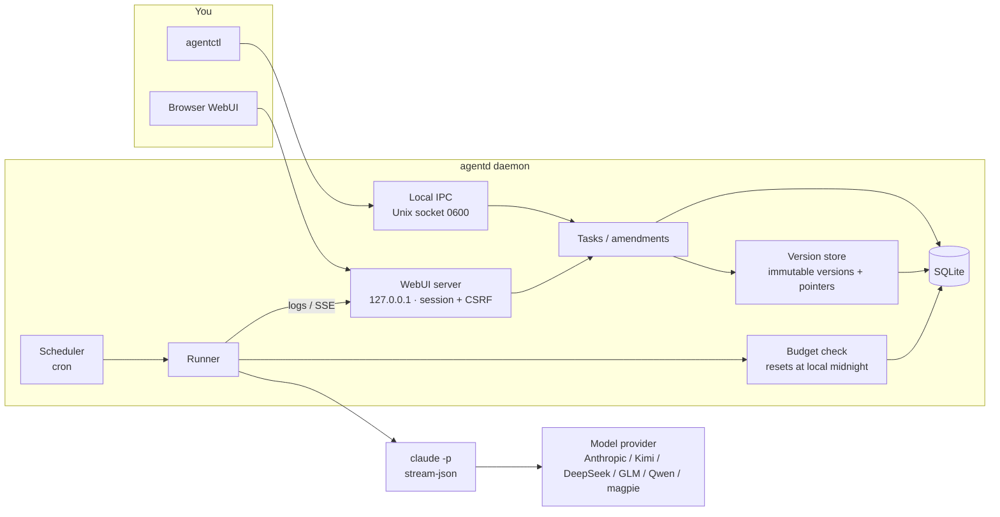

# tidebot

[中文](README.md) · [English](README.en.md)

tidebot is a small thing I built for myself. It's a background process on my machine that runs Claude Code on a schedule.

I had a pile of repetitive chores: skim the repo every morning and write a daily report, sync issues, clean up logs. `claude -p` handles each of these fine. The annoying parts were scheduling and changing requirements. cron plus a shell script works, but every tweak means digging through a prompt, and if I break it there's no going back.

So tidebot does a few simple things:

- Every morning at 9 it writes my daily report. If I want it to add year-over-year numbers, I just tell it on the task page: "add YoY from now on". It turns that into a requirement, I click confirm, and the task gets a new version.
- Broke something? Click an older version and you're back. History never goes away.
- Daily spend has a cap. When it's hit, things stop. No burning a month of credits overnight.

It's not a platform and doesn't want to become one. Single user, runs locally, one binary, about 13 MB of memory when idle.


## Screenshots

Task detail. The middle column is a conversation with the task. What you say gets split into individual requirements, and nothing changes until you confirm. Items from the same message can be confirmed together as a single version; uncheck the ones you don't want.


The version tree. Every confirmation is a new version. Rolling back just moves the "current" pointer; nothing is deleted.


Live run log, streamed over SSE. Secrets are masked before the log ever hits disk.


Spend. The daily budget resets at midnight in your own timezone (not UTC). Going over pauses the task and records an event.


The UI speaks English and Simplified Chinese. It follows your browser by default and there's a switch in the top bar. Chinese screenshots are in [README.md](README.md).

## What it does

Scheduled tasks you can keep talking to. Tasks have a cron schedule or run on demand. You change requirements in plain language; tidebot splits them into add / modify / delete items and marks each as permanent or next-run-only. "Keep backups for 10 days this time" only affects the next run and leaves the task itself alone. If something conflicts with an existing requirement, it asks whether to replace or keep both.

Skills with versions and rollback. Import a Claude Code skill directory; every re-import is a new version. A task can pin a specific skill version, and you can roll back when a new one misbehaves.

Optional skill optimization (not finished). The schema has a place for it and there's a separate `optimization` budget bucket, but automatic rewriting and canary comparison aren't implemented yet.

Buttons and plugins. A button is a one-click preset bound to a task or a prompt; the first four show up on the home page. The plugins page is a placeholder for now. Installing MCP servers and triggers isn't built yet.

Cost caps. Daily limits per global / task / bucket (production, canary, optimization, assist). Checked before every run, with `--max-budget-usd` as a backstop during the run.

Any model provider. Anything with an Anthropic-compatible endpoint works. Built in: Anthropic, Kimi (including Coding Plan), DeepSeek, Zhipu GLM / Z.AI, Qwen DashScope, and the local magpie gateway. Keys are injected only into the `claude` child process environment. They never go into the database or the logs.

Tiny footprint. Measured on a Linux x86_64 box (Go 1.24, `make build`):

| What | Number |
|---|---|
| `agentd` binary (stripped) | 11.5 MB |
| `agentctl` binary | 3.1 MB |
| Idle RSS, WebUI off | ~13 MB |
| Idle RSS, WebUI on | ~13.3 MB |
| After a few runs and a WebUI login | ~20 MB |
| Peak during login (argon2id hash) | ~84 MB, released right after |
| WebUI frontend (JS + CSS, gzipped) | ~25 KB, no CDN, no framework |

## Architecture



## Quick start

You need Go 1.22+. Real runs need the `claude` CLI installed. If you just want to look around, the repo ships a fake `claude` that costs nothing.

```bash
git clone https://github.com/Zhengmingming1/tidebot.git
cd tidebot
make build                     # produces bin/agentd and bin/agentctl

export TIDEBOT_HOME=$HOME/.tidebot
./bin/agentd &                 # start the daemon
./bin/agentctl status
```

To see the UI right away, there's a demo script that starts an isolated instance with the fake claude and seeds demo data:

```bash
scripts/demo-webui.sh          # open http://127.0.0.1:17421, password demo-pass-99
```

To turn on the WebUI for your own instance:

```bash
./bin/agentctl auth set-password --password 'pick-your-own'
./bin/agentctl webui on        # listens on 127.0.0.1:7420 only, by default
```

## Providers

Keys live in environment variables, never in config files. The variable is `TIDEBOT_API_KEY_<PROVIDER_ID>`; Kimi Coding Plan also accepts `KIMI_API_KEY`.

```bash
export TIDEBOT_API_KEY_DEEPSEEK=...      # your own key
export TIDEBOT_DEFAULT_PROVIDER=deepseek
```

Built-in provider IDs: `anthropic`, `kimi`, `kimi-cn`, `kimi-coding`, `kimi-coding-intl`, `deepseek`, `zhipu`, `zai`, `qwen`, `qwen-coding`, `qwen-coding-intl`, `magpie`. Endpoints and sources are in [docs/providers.md](docs/providers.md).

To add another one, put it in `$TIDEBOT_HOME/providers.yaml`:

```yaml
providers:
  - name: my-gateway
    base_url: https://example.com/anthropic
    auth_env: ANTHROPIC_AUTH_TOKEN
    secret_env: MY_GATEWAY_KEY
    model: some-model
```

Other common settings go in `$TIDEBOT_HOME/config.yaml`:

```yaml
default_provider: kimi-coding
max_concurrency: 2
timezone: Asia/Shanghai      # used for displayed times and the daily budget reset; empty = system
webui_addr: 127.0.0.1:7420
```

## CLI examples

```bash
# a task that runs every day at 9
agentctl tasks create --name "Daily report" --prompt "Summarize today's commits and issues" \
  --cron "0 9 * * *" --workspace ~/work/repo

# change requirements in plain language, then confirm the whole batch (one version)
agentctl amend propose --task <task_id> --text "add YoY numbers; put the table first"
agentctl amend confirm --batch <amendment_id>
agentctl amend confirm --batch <amendment_id> --only <req_id>   # just some of them

# versions and rollback
agentctl tasks versions --id <task_id>
agentctl tasks rollback --id <task_id> --version <version_id>

# skills
agentctl skills import --name weekly-report --dir ./skills/weekly-report
agentctl skills pin --task <task_id> --skill <skill_id> --version <version_id>

# budgets
agentctl spend summary
agentctl spend set-budget --scope global --max-usd 5

# run once now
agentctl tasks run --id <task_id>
```

CLI messages come in English and Chinese too. They follow your system locale, or set `TIDEBOT_LANG=en` / `TIDEBOT_LANG=zh-CN`.

## Status

This is a personal project maintained by one person, and it's early.

Works today:

- Scheduling, manual runs, concurrency limit, timeouts
- Immutable task versions, rollback, version tree
- Plain-language amendments: structured items, conflict detection, batch confirm
- Skill import, versions, pinning, rollback
- Daily spend caps at global / task / bucket level, reset at local midnight
- WebUI: home, tasks, live logs, spend, settings, in English and Chinese
- Multiple model providers, keys only in the child process

Not there yet:

- Requirement splitting uses a local rule by default (split on semicolons). Model-based splitting needs `TIDEBOT_AMEND_AI=1` and is still being tuned.
- Skill auto-optimization and canary comparison aren't implemented.
- Plugins are a placeholder page; installing MCP servers and triggers isn't built.
- Notifications only go to the log.
- Secrets come from environment variables only; OS keychain support isn't wired up.
- Mostly used on Linux and macOS. Windows is untested.
- A CI workflow is written (`docs/ci/`) but not enabled in the repo yet.

## About Anthropic

tidebot drives the Claude Code CLI installed on your machine, with your own API key or subscription. It is not affiliated with, endorsed by, or sponsored by Anthropic. Please follow the terms of Anthropic and of whichever model provider you use. "Claude" and "Claude Code" are trademarks of Anthropic.

## Docs

- [Design plan](docs/final-plan.md)
- [Research report](docs/report.md)
- [Model providers](docs/providers.md)
- [Phase 0 measurements](docs/phase0-results.md)
