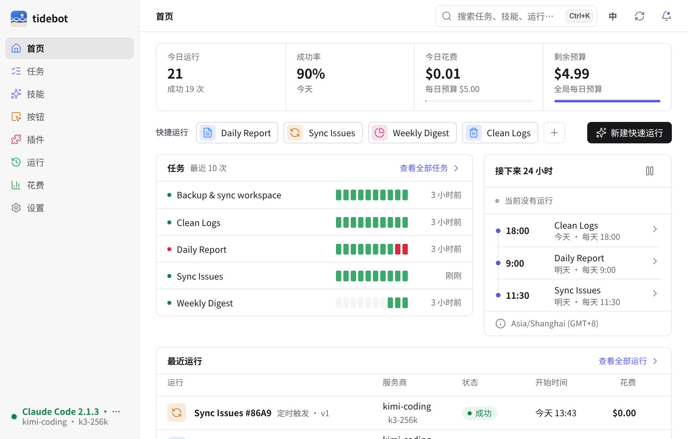
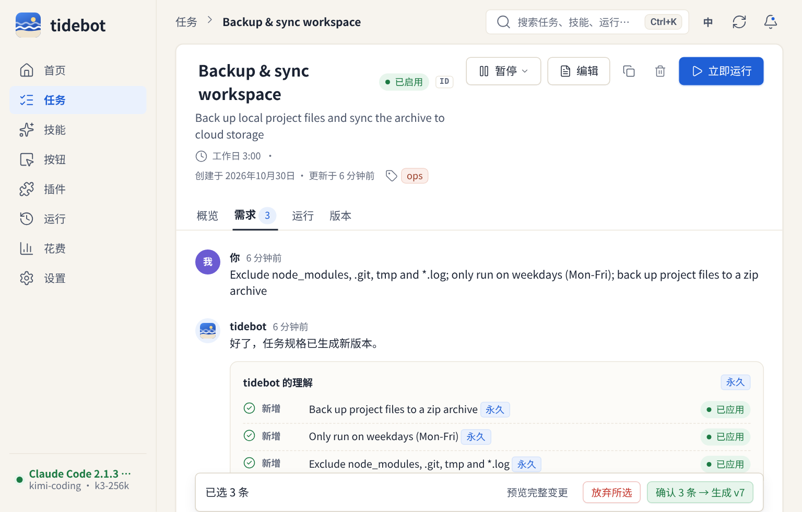
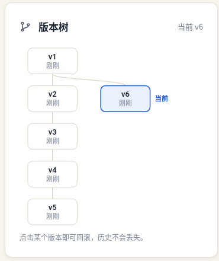
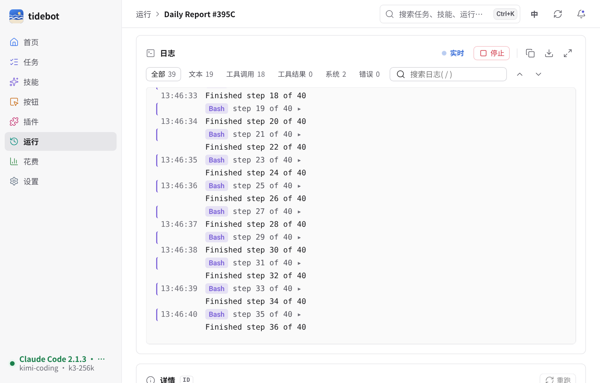
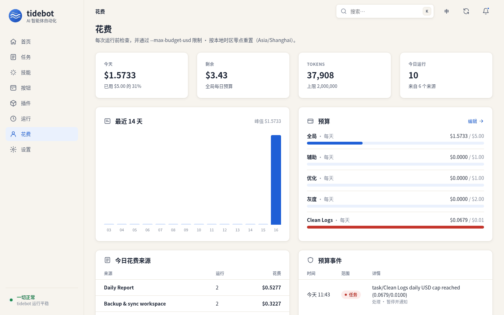
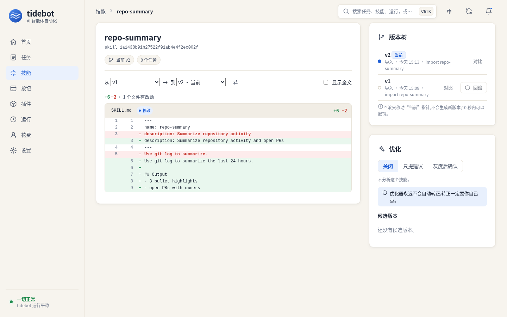
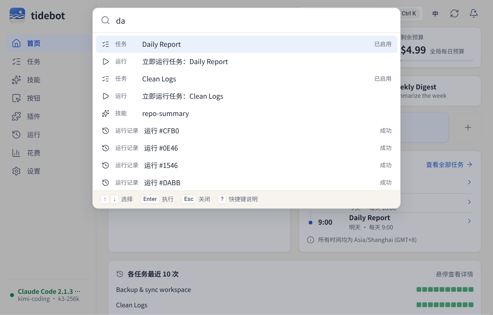
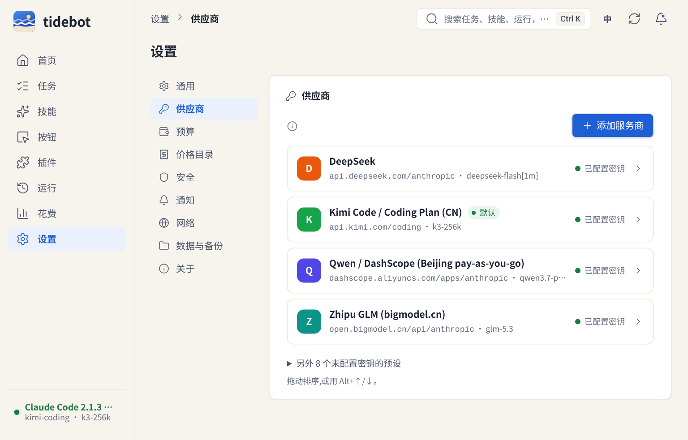
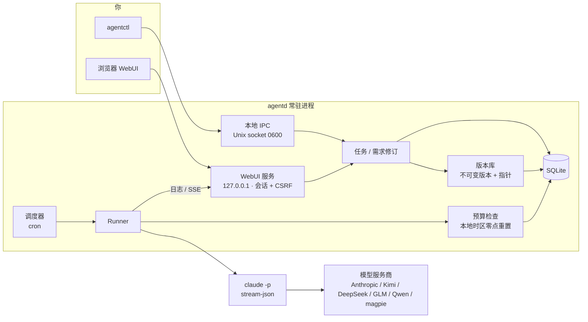

# tidebot

[中文](README.md) · [English](README.en.md)

tidebot 是我给自己写的一个小工具：一个常驻在本机后台的进程，帮我定时去跑 Claude Code。

我有不少重复的活儿，比如每天早上看一眼仓库动态写个日报、同步 issue、清理日志。这些事交给 `claude -p` 都能做好，麻烦的是“定时”和“改需求”。cron 加 shell 脚本能跑，但想改点什么就得去翻 prompt，改坏了也回不去。

所以 tidebot 做的事情很简单：

- 每天早上 9 点，它替我写日报。哪天我想让它加上同比数据，直接在任务页里跟它说一句“以后加上同比”，它会整理成一条需求，我点确认，任务就多一个新版本。
- 改坏了？点一下旧版本就回去了，历史一直都在。
- 每天花多少钱有上限，到了就停，不会半夜烧掉一个月的额度。

它不是一个平台，也不打算变成平台。单用户、本地运行、一个二进制文件，空闲时大约占 13 MB 内存。



## 截图

任务详情。中间是和任务的对话，你说的话会被拆成一条条需求，确认后才会生效。同一句话拆出来的几条可以一起确认，只生成一个版本；不想要的取消勾选就行。



版本树。每次确认就是一个新版本，回滚只是把“当前”指针挪回去，不会删任何东西。



运行时的实时日志，用 SSE 推过来，日志里的密钥在写盘前就已经打码。



花费页。每日预算按你所在时区的零点重置（不是 UTC），超了会自动暂停任务并记一条事件。



Skill 的版本和 diff。任意两个版本可以对比，回滚同样只挪指针，10 秒内能撤销。右边是优化器，它只会提候选版本，转正永远要你自己点。



按 Ctrl+K（Mac 上 ⌘K）打开命令面板，能搜任务、技能、运行记录，也能直接跑任务、跑按钮、切语言。只用键盘就够了，`?` 看全部快捷键。



设置按“通用 / 供应商 / 预算 / 安全 / 通知 / 数据与备份 / 关于”分开，每一项都有自己的地址，比如 `#/settings/security/2fa`。两步验证可以直接在这里开：扫码、输一次验证码、存好恢复码，验证码没对上之前不会生效。



界面支持中文和英文，默认跟随浏览器，右上角可以切换。英文截图见 [README.en.md](README.en.md)。

## 能做什么

可以一直对话的定时任务。任务有 cron 计划，也可以手动跑。需求用大白话改，tidebot 把它拆成“新增 / 修改 / 删除”几类，并区分“永久生效”和“只对下一次生效”。比如“这次备份保留 10 天”只影响下一次运行，不会改动任务本身。和已有需求冲突时，会先让你选是替换还是共存。

带版本的 Skill。可以导入 Claude Code 的 skill 目录，每次重新导入都是一个新版本。任务可以钉住某个 skill 版本，出问题了就回滚。

Skill 自动优化（可选，默认关）。有三种模式：关、只提建议、灰度。灰度会拿一部分运行去试候选版本，在页面上并排比成功率、花费和耗时。它从不自己转正，转正要你点确认。

按钮和插件。按钮就是一键预设：绑定一个任务或者一段 prompt，首页按你排好的顺序显示，可以拖，也可以用 Alt+方向键排。插件安装时按权限逐项勾选，高风险的默认不勾，装好以后也能单独收回某一项；有配置项的插件会给一个表单，密码类字段存进去以后就读不回来。

花费上限。全局、按任务、按预算桶（生产 / 灰度 / 优化 / 辅助）分别设置每日上限。每次运行前检查一次，运行时再用 `--max-budget-usd` 兜底。

任意模型服务商。只要提供 Anthropic 兼容接口就能用。内置了 Anthropic 官方、Kimi（含 Coding Plan）、DeepSeek、智谱 GLM / Z.AI、通义千问 DashScope，还有本地网关 magpie。密钥只注入到 `claude` 子进程的环境变量里，不进数据库，也不写日志。

占用很小。下面是我在一台 Linux x86_64 机器上实测的数字（Go 1.24，`make build`）：

| 项目 | 数值 |
|---|---|
| `agentd` 二进制（已 strip） | 11.5 MB |
| `agentctl` 二进制 | 3.1 MB |
| 空闲内存 RSS（不开 WebUI） | 约 13 MB |
| 空闲内存 RSS（开 WebUI） | 约 13.3 MB |
| 跑过几次任务、登录过 WebUI 之后 | 约 20 MB |
| 登录瞬间峰值（argon2id 哈希） | 约 84 MB，随即释放 |
| WebUI 前端（JS + CSS，gzip 后） | 约 25 KB，不依赖 CDN 和框架 |

## 架构



## 下载

[](https://github.com/Zhengmingming1/tidebot-releases/releases/latest/download/tidebot-desktop-macOS-AppleSilicon-Intel.dmg) [](https://github.com/Zhengmingming1/tidebot-releases/releases/latest/download/tidebot-desktop-Windows-x64-Setup.exe) [](https://github.com/Zhengmingming1/tidebot-releases/releases/latest/download/tidebot-desktop-Linux-x64.AppImage) [](https://github.com/Zhengmingming1/tidebot-releases/releases/latest/download/tidebot-desktop-Linux-x64.deb)

点你的系统就行。Mac 不分芯片，M 系列和 Intel 用同一个 .dmg。服务端、ARM 和 Docker 在 [Releases 页面](https://github.com/Zhengmingming1/tidebot-releases/releases/latest)，页面最上面有一张"下载哪个？"的表。
GitHub 的 README 没法自动识别你的系统，所以只能列出来让你挑。从 v0.1.1 起这些链接才有效，v0.1.0 请到 Releases 页面下载。

目前没签名：macOS 第一次打开要右键 → 打开（或 `xattr -dr com.apple.quarantine /Applications/tidebot.app`），Windows 弹 SmartScreen 时点"更多信息 → 仍要运行"。

## 安装

预编译的包在 [Releases](https://github.com/Zhengmingming1/tidebot-releases/releases) 页面，每个文件的 sha256 都在 `checksums.txt` 里。
不管装哪种，真跑任务都需要你自己装好 `claude` CLI。

- **服务端（agentd + agentctl）**：下载 `tidebot-server_<版本>_<系统>_<架构>.tar.gz`（Windows 是 `.zip`），解压后放进 PATH。
  Debian/Ubuntu 可以直接装 `.deb`：`sudo apt install ./tidebot-server_0.1.0_amd64.deb`，然后 `systemctl --user enable --now tidebot`。
- **桌面版**：macOS 用 `.dmg`（通用包，Intel 和 Apple 芯片都行），Windows 用 `_setup.exe`（装到当前用户，不要管理员权限），
  Linux 用 `.deb` 或 `.AppImage`（AppImage 没打包 WebKitGTK，系统里得有 `libwebkit2gtk-4.1`）。
  没签名的话 macOS 第一次打开要右键 → 打开，Windows 会弹 SmartScreen。
- **Docker**：`docker pull ghcr.io/zhengmingming1/tidebot:0.1.0`。镜像里没有 `claude` CLI，怎么加见 [docs/release.md](docs/release.md)。

装好后 `agentctl call update.check` 能查新版本，`update.apply` 会校验 sha256 后原地替换（旧文件留成 `.prev`）。

## 快速开始

需要 Go 1.22 以上。真跑任务需要本机装好 `claude` CLI；只想看看的话，仓库里带了一个假的 `claude`，不花钱。

```bash
git clone https://github.com/Zhengmingming1/tidebot.git
cd tidebot
make build                     # 生成 bin/agentd 和 bin/agentctl

export TIDEBOT_HOME=$HOME/.tidebot
./bin/agentd &                 # 启动守护进程
./bin/agentctl status
```

想直接看界面的话，有一个演示脚本，会用假的 claude 起一个独立实例并填好演示数据：

```bash
scripts/demo-webui.sh          # 打开 http://127.0.0.1:17421，密码 demo-pass-99
```

自己的实例要开 WebUI 的话：

```bash
./bin/agentctl auth set-password --password '换成你自己的密码'
./bin/agentctl webui on        # 默认只监听 127.0.0.1:7420
```

## 配置服务商

最省事的是在 WebUI 的「设置 → 服务商」里加：选一个预设（Anthropic、Kimi、DeepSeek、智谱、Qwen 等），填 Key，点「测试连接」。Key 加密存在本机，页面上只显示「已配置」和后 4 位，保存后就读不回来了。

也可以用环境变量，不要把密钥写进配置文件。变量名是 `TIDEBOT_API_KEY_<服务商 ID>`，Kimi Coding Plan 也认 `KIMI_API_KEY`。

```bash
export TIDEBOT_API_KEY_DEEPSEEK=...      # 你自己的 key
export TIDEBOT_DEFAULT_PROVIDER=deepseek
```

内置的服务商 ID：`anthropic`、`kimi`、`kimi-cn`、`kimi-coding`、`kimi-coding-intl`、`deepseek`、`zhipu`、`zai`、`qwen`、`qwen-coding`、`qwen-coding-intl`、`magpie`。各家的接口地址和出处见 [docs/providers.md](docs/providers.md)。

想加别的服务商，在 `$TIDEBOT_HOME/providers.yaml` 里写：

```yaml
providers:
  - name: my-gateway
    base_url: https://example.com/anthropic
    auth_env: ANTHROPIC_AUTH_TOKEN
    secret_env: MY_GATEWAY_KEY
    model: some-model
```

其他常用配置写在 `$TIDEBOT_HOME/config.yaml`：

```yaml
default_provider: kimi-coding
max_concurrency: 2
timezone: Asia/Shanghai      # 显示时间和每日预算重置都用它，不填就跟随系统
webui_addr: 127.0.0.1:7420
```

任务、技能、按钮、插件和触发器现在都能在 WebUI 里建：技能直接拖 zip 或文件夹进去，任务的定时可以选「每天 / 工作日 / 每周」，会列出接下来几次在本地时区的运行时间。下面的命令行照样能用。

## 命令行示例

```bash
# 建一个每天 9 点跑的任务
agentctl tasks create --name "日报" --prompt "总结今天仓库里的提交和 issue" \
  --cron "0 9 * * *" --workspace ~/work/repo

# 用大白话改需求，然后整批确认（只生成一个版本）
agentctl amend propose --task <task_id> --text "以后加上同比数据；表格放在最前面"
agentctl amend confirm --batch <amendment_id>
agentctl amend confirm --batch <amendment_id> --only <req_id>   # 只确认其中几条

# 看版本、回滚
agentctl tasks versions --id <task_id>
agentctl tasks rollback --id <task_id> --version <version_id>

# Skill
agentctl skills import --name weekly-report --dir ./skills/weekly-report
agentctl skills pin --task <task_id> --skill <skill_id> --version <version_id>

# 预算
agentctl spend summary
agentctl spend set-budget --scope global --max-usd 5

# 手动跑一次
agentctl tasks run --id <task_id>
```

命令行的提示信息也有中英文，跟随系统语言，或者用 `TIDEBOT_LANG=zh-CN` / `TIDEBOT_LANG=en` 指定。

## 桌面版（试验中）

`cmd/tidebot-desktop` 是个托盘程序，核心直接跑在同一个进程里，窗口通过 webview 的进程内资源服务读 WebUI，不开端口。
关掉窗口只是藏到托盘，定时任务照跑。托盘菜单从上到下是：出问题时才出现的问题区（核心没响应、今日预算用完、最近一小时有失败），正在运行几个任务，前 5 个按钮，“暂停全部调度”，局域网访问，打开窗口，退出。
图标有三种状态：空闲、运行中、有问题。核心挂掉的话，托盘大约 3 秒内就会显示出来。
运行完成、失败、需要确认、超预算都会弹系统通知。菜单语言跟 WebUI 里的语言设置走，没设就跟系统。

```bash
scripts/build-desktop.sh linux        # 需要 Go 1.25、libgtk-3-dev、libwebkit2gtk-4.1-dev
bin/tidebot-desktop --autostart enable --hidden   # 登录自启，启动时藏在托盘
```

老实说：只在 Linux 上真正用过。macOS 和 Windows 版能在 CI 里编出来、打成安装包，但我没在真机上点过。
它用的是 Wails v3 beta，还会变。内存也不小，WebKit 加起来四五百 MB（核心本身十几 MB），数字在 docs/phase0-results.md。

## 现状

这是一个人维护的个人项目，还在早期。

已经能用的：

- 定时调度、手动运行、并发上限、超时；失败重试（退避）、连续失败 3 次熔断、停机后补跑、重叠策略
- 任务的不可变版本和回滚，版本树
- 自然语言修改需求：拆成结构化条目、冲突检测、整批确认；条目攒多了会提议合并
- Skill 导入、版本、钉住、回滚；自动优化（关 / 只建议 / 灰度三种模式），灰度变差会自动撤回
- 全局 / 任务 / 预算桶三级每日花费上限，按本地时区零点重置
- 执行防护：每个任务独立工作目录、工具白名单、危险命令拦下来等你确认、外部输入按数据包裹
- 插件：独立进程，JSON-RPC 走 stdio，按版本安装，权限逐项批准，崩 3 次熔断；能提供 MCP 工具和触发器
- 触发器：webhook（token 或 HMAC 签名）、文件变动、邮件和 IM（通过插件）；工作流包导入导出
- 通知：邮件、webhook、飞书、钉钉、企业微信、Telegram，带免打扰时段和每日汇总
- 备份（`.agentbak`，带口令才会包含密钥）和恢复（`agentd restore`）、日志清理、运行概况和 Prometheus `/metrics`
- 沙箱试跑：拷一份工作目录跑，记到 dry_run 预算桶，告诉你改了哪些文件
- WebUI 中英文，CI 里会检查两份词条的 key 是否一致；命令面板和快捷键；通知按“失败 / 需要我确认 / 其他”分组
- 登录可开两步验证（TOTP），带一次性恢复码；连续输错会告诉你还要等多久
- 桌面版（托盘 + 窗口）
- Linux、macOS、Windows 上 CI 都在跑测试；Windows 用命名管道做本地 IPC

还没做好的：

- 需求拆分默认用本地的规则（按分号拆），要用模型来拆需要设 `TIDEBOT_AMEND_AI=1`，效果还在调
- 插件的 CPU 限制没做；内存只在 Linux 上用 rlimit 粗略限制
- 密钥存在本地加密文件里，系统钥匙串还没接
- 防护规则里的路径判断按 Unix 路径写的，Windows 上写文件越界检查不可靠
- 只有 Linux 的包我自己装过跑过；macOS 的 .dmg 和 Windows 安装包是 CI 打出来的，还没人点开试过
- 默认不签名
- 仓库还是私有的，所以自更新现在查不到新版本

## 关于 Anthropic

tidebot 调用的是你本机安装的 Claude Code CLI，用的是你自己的 API key 或订阅。它和 Anthropic 没有任何关系，没有得到 Anthropic 的认可或赞助。请按 Anthropic 和你所用模型服务商的使用条款来用。“Claude”和“Claude Code”是 Anthropic 的商标。

## 文档

- [方案设计](docs/final-plan.md)
- [调研报告](docs/report.md)
- [模型服务商说明](docs/providers.md)
- [发布和打包](docs/release.md)
- [阶段 0 实测](docs/phase0-results.md)
