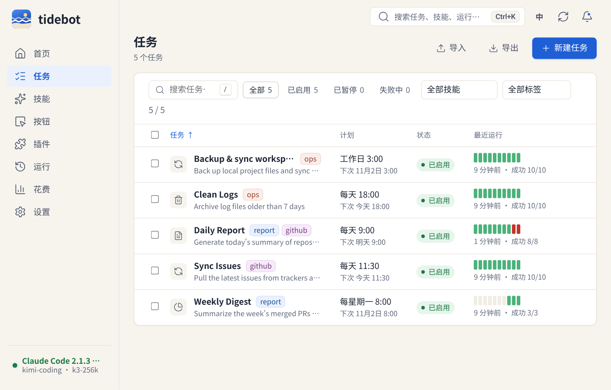
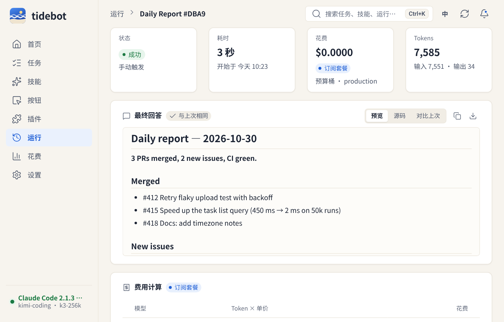
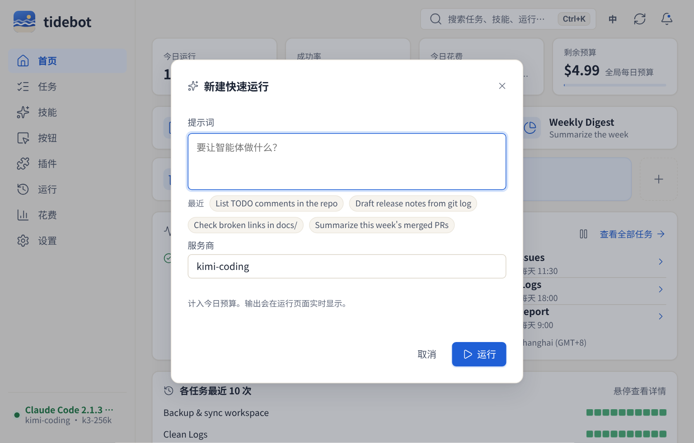
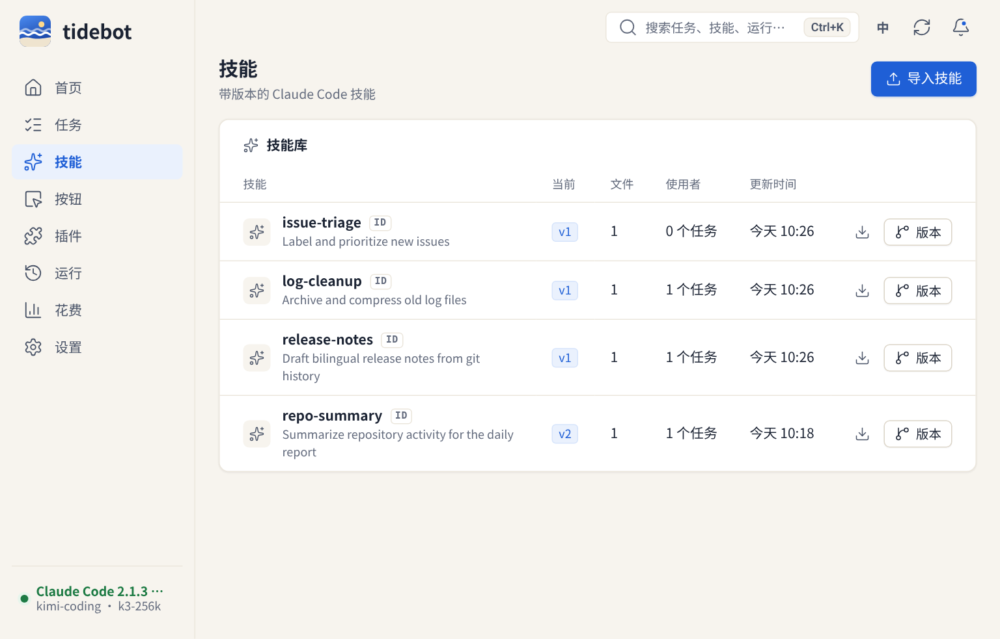
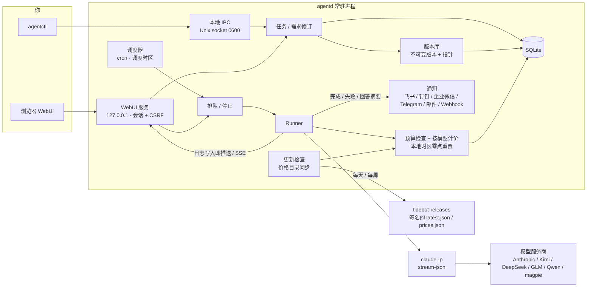
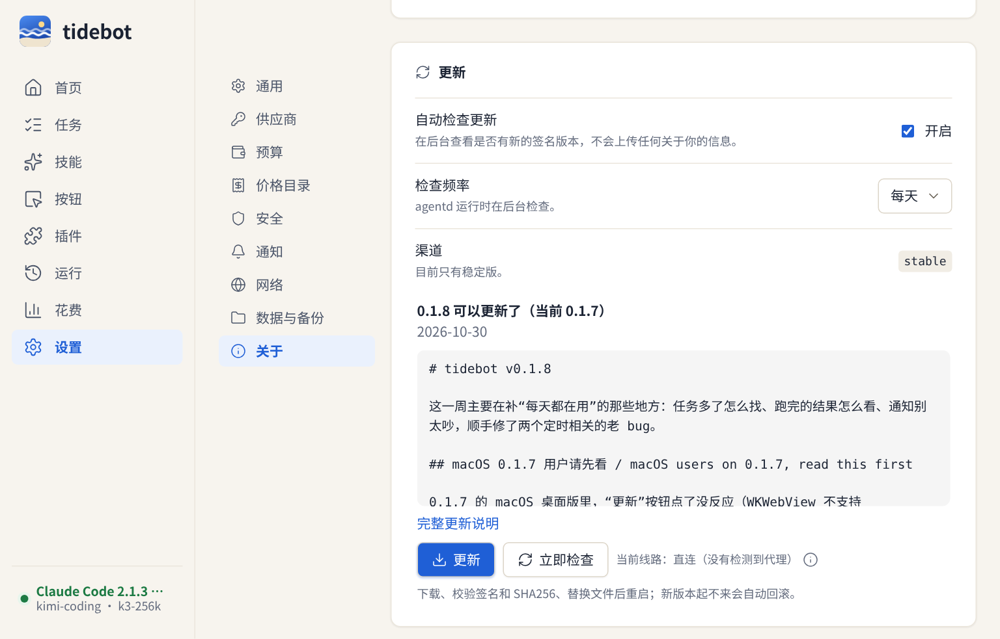

# tidebot

[](https://github.com/Zhengmingming1/tidebot/actions/workflows/ci.yml) [](LICENSE)

[中文](README.md) · [English](README.en.md)

tidebot 是我给自己写的一个小工具：一个常驻在本机后台的进程，帮我定时去跑 Claude Code。

我有不少重复的活儿，比如每天早上看一眼仓库动态写个日报、同步 issue、清理日志。这些事交给 `claude -p` 都能做好，麻烦的是“定时”和“改需求”。cron 加 shell 脚本能跑，但想改点什么就得去翻 prompt，改坏了也回不去。

所以 tidebot 做的事情很简单：

- 每天早上 9 点，它替我写日报。哪天我想让它加上同比数据，直接在任务页里跟它说一句“以后加上同比”，它会整理成一条需求，我点确认，任务就多一个新版本。
- 改坏了？点一下旧版本就回去了，历史一直都在。
- 每天花多少钱有上限，到了就停，不会半夜烧掉一个月的额度。

它不是一个平台，也不打算变成平台。单用户、本地运行、一个二进制文件，空闲时大约占 30 MB 内存。


## 截图

下面的截图都是按 1024×655 的窗口拍的，也就是我平时在 Mac 上开着的大小。数据是演示脚本造的，不是真账号。

任务列表。每行后面是最近 10 次运行的色块，名字旁边是标签，点一下标签就只看这一类；“失败中”能直接筛出最近没跑成功的任务。纯键盘也能用：`j`/`k` 选行，回车打开，`r` 立即运行。



任务详情。和任务的对话就在需求页签里：你说的话会被拆成一条条需求，确认后才会生效。同一句话拆出来的几条可以一起确认，只生成一个版本；不想要的取消勾选就行。


版本树。每次确认就是一个新版本，回滚只是把“当前”指针挪回去，不会删任何东西。


运行时的实时日志。现在是写入即推送，新输出基本是秒到。复制、下载、全屏都在标题栏上，跑着的任务旁边有个“停止”，排队中的可以直接移出队列。日志里的密钥在写盘前就已经打码。


跑完的运行有一张“最终回答”卡片：Markdown 按排版显示，也能切到源码、复制、下载成 .md。点“对比上次”会和这个任务上一次成功的回答逐行对比，回答一字没变就标一个“与上次相同”。页面底部可以一键重跑，快速运行还能改了提示词再跑（按 `e`），或者直接存成定时任务。



快速运行。最近用过的提示词会以小标签列出来，点一下就填好；服务商记住上次的选择，Ctrl+Enter（Mac 上 ⌘+Enter）直接跑。没提交的提示词会自动存草稿，关掉弹窗或刷新页面都还在。



花费页。每个模型按自己的价格算，订阅套餐只计 Token 不计钱。每日预算按你所在时区的零点重置（不是 UTC），超了会自动暂停任务并记一条事件。可以按任务、服务商、模型或标签看，点柱状图的某一天就只看那天，选中的时间段可以导出 CSV。


技能库。每个技能都能下载成 .zip，拿到另一台电脑上直接导入。



Skill 的版本和 diff。任意两个版本可以对比，回滚同样只挪指针，10 秒内能撤销。任意版本都能单独下载。


按 Ctrl+K（Mac 上 ⌘K）打开命令面板，能搜任务、技能、运行记录，也能直接跑任务、跑按钮、切语言。只用键盘就够了，`?` 看全部快捷键。


设置按“通用 / 供应商 / 预算 / 价格目录 / 安全 / 通知 / 网络 / 数据与备份 / 关于”分开，每一项都有自己的地址，比如 `#/settings/security/2fa`。两步验证可以直接在这里开：扫码、输一次验证码、存好恢复码，验证码没对上之前不会生效。改密码、看哪些设备登录着、把别的设备踢下线也在“安全”里。通知渠道（飞书、钉钉、企业微信、Telegram、邮件、Webhook）同样在这里加，粘贴地址会自动认出是哪家，保存前可以先发一条测试。


界面支持中文和英文，默认跟随浏览器，右上角可以切换。英文截图见 [README.en.md](README.en.md)。

## 能做什么

可以一直对话的定时任务。任务有 cron 计划，也可以手动跑。需求用大白话改，tidebot 把它拆成“新增 / 修改 / 删除”几类，并区分“永久生效”和“只对下一次生效”。比如“这次备份保留 10 天”只影响下一次运行，不会改动任务本身。和已有需求冲突时，会先让你选是替换还是共存。

带版本的 Skill。可以导入 Claude Code 的 skill 目录，每次重新导入都是一个新版本。任务可以钉住某个 skill 版本，出问题了就回滚。

Skill 自动优化（可选，默认关）。有三种模式：关、只提建议、灰度。灰度会拿一部分运行去试候选版本，在页面上并排比成功率、花费和耗时。它从不自己转正，转正要你点确认。

按钮和插件。按钮就是一键预设：绑定一个任务或者一段 prompt，首页按你排好的顺序显示，可以拖，也可以用 Alt+方向键排。插件安装时按权限逐项勾选，高风险的默认不勾，装好以后也能单独收回某一项；有配置项的插件会给一个表单，密码类字段存进去以后就读不回来。

任务多了也好管。任务可以加标签，按标签筛、批量加删；可以导出成 JSON 拿到另一台机器导入（导入前逐条预览，默认暂停）。想歇一会儿，可以一键暂停全部定时，也可以只暂停某个任务 1 小时、4 小时或到明天 9 点，到点自动恢复。被自动暂停的任务会写明原因，比如连续失败或预算用完。

定时要准。调度按你设的时区算（“设置 → 通用”里能搜、能改），夏令时切换那天不会漏跑也不会多跑。笔记本用电池时可以把不急的任务往后放；磁盘快满时不启动新运行，腾出空间后自动恢复。

通知别太吵。成功通知会带上回答的开头几行，邮件带完整回答；也可以设成“只在回答有变化时才通知”，每天都一样的日报就不来打扰了。每个通知渠道都显示最近一次发没发出去，连续失败 3 次会提醒你。

快速运行和重跑。不想建任务，就在首页点“新建快速运行”，写一句话直接跑。跑完觉得不对，可以原样重跑，也可以改了提示词再跑，满意了再一键存成定时任务。正在跑的随时能停，排队的能直接移出队列，页面上会显示排在第几个。

花费上限。全局、按任务、按预算桶（生产 / 灰度 / 优化 / 辅助）分别设置每日上限。每次运行前检查一次，排队的运行轮到它时会再查一次（排队期间预算用完就跳过），运行时再用 `--max-budget-usd` 兜底。同时跑的几个运行会先从剩余额度里各自预留，不会一起冲过上限。运行中每 5 秒存一次用量，进程崩了也不会丢账。

按模型算钱。每次运行按实际的 Token 用量、用对应模型的价格算，不再拿 Claude 官方价格一刀切；订阅套餐（比如 Kimi Coding Plan）只记 Token。价格表会每周自动同步一次（签过名的价格目录，来源和更新时间收在“设置 → 价格目录”里），花费页可以按任务、服务商、模型分别看，也能导出 CSV。

数据不会越堆越多。“设置 → 数据与备份”里能看到占了多少空间，日志和运行记录保留多久可以自己改，清理前先预览会删什么；数据目录所在的盘快满时会提醒你。

任意模型服务商。只要提供 Anthropic 兼容接口就能用。内置了 Anthropic 官方、Kimi（含 Coding Plan）、DeepSeek、智谱 GLM / Z.AI、通义千问 DashScope，还有本地网关 magpie。密钥只注入到 `claude` 子进程的环境变量里，不进数据库，也不写日志。

占用不大。下面是 2026-10-30 在一台 Linux x86_64 机器上实测的数字（`go build -trimpath -ldflags="-s -w"`，即 `make build`；`scripts/measure.sh` 可以自己复现）：

| 项目 | 数值 |
|---|---|
| `agentd` 二进制（已 strip） | 17.8 MB |
| `agentctl` 二进制 | 4.1 MB |
| 空闲内存 RSS（不开 WebUI） | 约 29 MB |
| 空闲内存 RSS（开 WebUI） | 约 31 MB |
| WebUI 前端（JS + CSS，gzip 后） | 约 195 KB，不依赖 CDN 和框架；按内容哈希缓存，第二次打开不用再下载 |

这一周功能加得多，前端大了一圈；内存基本没涨。接口返回的 JSON 也会压缩，运行列表 100 条从约 70 KB 降到 12 KB。

## 架构



## 下载

[](https://github.com/Zhengmingming1/tidebot-releases/releases/latest/download/tidebot-desktop-macOS-AppleSilicon-Intel.dmg) [](https://github.com/Zhengmingming1/tidebot-releases/releases/latest/download/tidebot-desktop-Windows-x64-Setup.exe) [](https://github.com/Zhengmingming1/tidebot-releases/releases/latest/download/tidebot-desktop-Linux-x64.AppImage) [](https://github.com/Zhengmingming1/tidebot-releases/releases/latest/download/tidebot-desktop-Linux-x64.deb)

点你的系统就行。Mac 不分芯片，M 系列和 Intel 用同一个 .dmg。服务端、ARM 和 Docker 在 [Releases 页面](https://github.com/Zhengmingming1/tidebot-releases/releases/latest)，页面最上面有一张"下载哪个？"的表。
GitHub 的 README 没法自动识别你的系统，所以只能列出来让你挑。从 v0.1.1 起这些链接才有效，v0.1.0 请到 Releases 页面下载。

目前没签名：macOS 第一次打开要右键 → 打开（或 `xattr -dr com.apple.quarantine /Applications/tidebot.app`），Windows 弹 SmartScreen 时点"更多信息 → 仍要运行"。

## 安装

预编译的包在 [Releases](https://github.com/Zhengmingming1/tidebot-releases/releases) 页面，每个文件的 sha256 都在 `checksums.txt` 里。
不管装哪种，真跑任务都需要你自己装好 `claude` CLI。

- **服务端（agentd + agentctl）**：下载 `tidebot-server_<版本>_<系统>_<架构>.tar.gz`（Windows 是 `.zip`），解压后放进 PATH。
  Debian/Ubuntu 可以直接装 `.deb`：`sudo apt install ./tidebot-server_0.1.8_amd64.deb`，然后 `systemctl --user enable --now tidebot`。
- **桌面版**：macOS 用 `.dmg`（通用包，Intel 和 Apple 芯片都行），Windows 用 `-Windows-x64-Setup.exe`（装到当前用户，不要管理员权限），
  Linux 用 `.deb` 或 `.AppImage`（AppImage 没打包 WebKitGTK，系统里得有 `libwebkit2gtk-4.1`）。
  没签名的话 macOS 第一次打开要右键 → 打开，Windows 会弹 SmartScreen。
- **Docker**：`docker pull ghcr.io/zhengmingming1/tidebot:0.1.8`。镜像里没有 `claude` CLI，怎么加见 [docs/release.md](docs/release.md)。

自动更新：桌面版和服务端每天查一次新版本（“设置 → 关于 → 更新”里可以关）。也可以手动 `agentctl update check` / `agentctl update apply`：先验更新清单的签名和安装包的 sha256，再原地替换（旧文件留成 `.prev`），新版本 90 秒内起不来会自动回滚。`.deb`、Docker 这类由包管理器管的安装只提示，不自动替换。国内连 GitHub 慢的话，“设置 → 网络”里可以配代理和下载镜像。

“设置 → 关于”里能看到有没有新版本和这一版的更新说明，点“更新”会先在应用里弹一个确认框，然后下载、校验、替换、重启，进度都显示在这一栏里。



**用 macOS 桌面版 0.1.7 的话，这次要手动装一下。** 0.1.7 的 Mac 版里“更新”按钮点了没反应（WKWebView 不支持 `window.confirm()`，0.1.8 已经改成应用内的确认框）。步骤：点菜单栏的 tidebot 图标 → 退出；下载新的 [.dmg](https://github.com/Zhengmingming1/tidebot-releases/releases/latest/download/tidebot-desktop-macOS-AppleSilicon-Intel.dmg)，把 tidebot.app 拖进“应用程序”替换旧的；第一次打开时右键 → 打开，或者在终端执行 `xattr -dr com.apple.quarantine /Applications/tidebot.app`。数据不受影响。之后的版本在应用里点“更新”就行。

## 快速开始

需要 Go 1.26 以上。真跑任务需要本机装好 `claude` CLI；只想看看的话，仓库里带了一个假的 `claude`，不花钱。

```bash
git clone https://github.com/Zhengmingming1/tidebot.git
cd tidebot
make build                     # 生成 bin/agentd 和 bin/agentctl

export TIDEBOT_HOME=$HOME/.tidebot
./bin/agentd &                 # 启动守护进程
./bin/agentctl status
```

想直接看界面的话，有一个演示脚本，会用假的 claude 起一个独立实例并填好演示数据：

```bash
scripts/demo-webui.sh          # 打开 http://127.0.0.1:17421，密码 demo-pass-99
```

自己的实例要开 WebUI 的话：

```bash
./bin/agentctl auth set-password --password '换成你自己的密码'
./bin/agentctl webui on        # 默认只监听 127.0.0.1:7420
```

## 配置服务商

最省事的是在 WebUI 的「设置 → 服务商」里加：选一个预设（Anthropic、Kimi、DeepSeek、智谱、Qwen 等），填 Key，点「测试连接」。Key 加密存在本机，页面上只显示「已配置」和后 4 位，保存后就读不回来了。

也可以用环境变量，不要把密钥写进配置文件。变量名是 `TIDEBOT_API_KEY_<服务商 ID>`，Kimi Coding Plan 也认 `KIMI_API_KEY`。

```bash
export TIDEBOT_API_KEY_DEEPSEEK=...      # 你自己的 key
export TIDEBOT_DEFAULT_PROVIDER=deepseek
```

内置的服务商 ID：`anthropic`、`kimi`、`kimi-cn`、`kimi-coding`、`kimi-coding-intl`、`deepseek`、`zhipu`、`zai`、`qwen`、`qwen-coding`、`qwen-coding-intl`、`magpie`。各家的接口地址和出处见 [docs/providers.md](docs/providers.md)。

想加别的服务商，在 `$TIDEBOT_HOME/providers.yaml` 里写：

```yaml
providers:
  - name: my-gateway
    base_url: https://example.com/anthropic
    auth_env: ANTHROPIC_AUTH_TOKEN
    secret_env: MY_GATEWAY_KEY
    model: some-model
```

其他常用配置写在 `$TIDEBOT_HOME/config.yaml`：

```yaml
default_provider: kimi-coding
max_concurrency: 2
timezone: Asia/Shanghai      # 显示时间和每日预算重置都用它，不填就跟随系统
webui_addr: 127.0.0.1:7420
shutdown_grace: 5s           # 退出时等正在跑的任务收尾多久，超时就停下并记为「已停止」
```

任务、技能、按钮、插件和触发器现在都能在 WebUI 里建：技能直接拖 zip 或文件夹进去，任务的定时可以选「每天 / 工作日 / 每周」，会列出接下来几次在本地时区的运行时间。新建任务时写完提示词，名字和定时会自动帮你填一个，每日预算也会给个建议值；加服务商时直接粘贴 Base URL 或一段环境变量也能认出来。弹窗里有没保存的修改，按 Esc 或点外面会先问你要不要放弃。下面的命令行照样能用。

## 命令行示例

```bash
# 建一个每天 9 点跑的任务
agentctl tasks create --name "日报" --prompt "总结今天仓库里的提交和 issue" \
  --cron "0 9 * * *" --workspace ~/work/repo

# 用大白话改需求，然后整批确认（只生成一个版本）
agentctl amend propose --task <task_id> --text "以后加上同比数据；表格放在最前面"
agentctl amend confirm --batch <amendment_id>
agentctl amend confirm --batch <amendment_id> --only <req_id>   # 只确认其中几条

# 看版本、回滚
agentctl tasks versions --id <task_id>
agentctl tasks rollback --id <task_id> --version <version_id>

# Skill
agentctl skills import --name weekly-report --dir ./skills/weekly-report
agentctl skills pin --task <task_id> --skill <skill_id> --version <version_id>

# 预算
agentctl spend summary
agentctl spend set-budget --scope global --max-usd 5

# 手动跑一次；跑着的或排队的可以停掉
agentctl tasks run --id <task_id>
agentctl runs stop --id <run_id>
```

命令行的提示信息也有中英文，跟随系统语言，或者用 `TIDEBOT_LANG=zh-CN` / `TIDEBOT_LANG=en` 指定。

## 桌面版（试验中）

`cmd/tidebot-desktop` 是个托盘程序，核心直接跑在同一个进程里，窗口通过 webview 的进程内资源服务读 WebUI，不开端口。
关掉窗口只是藏到托盘，定时任务照跑。托盘菜单从上到下是：出问题时才出现的问题区（核心没响应、今日预算用完、最近一小时有失败），正在运行几个任务，前 5 个按钮，“暂停全部调度”，局域网访问，打开窗口，退出。
图标有三种状态：空闲、运行中、有问题。核心挂掉的话，托盘大约 3 秒内就会显示出来。
运行完成、失败、需要确认、超预算都会弹系统通知。菜单语言跟 WebUI 里的语言设置走，没设就跟系统。
导出 CSV、下载日志和技能时走系统自带的保存对话框，存完可以直接“在文件夹中显示”；“设置 → 数据与备份”里能一键打开数据文件夹。浏览器标签页的图标上会带个小角标，有任务在跑或刚失败一眼就能看到。

```bash
scripts/build-desktop.sh linux        # 需要 Go 1.26、libgtk-3-dev、libwebkit2gtk-4.1-dev
bin/tidebot-desktop --autostart enable --hidden   # 登录自启，启动时藏在托盘
```

老实说：我平时在 Linux 和 Apple 芯片的 Mac 上用。Windows 版能在 CI 里编出来、打成安装包、跑完测试，但我没在真机上点过。
它用的是 Wails v3 beta，还会变。内存也不小，WebKit 加起来四五百 MB（核心本身十几 MB），数字在 docs/phase0-results.md。

## 现状

这是一个人维护的个人项目，还在早期。

已经能用的：

- 定时调度（可改调度时区，夏令时安全）、手动运行、快速运行、并发上限、超时；全部或单个任务限时暂停；用电池或磁盘快满时推迟运行；运行可停止，排队可移出；失败重试（退避）、连续失败 3 次熔断、停机后补跑、重叠策略；退出时等正在跑的收尾
- 运行详情显示最终回答，可和上次对比；一键重跑、改后重跑、存为任务；复制任务；提示词自动存草稿
- 任务标签、最近 10 次运行一览、“失败中”筛选；任务导出导入；运行列表按时间筛选、搜索片段、导出 CSV / JSONL
- 任务的不可变版本和回滚，版本树
- 自然语言修改需求：拆成结构化条目、冲突检测、整批确认；条目攒多了会提议合并
- Skill 导入、版本、钉住、回滚；自动优化（关 / 只建议 / 灰度三种模式），灰度变差会自动撤回
- 全局 / 任务 / 预算桶三级每日花费上限，按本地时区零点重置；按模型价格计费，价格目录每周自动同步；花费导出 CSV
- 执行防护：每个任务独立工作目录、工具白名单、危险命令拦下来等你确认、外部输入按数据包裹
- 插件：独立进程，JSON-RPC 走 stdio，按版本安装，权限逐项批准，崩 3 次熔断；能提供 MCP 工具和触发器
- 触发器：webhook（token 或 HMAC 签名）、文件变动、邮件和 IM（通过插件）；工作流包导入导出
- 通知：邮件、webhook、飞书、钉钉、企业微信、Telegram，在设置页直接添加和测试；带回答摘要、可只在回答有变化时通知；显示每个渠道的发送结果，连续失败会提醒；免打扰时段和每日汇总
- 备份（`.agentbak`，带口令才会包含密钥）和恢复（`agentd restore`）、日志清理、运行概况和 Prometheus `/metrics`
- 沙箱试跑：拷一份工作目录跑，记到 dry_run 预算桶，告诉你改了哪些文件
- WebUI 中英文，CI 里会检查两份词条的 key 是否一致；命令面板和快捷键；通知按“失败 / 需要我确认 / 其他”分组
- 登录可开两步验证（TOTP），带一次性恢复码；连续输错会告诉你还要等多久；可改密码、查看并退出其他已登录设备
- 桌面版（托盘 + 窗口）
- Linux、macOS、Windows 上 CI 每次提交都跑测试；Windows 用命名管道做本地 IPC；CI 里还会用 gitleaks 扫一遍完整历史，防止把密钥提交进来
- 自动更新：签名的更新清单 + sha256 校验，失败自动回滚；支持系统代理和下载镜像
- 数据占用一览、保留天数可调、清理预览、磁盘空间不足提醒

还没做好的：

- 需求拆分默认用本地的规则（按分号拆），要用模型来拆需要设 `TIDEBOT_AMEND_AI=1`，效果还在调
- 插件的 CPU 限制没做；内存只在 Linux 上用 rlimit 粗略限制
- 密钥存在本地加密文件里，系统钥匙串还没接
- 防护规则里的路径判断按 Unix 路径写的，Windows 上写文件越界检查不可靠
- Linux 包和 macOS 的 .dmg 我自己装过；Windows 安装包是 CI 打出来的，还没在真机上点开试过
- 默认不签名

## 关于 Anthropic

tidebot 调用的是你本机安装的 Claude Code CLI，用的是你自己的 API key 或订阅。它和 Anthropic 没有任何关系，没有得到 Anthropic 的认可或赞助。请按 Anthropic 和你所用模型服务商的使用条款来用。“Claude”和“Claude Code”是 Anthropic 的商标。

## 许可证

tidebot 用 [GNU AGPL-3.0](LICENSE) 发布，只限这一个版本（SPDX: `AGPL-3.0-only`）。随便用、随便改、随便转发都行。只有一个要求：如果你改了它，又通过网络给别人用（比如把 WebUI 开给团队），也得把改过的源码给他们。

源码在 [github.com/Zhengmingming1/tidebot](https://github.com/Zhengmingming1/tidebot)。安装包和自动更新还是走 [tidebot-releases](https://github.com/Zhengmingming1/tidebot-releases)。界面图标来自 Lucide（ISC），依赖的许可证见 [THIRD_PARTY_NOTICES.md](THIRD_PARTY_NOTICES.md)。自己从源码编译的版本不会自动替换成官方安装包，只会提示有新版，详见 [docs/building.md](docs/building.md)。安全问题请按 [SECURITY.md](SECURITY.md) 私下报告。欢迎提 issue 和 PR，先看看 [CONTRIBUTING.md](CONTRIBUTING.md)。

## 文档

- [方案设计](docs/final-plan.md)
- [调研报告](docs/report.md)
- [模型服务商说明](docs/providers.md)
- [发布和打包](docs/release.md)
- [阶段 0 实测](docs/phase0-results.md)
