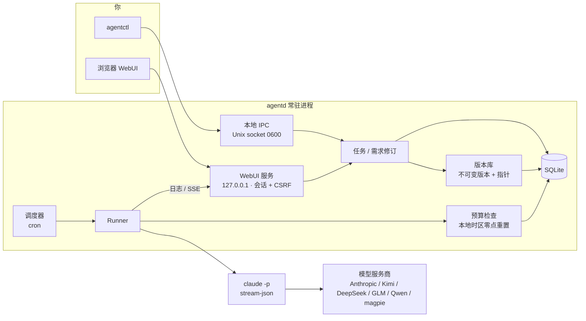

# tidebot

[中文](README.md) · [English](README.en.md)

tidebot 是我给自己写的一个小工具：一个常驻在本机后台的进程，帮我定时去跑 Claude Code。

我有不少重复的活儿，比如每天早上看一眼仓库动态写个日报、同步 issue、清理日志。这些事交给 `claude -p` 都能做好，麻烦的是“定时”和“改需求”。cron 加 shell 脚本能跑，但想改点什么就得去翻 prompt，改坏了也回不去。

所以 tidebot 做的事情很简单：

- 每天早上 9 点，它替我写日报。哪天我想让它加上同比数据，直接在任务页里跟它说一句“以后加上同比”，它会整理成一条需求，我点确认，任务就多一个新版本。
- 改坏了？点一下旧版本就回去了，历史一直都在。
- 每天花多少钱有上限，到了就停，不会半夜烧掉一个月的额度。

它不是一个平台，也不打算变成平台。单用户、本地运行、一个二进制文件，空闲时大约占 13 MB 内存。


## 截图

任务详情。中间是和任务的对话，你说的话会被拆成一条条需求，确认后才会生效。同一句话拆出来的几条可以一起确认，只生成一个版本；不想要的取消勾选就行。


版本树。每次确认就是一个新版本，回滚只是把“当前”指针挪回去，不会删任何东西。


运行时的实时日志，用 SSE 推过来，日志里的密钥在写盘前就已经打码。


花费页。每日预算按你所在时区的零点重置（不是 UTC），超了会自动暂停任务并记一条事件。


界面支持中文和英文，默认跟随浏览器，右上角可以切换。英文截图见 [README.en.md](README.en.md)。

## 能做什么

可以一直对话的定时任务。任务有 cron 计划，也可以手动跑。需求用大白话改，tidebot 把它拆成“新增 / 修改 / 删除”几类，并区分“永久生效”和“只对下一次生效”。比如“这次备份保留 10 天”只影响下一次运行，不会改动任务本身。和已有需求冲突时，会先让你选是替换还是共存。

带版本的 Skill。可以导入 Claude Code 的 skill 目录，每次重新导入都是一个新版本。任务可以钉住某个 skill 版本，出问题了就回滚。

Skill 自动优化（可选，还没做完）。数据库里留好了位置，也有单独的 `optimization` 预算桶，但自动改写和灰度对比还没实现。

按钮和插件。按钮就是一键预设：绑定一个任务或者一段 prompt，首页会显示前四个。插件页目前只是占位，MCP 服务和触发器的安装管理还没做。

花费上限。全局、按任务、按预算桶（生产 / 灰度 / 优化 / 辅助）分别设置每日上限。每次运行前检查一次，运行时再用 `--max-budget-usd` 兜底。

任意模型服务商。只要提供 Anthropic 兼容接口就能用。内置了 Anthropic 官方、Kimi（含 Coding Plan）、DeepSeek、智谱 GLM / Z.AI、通义千问 DashScope，还有本地网关 magpie。密钥只注入到 `claude` 子进程的环境变量里，不进数据库，也不写日志。

占用很小。下面是我在一台 Linux x86_64 机器上实测的数字（Go 1.24，`make build`）：

| 项目 | 数值 |
|---|---|
| `agentd` 二进制（已 strip） | 11.5 MB |
| `agentctl` 二进制 | 3.1 MB |
| 空闲内存 RSS（不开 WebUI） | 约 13 MB |
| 空闲内存 RSS（开 WebUI） | 约 13.3 MB |
| 跑过几次任务、登录过 WebUI 之后 | 约 20 MB |
| 登录瞬间峰值（argon2id 哈希） | 约 84 MB，随即释放 |
| WebUI 前端（JS + CSS，gzip 后） | 约 25 KB，不依赖 CDN 和框架 |

## 架构



## 快速开始

需要 Go 1.22 以上。真跑任务需要本机装好 `claude` CLI；只想看看的话，仓库里带了一个假的 `claude`，不花钱。

```bash
git clone https://github.com/Zhengmingming1/tidebot.git
cd tidebot
make build                     # 生成 bin/agentd 和 bin/agentctl

export TIDEBOT_HOME=$HOME/.tidebot
./bin/agentd &                 # 启动守护进程
./bin/agentctl status
```

想直接看界面的话，有一个演示脚本，会用假的 claude 起一个独立实例并填好演示数据：

```bash
scripts/demo-webui.sh          # 打开 http://127.0.0.1:17421，密码 demo-pass-99
```

自己的实例要开 WebUI 的话：

```bash
./bin/agentctl auth set-password --password '换成你自己的密码'
./bin/agentctl webui on        # 默认只监听 127.0.0.1:7420
```

## 配置服务商

密钥放在环境变量里，不要写进配置文件。变量名是 `TIDEBOT_API_KEY_<服务商 ID>`，Kimi Coding Plan 也认 `KIMI_API_KEY`。

```bash
export TIDEBOT_API_KEY_DEEPSEEK=...      # 你自己的 key
export TIDEBOT_DEFAULT_PROVIDER=deepseek
```

内置的服务商 ID：`anthropic`、`kimi`、`kimi-cn`、`kimi-coding`、`kimi-coding-intl`、`deepseek`、`zhipu`、`zai`、`qwen`、`qwen-coding`、`qwen-coding-intl`、`magpie`。各家的接口地址和出处见 [docs/providers.md](docs/providers.md)。

想加别的服务商，在 `$TIDEBOT_HOME/providers.yaml` 里写：

```yaml
providers:
  - name: my-gateway
    base_url: https://example.com/anthropic
    auth_env: ANTHROPIC_AUTH_TOKEN
    secret_env: MY_GATEWAY_KEY
    model: some-model
```

其他常用配置写在 `$TIDEBOT_HOME/config.yaml`：

```yaml
default_provider: kimi-coding
max_concurrency: 2
timezone: Asia/Shanghai      # 显示时间和每日预算重置都用它，不填就跟随系统
webui_addr: 127.0.0.1:7420
```

## 命令行示例

```bash
# 建一个每天 9 点跑的任务
agentctl tasks create --name "日报" --prompt "总结今天仓库里的提交和 issue" \
  --cron "0 9 * * *" --workspace ~/work/repo

# 用大白话改需求，然后整批确认（只生成一个版本）
agentctl amend propose --task <task_id> --text "以后加上同比数据；表格放在最前面"
agentctl amend confirm --batch <amendment_id>
agentctl amend confirm --batch <amendment_id> --only <req_id>   # 只确认其中几条

# 看版本、回滚
agentctl tasks versions --id <task_id>
agentctl tasks rollback --id <task_id> --version <version_id>

# Skill
agentctl skills import --name weekly-report --dir ./skills/weekly-report
agentctl skills pin --task <task_id> --skill <skill_id> --version <version_id>

# 预算
agentctl spend summary
agentctl spend set-budget --scope global --max-usd 5

# 手动跑一次
agentctl tasks run --id <task_id>
```

命令行的提示信息也有中英文，跟随系统语言，或者用 `TIDEBOT_LANG=zh-CN` / `TIDEBOT_LANG=en` 指定。

## 现状

这是一个人维护的个人项目，还在早期。

已经能用的：

- 定时调度、手动运行、并发上限、超时
- 任务的不可变版本和回滚，版本树
- 自然语言修改需求：拆成结构化条目、冲突检测、整批确认
- Skill 导入、版本、钉住、回滚
- 全局 / 任务 / 预算桶三级每日花费上限，按本地时区零点重置
- WebUI：首页、任务、实时日志、花费、设置，支持中英文
- 多家模型服务商，密钥只进子进程

还没做好的：

- 需求拆分默认用本地的规则（按分号拆），要用模型来拆需要设 `TIDEBOT_AMEND_AI=1`，效果还在调
- Skill 自动优化和灰度对比还没实现
- 插件只有占位页，MCP 服务和触发器的安装管理还没做
- 通知只有日志一个渠道
- 密钥只支持环境变量，系统钥匙串还没接
- 主要在 Linux 和 macOS 上用，Windows 没测过
- CI 配置写好了（`docs/ci/`），但还没在仓库里启用

## 关于 Anthropic

tidebot 调用的是你本机安装的 Claude Code CLI，用的是你自己的 API key 或订阅。它和 Anthropic 没有任何关系，没有得到 Anthropic 的认可或赞助。请按 Anthropic 和你所用模型服务商的使用条款来用。“Claude”和“Claude Code”是 Anthropic 的商标。

## 文档

- [方案设计](docs/final-plan.md)
- [调研报告](docs/report.md)
- [模型服务商说明](docs/providers.md)
- [阶段 0 实测](docs/phase0-results.md)
