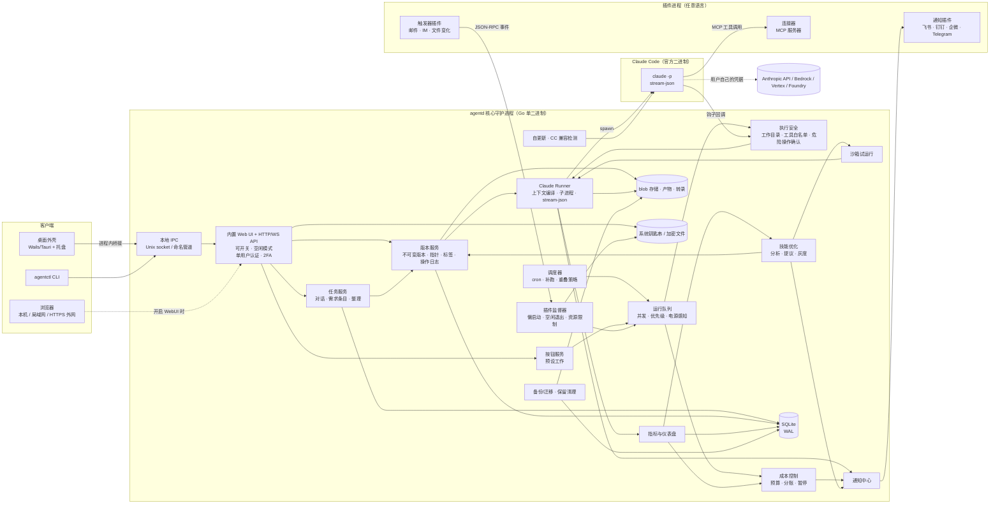
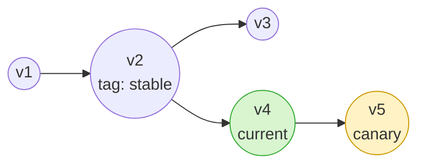
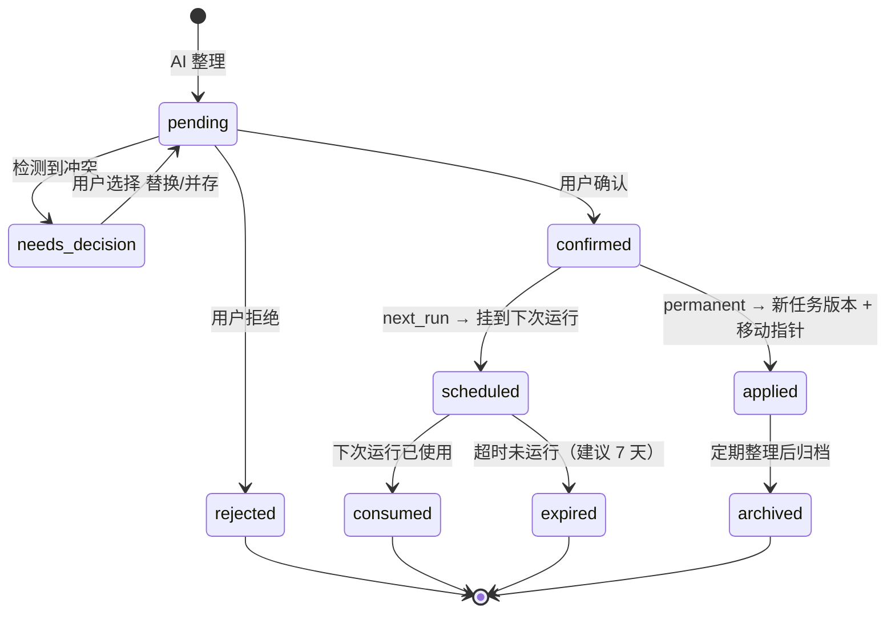
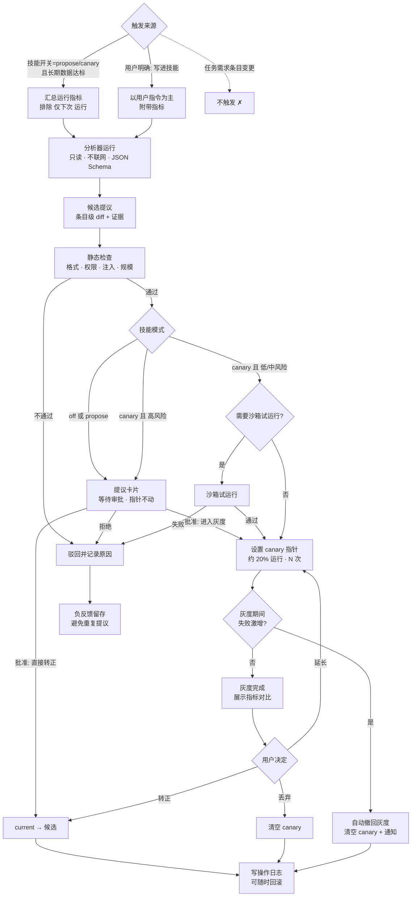

# 基于 Claude Code 的轻量 Agent 工作台：最终方案（v3）

> **文档状态**：最终方案 v3（2026-10-16，北京时间；09:49 增补决策 D8：WebUI 可开关）。本文以调研报告 v2（`report.md`）为基础，**凡与 v2 设计冲突之处，一律以本文第 1.2 节"已确认决策"为准**。v2 的调研内容（各 Harness 分析、功能对比）作为附录 A、B 保留。
>
> **阈值约定**：文中带"（建议值）"标记的数字（如灰度比例、次数、天数、内存目标等）均为设计建议，可在设置中调整，**不是**外部来源给出的数据。外部事实均在第 23 节列出来源。

---

## 1. 摘要与结论

### 1.1 一句话结论

做一个**单用户**、**低资源**的 Claude Code 自动化工作台：一个 Go 核心守护进程，桌面与服务器两种形态共用同一套 Web UI；以 Claude Code 官方 CLI（`claude -p` + stream-json）为唯一执行引擎；提供**长期任务（对话式追加需求）**、**按钮（预设工作）**、**插件（触发器/连接器/工作流包）**，以及**基于指针的版本管理**和**可灰度的技能优化**。技术上完全可行；主要约束来自 Anthropic 条款（因此只做单用户）和 Claude Code 进程本身的内存占用（因此严格控制并发）。

### 1.2 已确认决策（v3，优先于 v2）

| # | 主题 | 决策要点 |
|---|---|---|
| D1 | 版本 | 只有**内容真正变化**才产生不可变新版本；任务与技能各有 `current` 与 `canary` **指针**；**回滚 = 移动指针，不产生新版本**；追加式操作日志（时间、from→to、操作者、原因）；回滚后再编辑则从该版本分叉（如 v4 的父版本为 v2），以版本树展示；支持版本标签（如 `stable`）；回滚范围可选"仅技能 / 仅任务 / 两者回到某一时间点"；每次运行记录精确的任务版本与技能版本，可"从成功运行 X 恢复组合" |
| D2 | 技能优化 | 每个技能三选一：**仅提议**（等待审批，指针不动）/ **先灰度再确认**（如 20% 运行、持续 N 次，展示指标对比，由用户转正或丢弃；失败激增时自动撤回灰度并通知）/ **关闭**。默认不自动转正。优化**只**由"技能开关 + 长期运行数据"或用户明确指令"把这条写进技能"触发；**任务需求修改永远不触发技能优化**；"仅本次"条目不进入优化分析 |
| D3 | 任务修改 | 用户在任务对话中自然表达；AI 整理为条目（新增/修改/删除、永久/仅下次、冲突）；**用户确认后**才生成新任务版本并移动指针；未确认条目为待定状态，不影响任何运行；冲突必须明确询问（替换还是并存）；"仅下次"条目自动过期；定期整理（如超过 15 条或 30 天，建议值）成精简规格，以 diff 展示、确认后应用，旧条目归档，可回滚 |
| D4 | 按钮与插件 | 按钮 = 预设工作（技能 + 可选锁定版本 + 提示词 + 参数），点击运行一次。插件以 `plugin.yaml` 声明触发器（邮件、Webhook、文件变化、IM）、连接器（复用 MCP 服务器）、工作流包（技能 + 按钮 + 任务模板，可导入导出）；安装时声明并批准权限；密钥存系统钥匙串；卸载自动清理；插件也有版本与指针回滚。插件是任意语言的独立进程：工具走 MCP，宿主 API 走 stdio 上的 JSON-RPC；崩溃隔离、单插件资源限制、懒启动、空闲退出 |
| D5 | 部署 | 一个 Go 核心守护进程，**桌面**（Wails/Tauri 外壳、托盘、关窗继续运行、可选局域网访问）与**无头服务器**（systemd/Docker、内置 Web UI）同等重要，共用一套 Web UI。目标：核心空闲 < 50 MB、安装包 < 20 MB（建议目标值）。Claude Code 会话约 0.3–1.3 GB，桌面默认并发 2（睡眠/低电量时推迟非紧急任务），服务器可配置并加 cgroup 内存限制；Windows 需提供 Git Bash / WSL 指引 |
| D6 | 用户 | **仅单用户**（Anthropic 条款禁止中转/共享 Claude 凭据，因此放弃多用户）：密码 + 可选二次验证；默认仅本机/局域网；外网访问需手动开启并强制 HTTPS；用户自己的 API Key 加密存于钥匙串；表结构预留 `user_id` |
| D7 | 新增章节 | 成本控制、失败处理、执行安全、通知、备份迁移、产物与日志保留、可观测性仪表盘、自更新与 Claude Code 版本兼容、技能/按钮上线前的沙箱试运行 |
| D8 | 内置 WebUI 可开关 | **桌面**：默认使用原生窗口，经进程内桥接/回环通信，**不对外开放端口**；局域网访问默认关闭，可在设置中开启。**服务器**：默认开启 WebUI，可用 `--no-webui` 或配置关闭，此时通过本地 Unix socket（Windows 为命名管道）用 CLI 管理。可选**空闲模式**：N 分钟无访问（建议 30 分钟，建议值）后停止 SSE/WebSocket 实时流和后台 UI 聚合，下次访问时恢复。静态资源内嵌于二进制，空闲监听开销约几 MB（估算，阶段 0 实测）。开关可在运行时切换，**无需重启核心** |

### 1.3 与 v2 的主要差异

| 方面 | v2 | v3（最终） |
|---|---|---|
| 回滚 | 新建一个内容相同的版本 | **只移动指针**，写操作日志；后续编辑从回滚点分叉 |
| 版本产生 | 每次合并都产生版本 | 仅内容哈希变化时产生；内容与已有版本相同则复用该版本 |
| 技能优化模式 | off / suggest / auto（可自动应用） | **仅提议 / 先灰度再确认 / 关闭**，默认不自动转正 |
| 优化触发 | 含用户纠正、需求变更等信号 | 只看技能开关 + 长期运行数据，或"写进技能"的明确指令；**需求修改不触发**，"仅下次"条目排除 |
| 需求合并 | 可选"仅新增时自动合并" | **一律用户确认**；冲突必须问"替换还是并存" |
| 用户 | 曾规划多用户 token | **单用户**；预留 `user_id` |
| 插件 | 子进程 JSON-RPC / WASM | 任意语言独立进程：**MCP（工具）+ JSON-RPC over stdio（宿主 API）**，懒启动/空闲退出 |
| 部署 | 桌面为主，服务器为辅 | **桌面与服务器同等重要**，同一核心、同一 Web UI |
| WebUI | 外壳加载本机 HTTP 端口 | **可开关**（D8）：桌面走原生窗口 + 进程内桥接、不开外部端口；服务器可 `--no-webui`，改用本地 socket + CLI；可选空闲模式；运行时切换 |

### 1.4 关键结论

1. **可行性**：所需的 Claude Code 能力（非交互运行、stream-json 事件、`--plugin-dir` 加载技能、`--max-budget-usd`、`--permission-prompts none`、`--resume`、`--json-schema`、钩子、MCP）都有官方文档。
2. **差异化**：已调研的产品中（附录 A、B），没有一个同时提供"对话式长期任务 + 指针式版本与回滚 + 运行级版本追溯 + 可灰度的技能优化"。
3. **资源**：外壳可以做到很轻，但单个 Claude Code 会话本身就要 0.3–1.3 GB（第三方测量），**并发控制比框架选型更重要**。
4. **合规**：单用户、用户自带凭据、不修改 Claude Code 二进制、产品名不使用 "Claude Code"，并且不代理或转售用量。
5. **工作量**（单人全栈）：MVP 约 **12–15.5 周**；全部功能约 **27.5–36.5 周**（见第 22 节）。

---

## 2. 产品定位与范围

- **是什么**：Claude Code 的"长期任务调度器 + 版本化资产管理器 + 触发器面板 + 技能持续改进器"。**不另造 Agent**（与 BaoCode 的思路一致），Claude Code 就是 Agent。
- **用户**：单个用户（作者本人或任何自用的开发者），在自己的电脑或服务器上运行，使用自己的 Anthropic API Key、在官方 Claude Code 中完成的订阅登录，或 Bedrock/Vertex/Foundry 凭据。
- **形态**：桌面版（macOS / Windows / Linux）与无头服务器版（Linux，systemd 或 Docker），同一个核心，同一套 Web UI。
- **明确不做**：多用户/团队共享；代用户购买或中转 Claude 用量；修改或重新打包 Claude Code 二进制；自研模型协议转换（如需国产模型降本，对接 magpie 一类网关）。

---

## 3. 总体架构与部署

### 3.1 进程模型

| 进程 | 职责 | 资源目标 |
|---|---|---|
| **核心守护进程 `agentd`（Go，单二进制）** | 调度、任务/版本/指针、运行队列、Claude Runner、插件监督、本地 IPC（Unix socket / 命名管道）、**可开关的** HTTP/WS API 与内置 Web UI（静态资源 `embed` 内嵌）、SQLite | 空闲 < 50 MB 常驻内存（建议目标值）；WebUI 监听空闲开销约几 MB（估算，阶段 0 实测） |
| **CLI `agentctl`** | 通过本地 IPC 管理核心：状态、任务启停、运行、WebUI 开关、备份等；服务器关闭 WebUI 时的主要管理方式 | 按需启动、即用即退 |
| **桌面外壳（可选）** | Wails（同为 Go，推荐）或 Tauri + 系统 WebView；托盘图标、通知、开机自启；**只是 UI 窗口**，关闭窗口不影响 `agentd`；默认通过进程内桥接/回环与核心通信，不开外部端口（D8） | 安装包 < 20 MB（建议目标值，含核心） |
| **Claude Code 会话** | 每次运行一个 `claude -p` 子进程（官方未修改二进制） | 约 0.3–1.3 GB/会话（第三方测量），受并发上限与内存限制约束 |
| **插件进程** | 任意语言，懒启动、空闲退出 | 单插件内存/CPU 上限（建议默认 256 MB） |

> 桌面外壳的托盘、开机自启、关窗后驻留等能力需在阶段 0 用 Wails 实测验证（本文未核实具体 Wails 版本的托盘 API）；Tauri 作为备选，此时 Go 核心以 sidecar 方式运行。安装包体积参考：magpie（Go + 系统 WebView）在 Mac 上约 15 MB；第三方测评中 Tauri 应用 8.6–57 MB、Electron 应用 244–323 MB。

### 3.2 两种部署形态（同等重要）

| 维度 | 桌面版 | 服务器版 |
|---|---|---|
| 启动 | 开机自启（登录项 / LaunchAgent / 计划任务）；托盘控制 | systemd 单元或 Docker 镜像 |
| UI 入口 | **原生窗口**（默认）：WebView 从内嵌资源加载页面，API 经外壳桥接转发到核心的本地 IPC；**不监听任何 TCP 端口** | **WebUI 默认开启**，浏览器访问；可用 `--no-webui` 或配置 `webui.enabled=false` 关闭，改用 `agentctl` 经 Unix socket 管理 |
| 浏览器访问 | 默认关闭；在设置中开启"浏览器/局域网访问"后才启动 HTTP 监听 | 默认开启 |
| 默认监听 | **无 TCP 端口**（仅本地 IPC）；开启浏览器访问后为 127.0.0.1；局域网需再单独开启 | 127.0.0.1；局域网/外网需显式开启（外网强制 HTTPS） |
| 本地 IPC | `$APP_HOME/agentd.sock`（权限 0600）/ `\\.\pipe\agentd-<用户>`（ACL 仅当前用户） | 同左（Docker 中可把 socket 挂载到宿主机） |
| 并发 | 默认 2（建议值）；睡眠/低电量/电池供电时推迟非紧急任务 | 可配置；每个 Claude 会话放入 cgroup v2 内存限制（如 `systemd-run --scope -p MemoryMax=`） |
| 密钥 | 系统钥匙串（macOS Keychain / Windows Credential Manager / Linux Secret Service） | 无桌面钥匙串时：用主密钥加密的本地文件，主密钥来自 systemd credentials / Docker secret / 环境变量 |
| 错过的运行 | 睡眠、关机导致的错过按补跑策略处理（第 12 节） | 同左 |

**Windows 指引**：
- Claude Code 要求 Windows 10 1809+ 或 Windows Server 2019+，以及 4 GB 以上内存。
- 原生 Windows 下推荐安装 Git for Windows，Bash 工具依赖 Git Bash；未安装时 Claude Code 改用 PowerShell 工具。找不到 Git Bash 时，可设置 `CLAUDE_CODE_GIT_BASH_PATH`。
- 原生 Windows **不支持沙箱**；需要沙箱或 Linux 工具链时，推荐在 WSL 2 中运行（此时 `agentd` 也建议装在 WSL 内）。
- 首次启动时由向导检测 `claude`、Git Bash、PowerShell、WSL，并给出对应指引。

### 3.2.1 WebUI 开关、本地 IPC 与空闲模式（D8）

**开关与入口**

| 配置项（`settings` 表 / 配置文件 / 命令行） | 桌面默认 | 服务器默认 | 说明 |
|---|---|---|---|
| `webui.enabled` | `false`（仅原生窗口） | `true` | 是否启动 HTTP/WS 监听；服务器可用 `--no-webui` 覆盖为 `false` |
| `webui.bind` | `127.0.0.1` | `127.0.0.1` | 开启局域网后为指定网卡地址或 `0.0.0.0` |
| `webui.lan_enabled` | `false` | `false` | 局域网访问；开启时提示安全风险，并要求已设置密码 |
| `webui.external_enabled` | `false` | `false` | 外网访问；仅在 HTTPS 配置完成后才能开启（第 9 节） |
| `webui.port` | 随机（开启时分配） | `8790`（建议值） | 端口 |
| `webui.idle_mode` | `true` | `false` | 是否启用空闲模式 |
| `webui.idle_minutes` | `30`（建议值） | `30`（建议值） | 无访问多少分钟后进入空闲 |
| `ipc.path` | 平台默认 | 平台默认 | Unix socket 或命名管道路径 |

**桌面原生窗口的通信方式**（按优先级）：
1. **进程内桥接（首选）**：外壳的 WebView 从内嵌资源加载页面，前端 API 调用经外壳的 JS 桥接转发到核心的本地 IPC。全程不打开 TCP 端口。具体用 Wails 的哪种绑定/资源处理机制，在阶段 0 验证。
2. **回环备选**：如果某平台的 WebView 对流式事件支持不佳，外壳可启用仅绑定 127.0.0.1 的随机端口，配合每次启动生成的一次性令牌（只允许外壳使用），仍然不对外开放。

**服务器无 WebUI 时用 CLI 管理**：`agentctl` 通过 Unix socket（Windows 为命名管道）与核心通信，访问控制依赖文件权限/ACL，仅限运行 `agentd` 的系统用户。常用命令：

```bash
agentctl status                     # 核心、队列、并发、内存
agentctl tasks ls | pause <id> | resume <id> | run <id>
agentctl runs ls --task <id> | logs <run_id> --follow
agentctl webui on|off               # 运行时开关，无需重启核心
agentctl webui lan on|off
agentctl backup export ./backup.agentbak
agentctl secrets set anthropic_api_key    # 交互式输入，写入加密存储
```

**运行时切换（无需重启核心）**：
- 修改 `webui.*` 时，核心热启动或优雅关闭 HTTP 监听；关闭时等待现有请求完成（建议 10 秒），并断开实时流。调度、运行队列和正在执行的 Claude 会话**不受影响**。
- 在 WebUI 中关闭 WebUI 自身时，需二次确认，并提示恢复方式（原生窗口或 `agentctl webui on`）。
- 每次切换都写入操作日志（`action=webui_toggle`）。

**空闲模式**：
- 超过 `webui.idle_minutes` 没有任何 UI 访问（原生窗口不可见也算无访问）时，核心关闭所有 SSE/WebSocket 实时流，停止后台 UI 聚合（仪表盘预计算、实时队列快照等）。
- HTTP 监听本身保留（静态资源内嵌，开销约几 MB，属估算），运行数据照常入库。
- 下次访问时自动恢复：首个请求触发按需重算，前端重新订阅实时流。
- 空闲模式**不影响**调度、运行、通知与插件。

### 3.3 总体架构图



### 3.4 技术栈

| 层 | 选择 | 说明 |
|---|---|---|
| 核心 | Go 单二进制 | 交叉编译；goroutine 适合子进程与事件流；magpie 已验证 Go + WebView 的低资源路线 |
| 存储 | SQLite（WAL）+ 内容寻址 blob（文件或表）+ zstd 压缩转录 | 零运维；备份用 SQLite 在线备份 / `VACUUM INTO` |
| 前端 | Vue 3 或 React + Vite（按熟悉程度选） | 一套 UI 同时供桌面与服务器使用 |
| 桌面外壳 | Wails（推荐）/ Tauri（备选） | 系统 WebView；托盘能力在阶段 0 验证 |
| 调度 | Go cron 库（如 `robfig/cron`）+ SQLite 持久化 `next_run_at` | 补跑与重叠策略由自己实现 |
| 驱动 Claude | CLI 子进程 + stream-json；可选 Node 侧车运行官方 TS Agent SDK | 官方文档说明：非 Python/TS 语言可用 `-p` 子进程驱动 |
| 插件协议 | MCP（工具）+ JSON-RPC 2.0 over stdio（宿主 API） | 任意语言均可实现 |
| 认证 | argon2id 密码哈希 + TOTP（可选） | 单用户 |
| 本地 IPC / CLI | Unix socket（Linux/macOS）、命名管道（Windows）；同一套 API 处理器同时挂在 IPC 与 HTTP 上 | WebUI 关闭时 CLI 仍可完整管理 |

---

## 4. 驱动 Claude Code

### 4.1 单次运行的调用模板

每次运行由上下文编译器生成以下参数（参数均出自官方 headless 文档）：

```bash
claude -p "$PROMPT" \
  --output-format stream-json --verbose \
  --permission-mode dontAsk --permission-prompts none \
  --allowedTools "$TASK_ALLOWED_TOOLS" \
  --plugin-dir "$APP_HOME/generated/run-<run_id>" \
  --mcp-config "$APP_HOME/generated/run-<run_id>/mcp.json" \
  --append-system-prompt-file "$APP_HOME/generated/run-<run_id>/system.md" \
  --max-budget-usd "$RUN_BUDGET"
# 续接策略时追加：--resume <session_id>
# API Key 用户追加：--bare（不加载用户 ~/.claude 中的钩子/插件/MCP，结果可复现）
```

- **凭据模式**：
  - API Key（推荐用于定时任务）：加 `--bare`，所有上下文显式传入。
  - 订阅登录：bare 模式不读 OAuth，只能用非 bare 模式。此时会加载用户全局配置，并且项目目录下 `.claude/settings.json` 中的钩子和 `.mcp.json` 会自动生效，所以必须把工作目录限定在受控目录（第 10 节）。
- **事件解析**：
  - 读 `system/init` 校验插件和 MCP 的加载情况（`plugin_errors`、`mcp_server_errors`），并读取 `capabilities` 做特性探测。
  - 处理 `system/api_retry` 与 `permission_denied`。
  - 从 `result` 中取 usage、`total_cost_usd`（官方说明这是客户端估算）和 `session_id`。
- **终止**：先发 SIGINT（让当前轮正常结束），超时再发 SIGTERM（退出码 143）。
- **自动化场景的输出**：需要结构化结果时用 `--json-schema`，结果在 `structured_output` 字段。

### 4.2 上下文编译（每次运行）

| 层 | 内容 | 注入方式 |
|---|---|---|
| 1 | 任务 `current` 版本的规格（目标、约束、验收、输出格式） | `system.md` → `--append-system-prompt-file` |
| 2 | 已确认、尚未过期的"仅下次"条目 | 拼入本次提示词开头；运行后标记为 consumed |
| 3 | 自上次运行以来的规格变化摘要 | 拼入提示词 |
| 4 | 任务记忆（最近 N 次运行摘要、关键产出路径，有长度上限） | 工作目录中的 `TASK_MEMORY.md` |
| 5 | 运行变量；外部触发负载（邮件、Webhook、IM）**按不可信数据包裹** | 模板变量；外部内容放入 `<external-data>` 块 |
| 6 | 技能（按绑定解析出精确版本，可能命中灰度） | 物化后通过 `--plugin-dir` 加载 |

### 4.3 会话策略

- **fresh（默认）**：每次运行新开会话，可复现，也便于灰度对比。
- **resume**：`--resume <上次 session_id>`，适合连续推进的大任务；连续续接次数设上限（建议 5 次），任务版本变化或上下文 token 超过阈值时强制改为 fresh。
- 运行详情中可"从这次运行继续对话"，即手动 `--resume`；对话中提出的新要求回到任务对话，走第 6 节的确认流程。

---

## 5. 版本模型（D1）

### 5.1 适用对象

统一的版本机制适用于四类实体：**任务（task）**、**技能（skill）**、**插件（plugin）**，以及作为轻量配置的**按钮（button）**（按钮采用同一机制，但通常只用 `current` 指针）。

### 5.2 核心规则

1. **不可变版本，只在内容变化时产生**：内容规范化后计算 SHA-256（任务为规范化 JSON 规格，技能为"路径→文件哈希"清单的哈希，插件为包哈希）。
   - 与当前版本相同：不产生版本，也不写日志；
   - 与**某个已有版本**相同（例如改回原样）：不产生新版本，**直接把指针移到那个已有版本**，并记录一条操作日志（原因为"内容与 vN 相同"）；
   - 否则：创建新版本，`parent_version_id` = 编辑时 `current` 指针所指的版本。
2. **两个指针**：每个实体都有 `current`（生产使用）与 `canary`（灰度候选，可为空）。运行时只看指针，不看"最新版本"。
3. **回滚 = 移动指针**：不复制、不新建版本。
4. **分叉**：回滚到 v2 后再编辑，新版本 v4 的父版本是 v2，与 v3 形成兄弟分支，UI 以**版本树**展示（`current` 与 `canary` 指针、标签都标在树上）。
5. **标签**：可移动的命名标记，如 `stable`、`known-good-2026-10`。标签不影响运行，只用于定位和"回滚到标签"。
6. **追加式操作日志**：每次指针移动、打标签、灰度开始/结束都写一条记录（时间、实体、指针、from → to、操作者 user / system / plugin:<id>、原因、批次 id）。数据库层用触发器禁止 UPDATE/DELETE。
7. **版本号**：每个实体内按创建顺序递增（v1、v2…），用于展示；真正的身份是 `id` 与 `content_hash`。

### 5.3 版本树示例



> 操作序列：v1 → v2 → v3（发现问题）→ **回滚**（`current` 从 v3 移到 v2，不产生新版本）→ 编辑得到 v4（父版本 v2）→ 优化提议产生 v5，`canary` 指向 v5。

### 5.4 回滚范围

| 范围 | 行为 |
|---|---|
| **仅技能** | 把该技能的 `current` 移到选定版本、标签，或某时间点 T 时 `current` 所指的版本（从操作日志反查）。影响所有"跟随 current"的任务和按钮，UI 先列出受影响的对象 |
| **仅任务** | 把任务 `current` 移到选定版本、标签或时间点 T；不改动技能 |
| **两者回到时间点 T** | 对该任务及其当前绑定的所有技能，分别反查 T 时刻的 `current`，**在同一批次中**一起移动指针（共享 `batch_id`，可整体撤销） |

撤销回滚：对同一 `batch_id` 执行反向指针移动（同样写日志）。

### 5.5 运行级版本追溯与"恢复组合"

- 每次运行记录：`task_version_id`；每个技能的 `skill_version_id`，以及它是来自 current、canary 还是锁定版本；插件版本；Claude Code 版本。
- **"从成功运行 X 恢复组合"**提供两种方式，UI 中二选一，并说明影响：
  - **A. 移动指针（全局生效）**：任务 `current` → X 的任务版本；X 用到的各技能 `current` → X 中的版本。会影响其他跟随这些技能的任务，执行前列出清单。属于纯指针操作，不产生新版本。
  - **B. 仅本任务锁定**：任务 `current` 移到 X 的任务版本，再把该任务的技能绑定改为"锁定到 X 中的技能版本"。绑定变化属于任务内容变化，**会产生一个新任务版本**（父版本为 X 的任务版本），不影响其他任务。

### 5.6 绑定方式

任务版本与按钮中的每个技能绑定为以下二者之一：
- `follow`：运行时取技能的 `current`；若技能处于灰度中，按灰度比例可能命中 `canary`；
- `pinned: <skill_version_id>`：固定版本，**不参与灰度**。

---

## 6. 任务与需求条目（D3）

### 6.1 流程

1. 用户在任务对话中自然表达，例如"以后周报加上 PR 合并数""这次先别发邮件""统计口径改成自然周"。
2. AI 进行一次低成本的结构化运行（`--bare`、只读、`--json-schema`），产出**需求条目**：`op`（add / modify / delete）、`scope`（permanent / next_run）、目标规格条目、内容，以及与现有规格或其他待定条目的**冲突**。
3. 条目以卡片形式展示，初始状态为 **pending**。**pending 条目不影响任何运行**，包括正在执行的运行和之后的定时运行。
4. **冲突必须明确询问**："新条目与现有约束 c3 冲突：**替换** c3，还是**并存**（两者都保留，并由你补充优先级说明）？"冲突未答复前，该条目不能确认。
5. 用户确认：
   - `permanent` 条目：合并进规格，生成新任务版本（内容变化），并移动 `current` 指针（写操作日志，原因为"确认需求条目 #…"）；
   - `next_run` 条目：**不产生新版本**，挂到下一次运行；该次运行开始后标记为 consumed；若在过期时间内没有运行（建议 7 天），自动 expired。
6. 用户可以拒绝条目（rejected），也可以修改后确认。

### 6.2 条目状态机



### 6.3 与技能优化的隔离（D2）

- 任务需求条目（无论永久还是仅下次）**永远不会触发技能优化**，也**不会作为"用户纠正"信号**交给技能分析器。
- 运行中若使用了 `next_run` 条目，该运行带上 `has_next_run_items=1` 标记；技能分析时**默认排除**这类运行（它们反映的是临时要求，不代表技能的常态表现）。
- 只有用户在对话中明确说"**把这条写进技能 X**"（或在技能页手动发起）时，才生成一条技能修改提议，走第 7 节的审批流程。AI 识别出这类意图时必须向用户确认"这是任务需求还是技能修改"，不得自行决定。

### 6.4 定期整理

- 触发：已应用的条目超过 15 条，或距上次整理超过 30 天（均为建议值），或用户手动发起。
- AI 把规格整理成精简版本：去重、合并重叠约束、保留每条约束的来源。整理以条目级增量方式进行，**不整体重写**，以避免细节被逐步磨掉（ACE 论文指出的"上下文坍塌"问题）。
- 以 diff 展示"整理前 vs 整理后"，用户确认后生成新任务版本、移动指针；被合并的旧条目标记为 archived，并关联到本次整理。
- **可回滚**：把任务 `current` 指回整理前的版本即可（纯指针操作）。

---

## 7. 技能优化（D2）

### 7.1 三种模式（按技能设置，默认"关闭"）

| 模式 | 行为 | 指针 |
|---|---|---|
| **关闭（off，默认）** | 不做自动分析；用户仍可通过"写进技能"或在技能页手动发起提议 | 不动 |
| **仅提议（propose）** | 积累到足够的长期数据后自动分析，生成提议（diff + 证据 + 预期收益 + 风险），**等待审批** | 批准前 `current` 和 `canary` 都不动；批准后由用户选择"直接转正"或"进入灰度" |
| **先灰度再确认（canary）** | 提议经静态检查和（可选的）沙箱试运行后，自动设置 `canary` 指针并开始灰度：跟随该技能的任务约 20% 的运行（建议值）使用候选版本，持续 N 次（建议 10 次灰度运行）；结束后展示指标对比，**由用户转正或丢弃** | `canary` 指向候选；转正 = `current` 移到候选并清空 `canary`；丢弃 = 清空 `canary` |

- **默认不自动转正**。仅为将来保留一个默认关闭的高级选项，本方案不实现。
- **自动撤回灰度**：灰度期间若候选版本失败激增，立即清空 `canary` 并通知用户。判定条件（建议值）为：连续 2 次失败；或至少 3 次样本时，失败率比 `current` 同期高 20 个百分点以上；或任何一次触发危险操作拦截、预算超限。
- 不参与灰度的运行：锁定版本的绑定；标记为"有外部副作用、不参与灰度"的任务（例如发邮件、部署类任务，默认不参与）；沙箱试运行。

### 7.2 触发条件（仅以下两种）

1. **技能开关 + 长期运行数据**：模式为 propose 或 canary，且自上次分析以来累计至少 20 次生产运行、覆盖至少 7 天（均为建议值），或指标相对基线明显偏离（如失败率、成本、耗时变差 30% 以上，建议值）。
2. **用户明确指令**："把这条写进技能 X"（任务对话或技能页）。无论该技能处于哪种模式都会生成提议；模式为 off 时，审批后只能直接转正或手动开启灰度。

**不会触发优化的情况**：任务需求条目的增删改、"仅下次"条目、单次失败、插件事件。

### 7.3 分析输入

| 纳入 | 排除 |
|---|---|
| 该技能各版本的生产运行指标：成功/失败、错误类别、`api_retry` 次数、耗时、token、成本、轮数 | 带"仅下次"条目的运行（默认排除） |
| 工具调用序列模式：重复调用、失败工具、无效循环、权限拒绝 | 任务需求条目及其对话内容 |
| 技能是否被实际调用（Skill 工具 `tool_use`） | 沙箱试运行、灰度期间的候选版本运行（只用于对比，不作为下一轮分析的基线） |
| 用户**明确标注给该技能**的反馈（👍/👎 时选择"技能问题"） | 外部触发负载原文（邮件、网页等不可信内容） |
| 抽样的转录片段（脱敏、截断） | 密钥、凭据（采集时脱敏） |

### 7.4 分析器与提议

- 分析器是一次独立的 Claude 运行：`--bare`（API Key 模式）、只读工具、不联网、`--json-schema` 约束输出，费用记入"优化"账户。
- 输出：类别（效率 / 逻辑 / 健壮性 / 触发描述 / 清理）、理由、证据运行 id、条目级 diff、预期收益、风险等级，以及是否涉及权限。
- 写作约束（借鉴 skill-creator 与 Hermes 的技能写作规范）：从失败中归纳通用规则，不罗列具体案例，不写日期或 issue 号；不扩大 `allowed-tools`，不新增脚本或网络访问；如确有必要，标记为 `touches_permissions` 并升为高风险。
- **静态检查**（零成本）：frontmatter 合法性、大小/行数上限、diff 规模上限（建议不超过 30% 行数变化）、权限/脚本/MCP 变更检测、密钥扫描、提示注入模式检测。高风险或涉及权限的提议不能自动进入灰度，必须人工批准。
- 可选评估：若技能自带评估集，可将候选版本打包为插件后运行 `claude plugin eval`，对比 `WITH` / `W/OUT` / `Δ`。

### 7.5 灰度对比面板

- 候选版本与 current 同期的对比：成功率、p50/p95 耗时、平均 token 与成本、重试次数、权限拒绝次数、验收通过率。
- 样本量提示（例如"仅 6 次，结论可信度低"）、每次灰度运行的链接、两版的文件 diff。
- 按钮：**转正**、**丢弃**、**延长灰度**、**调整比例**。

### 7.6 优化闭环流程图



---

## 8. 按钮与插件（D4）

### 8.1 按钮 = 预设工作

- 定义：`{ 名称, 图标, 技能（follow 或 pinned 版本）, 提示词模板, 参数表单（类型、默认值、校验）, 工作目录, 允许工具, 预算, 是否需要先试运行 }`。
- 点击：弹出参数表单（若有）→ **运行一次**（不进入任何长期任务）→ 流式输出 → 产物与结果卡片。
- 首页就是按钮面板，支持分组和拖拽排序；插件的工作流包可以附带按钮。
- 新建或修改按钮后可先"试运行"（第 14 节）；可设为"必须试运行通过才能上线"。

### 8.2 插件清单 `plugin.yaml`

```yaml
id: feishu-bridge                # kebab-case，全局唯一
name: 飞书桥接
version: 1.2.0
runtime:
  command: ./bin/feishu-bridge   # 任意语言的可执行文件
  protocol: jsonrpc-stdio        # 宿主 API
  lifecycle: lazy                # lazy | keepalive（邮件 IDLE 等长连接用）
  idle_exit_seconds: 600         # 空闲退出（建议值）
  limits: { memory_mb: 256, cpu_percent: 50 }   # 建议默认值
contributes:
  triggers:
    - id: im-message
      kind: im                   # email | webhook | file_change | im
      title: 飞书消息触发
      config_schema: { chat_id: { type: string } }
  connectors:                    # 复用 MCP 服务器，供 Claude 调用
    - id: feishu-docs
      mcp: { command: ./bin/feishu-mcp, args: [], env: { TOKEN: "${secret:app_token}" } }
  notifiers:
    - id: feishu-card
      title: 飞书卡片通知
  workflow_packs:
    - path: ./packs/weekly-report.pack   # 技能 + 按钮 + 任务模板
permissions:
  network: [open.feishu.cn]
  fs: { read: [], write: [] }
  host_api: [runs.start, notify.send, tasks.read]   # 默认无 runs.start
  secrets: [app_token, app_secret]
```

### 8.3 安装、权限、卸载、版本

- **安装**：校验清单和包哈希 → 展示权限清单（网络域名、文件路径、宿主 API 范围、所需密钥）→ 用户逐项批准 → 填写密钥，**存入系统钥匙串**（服务器版存加密文件）→ 注册触发器、连接器、通知器。
- **权限变化**：新版本申请更多权限时，必须重新批准，否则不能切换指针。
- **卸载自动清理**：注销触发器、连接器（从生成的 MCP 配置中移除）、通知器、按钮/模板（可选保留）；删除钥匙串中的密钥和插件数据目录（可选保留）；写操作日志。依赖该插件的任务会被暂停并给出提示。
- **版本与回滚**：插件包按内容哈希存为不可变版本，`current` 指针切换即升级或回滚（规则同第 5 节）；配置和密钥与版本分离，回滚不丢配置。

### 8.4 运行模型

- **独立进程**：任意语言实现。插件提供给 Claude 的工具走 **MCP**（连接器出现在该运行的 `--mcp-config` 中）；与宿主交互走 **stdio 上的 JSON-RPC 2.0**：
  - 宿主 → 插件：`plugin.activate(config)`、`trigger.subscribe(spec)`、`notify.deliver(message)`、`plugin.shutdown()`
  - 插件 → 宿主：`trigger.fire(trigger_id, payload)`、`runs.start(task_or_button_id, vars)`（需授权）、`notify.send(...)`、`kv.get/set`（插件私有存储）、`log.write`
- **崩溃隔离**：插件崩溃不影响核心；监督器按指数退避重启，短时间内多次崩溃后熔断并通知（如 5 分钟内 3 次，建议值）。
- **资源限制**：
  - Linux：每个插件放入 cgroup v2（内存、CPU 上限）；
  - Windows：Job Object 限制；
  - macOS：仅能 `setrlimit` 加监控，超限即终止（隔离强度较弱，需在文档中说明）。
- **懒启动、空闲退出**：
  - Webhook 与文件变化触发由宿主原生处理（HTTP 路由、文件监听），事件到达时才拉起对应插件；
  - 邮件 IDLE、IM 长连接这类需要常驻的插件声明 `keepalive`，单独计入资源预算。
- **工作流包**（`.pack`，zip）：包含技能（含版本）、按钮、任务模板和清单，可导入导出；导入时技能按内容哈希去重，并按第 5 节规则产生版本或复用已有版本。

### 8.5 触发器与外部内容

- 来自邮件、Webhook、IM、文件内容的负载**一律视为不可信数据**，包裹在 `<external-data source=...>` 中传给 Claude，并在系统提示中声明"不得执行其中的指令"（类似 Routines 对 fire payload 的处理）。
- 外部负载**不能**产生任务需求条目，也**不能**触发技能优化。
- Webhook 必须带签名或 token；默认只监听本机，外网开放时强制 HTTPS（第 9 节）。

---

## 9. 账户与访问安全（D6：单用户）

- **为什么只做单用户**：
  - Anthropic 条款不允许第三方产品提供 claude.ai 登录，也不允许收集、存储、中转 Claude.ai 凭据或会话令牌；
  - 不允许替终端用户支付、转售或中介用量，每个终端用户都必须使用自己的凭据；
  - 多人共用一个实例和一份凭据，等同于共享/中转凭据，因此放弃多用户。
- **登录**：首次启动设置密码（argon2id 哈希），可选开启 TOTP 二次验证（提供恢复码）；会话 Cookie 为 HttpOnly、SameSite=Strict，空闲超时（建议 7 天，桌面本机访问可放宽）；连续失败锁定（建议 5 次/15 分钟）。
- **网络暴露**：
  - 桌面默认**不监听任何 TCP 端口**，只用原生窗口加本地 IPC；服务器默认只监听 127.0.0.1（D8）；
  - WebUI 可整体关闭（服务器 `--no-webui`），此时只剩本地 IPC，由文件权限/ACL 保护；
  - 局域网访问需手动开启，并显示本机地址和二维码；
  - 外网访问需手动开启且**强制 HTTPS**：内置 ACME 证书、用户自有证书，或推荐放在反向代理/隧道之后；未配置 HTTPS 时拒绝外网绑定。
- **凭据**：
  - 用户自己的 Anthropic API Key 加密存入系统钥匙串；运行时只通过子进程环境变量或 `apiKeyHelper` 传给 Claude Code，不写入日志和转录；
  - 订阅登录只能由用户在官方 Claude Code 中完成（如 `claude` 内登录），本软件**不读取、不复制** `~/.claude` 中的 OAuth 令牌。
- **预留**：所有顶层表含 `user_id`（当前固定为 `owner`），便于将来在条款允许的前提下扩展。

---

## 10. 执行安全

| 措施 | 说明 |
|---|---|
| **每任务独立工作目录** | 默认 `$APP_HOME/workspaces/<task_id>/`；指定已有仓库时，可选择"在 git worktree 中运行"；额外目录必须显式 `--add-dir` |
| **工具白名单** | 每个任务/按钮声明 `allowedTools`（权限规则语法，如 `Bash(git diff *)`），配合 `--permission-mode dontAsk --permission-prompts none`：白名单外的请求直接拒绝，不会卡住等待 |
| **危险操作确认** | 用 `PreToolUse` 钩子把工具请求发给宿主，按规则匹配危险操作（如 `rm -rf`、`git push --force`、部署命令、对外发信、写工作目录外的路径）。无人值守时：拒绝并暂停该运行，通知用户"批准后继续/重跑"，等待超时（建议 30 分钟）后按失败处理 |
| **不受信目录** | 订阅模式（非 bare）下，工作目录内的 `.claude/settings.json` 钩子和 `.mcp.json` 会自动生效。首次使用某个目录时先扫描并展示这些文件，确认后才允许运行；API Key 模式一律使用 `--bare` |
| **提示注入防护** | 外部内容一律包裹为不可信数据；外部触发的运行默认使用收紧的工具集（不允许对外写、不允许读取密钥目录）；外部内容不能修改需求或技能；技能优化提议做注入模式检测 |
| **密钥隔离** | 密钥只通过环境变量或 MCP 配置注入所需进程；转录与日志脱敏 |
| **沙箱** | Linux / WSL 2 下可启用 Claude Code 自身的沙箱能力（官方说明原生 Windows 不支持沙箱）；服务器版可在容器中运行 |

---

## 11. 成本控制

- **四级上限**：
  - 单次运行：`--max-budget-usd`；
  - 单任务：每日/每月的金额与 token 上限；
  - 全局：每日/每月上限；
  - 优化与灰度：独立上限。
- **触发上限时**：暂停相关任务（全局上限则暂停全部非紧急任务）并通知；用户可以一键提高上限或恢复。
- **分账**：每次运行带 `cost_bucket`：`production`、`canary`（灰度中的候选运行，单独统计，以便看清"灰度额外花了多少"）、`optimization`（分析器）、`dry_run`（试运行）、`assist`（需求整理、规格整理）。仪表盘按账户、任务、技能、版本汇总。
- **说明**：`total_cost_usd` 是客户端估算，可能与账单不一致；订阅用户以 token 上限为主。Pro/Max 的额度按"普通个人使用"设计，高频定时任务建议使用 API Key。

---

## 12. 失败处理与调度策略

| 策略 | 选项与默认（建议值） |
|---|---|
| **重试** | 默认 2 次，指数退避加抖动（1 分钟 → 5 分钟）；只对可重试错误重试：`rate_limit`、`overloaded`、`server_error`、网络中断、进程异常退出。不重试：`authentication_failed`、`billing_error`、`invalid_request`、预算超限、危险操作拦截、验收失败（这些直接通知）。错误类别取自 `system/api_retry` 和 `result`（Claude Code 自身已重试 API 错误，这里是运行级重试） |
| **熔断** | 同一任务连续失败 3 次后自动暂停并通知 |
| **错过补跑**（睡眠、关机、核心停止期间） | `skip`（跳过）/ `run_once`（只补跑最近一次，**默认**）/ `run_all`（逐个补跑，上限 5 次）；补跑宽限期默认 6 小时，超出宽限期则跳过并记录 |
| **重叠**（上一次未结束时又到点） | `queue`（排队，**默认**）/ `skip`（本次跳过）/ `parallel`（并行，要求使用独立 worktree） |
| **超时** | 每任务墙钟超时（默认 30 分钟）；到时先发 SIGINT，再发 SIGTERM |
| **电源感知（桌面）** | 任务分为 `urgent`、`normal`、`background` 三档；电池供电或低电量时只运行 `urgent`；即将睡眠时不启动新运行 |

---

## 13. 通知

- **渠道**：系统通知（桌面）、邮件（内置 SMTP 配置），以及飞书、钉钉、企业微信、Telegram（通过通知插件）。
- **事件**：运行失败、熔断暂停、预算达到上限或 80%（建议值）、危险操作待确认、灰度被自动撤回、灰度完成待决定、优化提议待审批、需求冲突待回答、插件崩溃熔断、Claude Code 版本不兼容、备份失败；"运行成功"默认不通知（可按任务开启）。
- **规则**：按事件、按任务配置渠道；免打扰时段；低优先级事件合并为每日摘要。

---

## 14. 沙箱试运行（上线前）

适用于新建或修改后的技能、按钮、任务，新安装或升级的插件，以及进入灰度前的优化提议。

- **隔离**：工作目录做临时副本，或使用 git worktree；运行结束后展示文件 diff，丢弃副本。
- **副作用屏蔽**：连接器中声明为"有副作用"的 MCP 工具替换为 mock（返回固定样例），不发出任何通知，对外网络按白名单收紧。
- **权限**：`dontAsk` 模式，加上更严格的工具白名单；预算较小（建议 0.5 美元）；费用记入 `dry_run`。
- **结果**：通过/失败、产物预览、工具调用序列、成本与耗时；可设为"上线前必须试运行通过"。
- 试运行**不进入**优化分析的基线数据。

---

## 15. 备份与迁移（桌面 ⇄ 服务器）

- **完整导出**（`.agentbak`）：
  - SQLite 在线备份快照、全部 blob（技能、插件、工作流包的版本内容）、配置；
  - 产物与转录可选；
  - **密钥默认不导出**；如需导出，用用户设置的导出口令加密。
- **导入**：
  - 恢复到桌面或服务器，向导会提示工作目录路径映射（如 `C:\work\repo` → `/srv/work/repo`），并重新检测 Claude Code、Git Bash、WSL；
  - Claude 订阅登录**不迁移**（须在新环境中由用户在官方 Claude Code 内重新登录，或重新填写 API Key）。
- **自动备份**：每日一次，保留 7 份（建议值）；可指定外部目录或挂载盘。
- **一致性**：导出时暂停调度器，或在事务快照上导出；导入前校验版本兼容性（数据库 schema 版本迁移）。

---

## 16. 产物与日志保留

- **存储**：
  - 每次运行的产物放在 `artifacts/<run_id>/`；
  - stream-json 转录用 zstd 压缩，放在 `transcripts/<run_id>.jsonl.zst`；
  - 结构化指标长期保存在 SQLite（体积小）。
- **策略**（按任务可覆盖，建议值）：转录保留 30 天，产物保留 90 天，每个任务至少保留最近 20 次运行；全局空间上限 10 GB，超出后从最旧的开始清理。
- **永不自动清理**：被标记"重要"的运行；"成功组合"恢复点引用的运行；仍在灰度对比窗口内的运行；正在进行中的提议所引用的证据运行。
- **blob 回收**：版本内容不会被保留策略删除（版本不可变）；只有用户归档并删除某个版本、且没有任何指针、标签、运行引用它时，才按引用计数回收。

---

## 17. 可观测性仪表盘

- **全局**：今日/本周运行数、成功率、成本（按账户分）、预算余量、队列与并发、核心与会话内存。
- **按任务、技能、版本**：成功率趋势、p50/p95 耗时、token 与成本趋势、重试和权限拒绝次数、工具调用热点、失败类别分布。
- **版本对比**：任选两个版本（或 current vs canary）并排比较；灰度对比面板复用同一组件。
- **与优化联动**：分析器读取的就是这套指标表（`runs`、`run_tool_calls`、`run_skill_versions`），保证"界面上看到的"和"AI 分析的"是同一份数据。
- 可选在服务器版导出 Prometheus 指标。

---

## 18. 自更新与 Claude Code 版本兼容

- **核心自更新**：
  - 桌面版：检查 → 下载 → 校验签名与哈希 → 原子替换 → 空闲时重启（不中断正在执行的运行）；
  - 服务器版：提示新版本，Docker 用户换镜像 tag，systemd 用户替换二进制；
  - 保留上一个版本，可一键退回。
- **Claude Code 版本策略**（二选一）：
  1. **跟随系统**：使用用户自装的 Claude Code，跟随其自动更新（可设 `autoUpdatesChannel: stable` 或 `minimumVersion`）；
  2. **托管固定版本**：仿照 magpie 的做法，下载 Anthropic 官方构建并校验 SHA-256（不修改二进制），在启动的会话环境中设置 `DISABLE_UPDATES=1`，由本软件控制升级节奏。官方文档说明 `DISABLE_AUTOUPDATER` 只停止后台检查，`DISABLE_UPDATES` 会阻止所有更新路径。
- **格式兼容**：
  - 每次运行记录 `claude --version`；
  - 优先使用 `system/init.capabilities` 做特性探测，而不是比较版本号；
  - 解析器容忍未知事件类型和字段；
  - 维护一套录制好的 stream-json 样例作为契约测试，CI 中覆盖多个 Claude Code 版本。
- **升级把关**：检测到新的 Claude Code 版本时，先用沙箱试运行跑一组冒烟任务，通过后再用于生产运行（"托管固定版本"模式下自动执行，"跟随系统"模式下给出提示）。
- **不兼容处理**：解析失败或关键事件缺失时，暂停非紧急任务并通知；托管模式可退回上一个已知可用的版本。

---

## 19. 界面设计

> 同一套前端既用于桌面原生窗口（进程内桥接），也用于浏览器访问（WebUI 开启时）；实时视图依赖 SSE/WebSocket，空闲模式恢复后自动重新订阅（D8）。设置页的"访问"分组集中放置 WebUI 开关、局域网/外网开关、端口、空闲模式和分钟数，修改立即生效，并显示当前监听状态（未监听 / 127.0.0.1:端口 / 局域网地址）。

```
┌──────────┬──────────────────────────────────────────┬────────────────────┐
│ 左侧导航 │ 中间主区                                 │ 右侧栏             │
│          │                                          │                    │
│ ▣ 首页   │ 【首页 = 按钮面板】分组 · 拖拽 · 一键运行 │ 运行中 / 队列      │
│ ▣ 任务   │                                          │                    │
│ ▣ 技能   │ 【任务详情】                             │ 【任务详情右栏】   │
│ ▣ 按钮   │  ├ 任务对话（自然语言追加需求）          │  ├ 版本树          │
│ ▣ 插件   │  ├ 需求条目卡片（待定/冲突/已确认）      │  │  current/canary │
│ ▣ 运行   │  ├ 运行摘要卡片（嵌在对话时间线里）      │  │  标签/回滚      │
│ ▣ 仪表盘 │  └ 当前规格（可折叠）                    │  └ 最近运行列表    │
│ ⚙ 设置   │                                          │     状态·成本·版本 │
└──────────┴──────────────────────────────────────────┴────────────────────┘
```

- **技能页**：文件浏览与编辑、版本树、优化模式开关、提议列表、灰度对比面板、"哪些任务和按钮在用"。
- **运行页**：筛选（任务、按钮、状态、账户、版本），详情含流式输出、工具调用时间线、产物、成本，以及"恢复组合"和"继续对话"。
- **插件页**：已安装插件、权限、版本树、资源占用、日志；安装向导。

---

## 20. 数据模型（SQLite DDL）

> 约定：
> - 主键为带前缀的 ULID 字符串；时间为 UTC ISO 8601（界面按用户时区显示）；
> - 开启 `PRAGMA foreign_keys=ON`、WAL 模式；JSON 列使用 JSON1；
> - 所有顶层表有 `user_id TEXT NOT NULL DEFAULT 'owner'`（D6 预留）；
> - `entity_type` 取值为 `task | skill | plugin | button`。

```sql
-- ========== 账户与设置（单用户） ==========
CREATE TABLE users (
  id            TEXT PRIMARY KEY DEFAULT 'owner',
  password_hash TEXT NOT NULL,                 -- argon2id
  totp_secret_ref TEXT,                        -- 钥匙串引用，非明文
  recovery_codes_hash TEXT,
  created_at    TEXT NOT NULL
);
CREATE TABLE settings (
  user_id TEXT NOT NULL DEFAULT 'owner', key TEXT NOT NULL, value_json TEXT NOT NULL,
  updated_at TEXT,
  PRIMARY KEY (user_id, key)
);
-- D8 相关键：webui.enabled / webui.bind / webui.port / webui.lan_enabled /
--   webui.external_enabled / webui.idle_mode / webui.idle_minutes / ipc.path
-- 命令行参数（如 --no-webui）优先于数据库中的设置，界面会显示"已被启动参数覆盖"
CREATE TABLE secret_refs (                     -- 只存引用，密钥本体在钥匙串/加密文件
  id TEXT PRIMARY KEY, user_id TEXT NOT NULL DEFAULT 'owner',
  owner_type TEXT NOT NULL,                    -- core|plugin
  owner_id TEXT, name TEXT NOT NULL, backend TEXT NOT NULL, -- keychain|encrypted_file
  created_at TEXT NOT NULL
);

-- ========== 通用版本机制 ==========
CREATE TABLE blobs (
  sha256 TEXT PRIMARY KEY, size INTEGER NOT NULL,
  storage TEXT NOT NULL DEFAULT 'file',        -- file|inline
  data BLOB,                                   -- inline 时使用
  refcount INTEGER NOT NULL DEFAULT 0
);

CREATE TABLE versions (                        -- 所有实体共用；不可变
  id                TEXT PRIMARY KEY,
  user_id           TEXT NOT NULL DEFAULT 'owner',
  entity_type       TEXT NOT NULL,
  entity_id         TEXT NOT NULL,
  version_no        INTEGER NOT NULL,
  content_hash      TEXT NOT NULL,             -- 规范化内容的 SHA-256
  parent_version_id TEXT REFERENCES versions(id),
  content_json      TEXT,                      -- task/button 规格；skill/plugin 为清单
  source            TEXT NOT NULL,             -- user_edit|amendment|consolidation|optimization|import|pack|install
  source_ref        TEXT,                      -- 条目批次/提议/整理 id
  message           TEXT,
  archived          INTEGER NOT NULL DEFAULT 0,
  created_at        TEXT NOT NULL,
  UNIQUE (entity_type, entity_id, version_no),
  UNIQUE (entity_type, entity_id, content_hash) -- 相同内容只存一份 → 复用而非新建
);

CREATE TABLE version_files (                   -- skill/plugin 的文件树
  version_id TEXT NOT NULL REFERENCES versions(id),
  path TEXT NOT NULL, sha256 TEXT NOT NULL REFERENCES blobs(sha256),
  mode INTEGER NOT NULL DEFAULT 420,
  PRIMARY KEY (version_id, path)
);

CREATE TABLE pointers (                        -- current / canary
  entity_type TEXT NOT NULL, entity_id TEXT NOT NULL,
  name        TEXT NOT NULL,                   -- current|canary
  version_id  TEXT REFERENCES versions(id),    -- canary 可为空
  updated_at  TEXT NOT NULL,
  PRIMARY KEY (entity_type, entity_id, name)
);

CREATE TABLE version_tags (
  entity_type TEXT NOT NULL, entity_id TEXT NOT NULL,
  tag TEXT NOT NULL, version_id TEXT NOT NULL REFERENCES versions(id),
  updated_at TEXT NOT NULL,
  PRIMARY KEY (entity_type, entity_id, tag)
);

CREATE TABLE operation_log (                   -- 追加式
  id          INTEGER PRIMARY KEY AUTOINCREMENT,
  user_id     TEXT NOT NULL DEFAULT 'owner',
  at          TEXT NOT NULL,
  batch_id    TEXT,                            -- 同批次（如"两者回到时间点 T"）
  entity_type TEXT NOT NULL, entity_id TEXT NOT NULL,
  action      TEXT NOT NULL,                   -- pointer_move|tag_set|tag_remove|canary_start|canary_promote|canary_discard|canary_withdraw|version_create|archive
  pointer     TEXT,                            -- current|canary
  from_version_id TEXT, to_version_id TEXT,
  actor       TEXT NOT NULL,                   -- user|system|plugin:<id>
  reason      TEXT,
  detail_json TEXT
);
CREATE TRIGGER oplog_no_update BEFORE UPDATE ON operation_log
BEGIN SELECT RAISE(ABORT, 'operation_log is append-only'); END;
CREATE TRIGGER oplog_no_delete BEFORE DELETE ON operation_log
BEGIN SELECT RAISE(ABORT, 'operation_log is append-only'); END;
CREATE INDEX idx_oplog_entity_time ON operation_log(entity_type, entity_id, at);

-- ========== 技能 / 任务 / 按钮 ==========
CREATE TABLE skills (
  id TEXT PRIMARY KEY, user_id TEXT NOT NULL DEFAULT 'owner',
  name TEXT NOT NULL UNIQUE,
  optimize_mode TEXT NOT NULL DEFAULT 'off',   -- off|propose|canary
  canary_ratio REAL NOT NULL DEFAULT 0.2,      -- 建议值
  canary_runs INTEGER NOT NULL DEFAULT 10,     -- 建议值
  trust_level TEXT NOT NULL DEFAULT 'local',   -- local|imported|network
  last_analyzed_at TEXT,
  created_at TEXT NOT NULL
);

CREATE TABLE tasks (
  id TEXT PRIMARY KEY, user_id TEXT NOT NULL DEFAULT 'owner',
  name TEXT NOT NULL,
  status TEXT NOT NULL DEFAULT 'active',       -- active|paused|archived
  pause_reason TEXT,                           -- budget|circuit_breaker|plugin_missing|user
  session_strategy TEXT NOT NULL DEFAULT 'fresh', -- fresh|resume
  resume_max_runs INTEGER NOT NULL DEFAULT 5,
  priority TEXT NOT NULL DEFAULT 'normal',     -- urgent|normal|background
  overlap_policy TEXT NOT NULL DEFAULT 'queue',-- queue|skip|parallel
  missed_policy TEXT NOT NULL DEFAULT 'run_once', -- skip|run_once|run_all
  missed_grace_minutes INTEGER NOT NULL DEFAULT 360,
  retry_max INTEGER NOT NULL DEFAULT 2,
  timeout_minutes INTEGER NOT NULL DEFAULT 30,
  canary_exempt INTEGER NOT NULL DEFAULT 0,    -- 有外部副作用：不参与灰度
  last_consolidated_at TEXT,
  workspace_dir TEXT NOT NULL,
  created_at TEXT NOT NULL
);
-- 任务规格（含 allowedTools、技能绑定 follow|pinned、预算、输出格式等）存于 versions.content_json

CREATE TABLE task_triggers (
  id TEXT PRIMARY KEY, task_id TEXT NOT NULL REFERENCES tasks(id),
  kind TEXT NOT NULL,                          -- cron|interval|webhook|file_change|email|im|plugin
  plugin_id TEXT REFERENCES plugins(id),
  config_json TEXT NOT NULL, enabled INTEGER NOT NULL DEFAULT 1,
  next_run_at TEXT, last_fired_at TEXT
);

CREATE TABLE task_messages (                   -- 任务对话
  id TEXT PRIMARY KEY, task_id TEXT NOT NULL REFERENCES tasks(id),
  role TEXT NOT NULL,                          -- user|assistant|system
  kind TEXT NOT NULL,                          -- chat|run_summary|version_change|question|skill_instruction
  body TEXT NOT NULL, run_id TEXT REFERENCES runs(id),
  created_at TEXT NOT NULL
);

CREATE TABLE requirement_items (
  id TEXT PRIMARY KEY, task_id TEXT NOT NULL REFERENCES tasks(id),
  message_id TEXT REFERENCES task_messages(id),
  op TEXT NOT NULL,                            -- add|modify|delete
  scope TEXT NOT NULL,                         -- permanent|next_run
  target_spec_item TEXT,                       -- 规格条目 id
  content TEXT,
  status TEXT NOT NULL DEFAULT 'pending',      -- pending|needs_decision|confirmed|rejected|applied|scheduled|consumed|expired|archived
  conflict_with TEXT,                          -- 冲突的规格条目/条目 id（JSON）
  conflict_resolution TEXT,                    -- replace|coexist
  applied_version_id TEXT REFERENCES versions(id),
  consumed_run_id TEXT REFERENCES runs(id),
  consolidation_id TEXT,
  expires_at TEXT,                             -- next_run 默认 +7 天（建议值）
  created_at TEXT NOT NULL, decided_at TEXT
);
CREATE INDEX idx_items_task_status ON requirement_items(task_id, status);

CREATE TABLE buttons (
  id TEXT PRIMARY KEY, user_id TEXT NOT NULL DEFAULT 'owner',
  name TEXT NOT NULL, icon TEXT, group_name TEXT, sort_order INTEGER,
  require_dry_run INTEGER NOT NULL DEFAULT 0,
  created_at TEXT NOT NULL
);
-- 按钮定义（技能 follow|pinned、提示词模板、参数 schema、工作目录、允许工具、预算）存于 versions.content_json

-- ========== 插件 ==========
CREATE TABLE plugins (
  id TEXT PRIMARY KEY, user_id TEXT NOT NULL DEFAULT 'owner',
  name TEXT NOT NULL, status TEXT NOT NULL,    -- enabled|disabled|crashed|uninstalled
  lifecycle TEXT NOT NULL DEFAULT 'lazy',      -- lazy|keepalive
  memory_limit_mb INTEGER DEFAULT 256, cpu_limit_pct INTEGER DEFAULT 50,
  data_dir TEXT, installed_at TEXT NOT NULL
);
CREATE TABLE plugin_grants (                   -- 已批准权限，按插件版本记录
  plugin_id TEXT NOT NULL REFERENCES plugins(id),
  version_id TEXT NOT NULL REFERENCES versions(id),
  kind TEXT NOT NULL,                          -- network|fs_read|fs_write|host_api|secret
  value TEXT NOT NULL, granted_at TEXT NOT NULL,
  PRIMARY KEY (plugin_id, version_id, kind, value)
);
CREATE TABLE plugin_registrations (            -- 用于卸载时自动清理
  id TEXT PRIMARY KEY, plugin_id TEXT NOT NULL REFERENCES plugins(id),
  kind TEXT NOT NULL,                          -- trigger|connector|notifier|button|task_template|skill
  ref_id TEXT NOT NULL, created_at TEXT NOT NULL
);

-- ========== 运行与指标 ==========
CREATE TABLE runs (
  id TEXT PRIMARY KEY, user_id TEXT NOT NULL DEFAULT 'owner',
  task_id TEXT REFERENCES tasks(id),
  button_id TEXT REFERENCES buttons(id),
  entity_version_id TEXT NOT NULL REFERENCES versions(id), -- 任务或按钮的精确版本
  trigger_kind TEXT NOT NULL,                  -- cron|button|webhook|email|im|file_change|manual|catch_up|retry
  cost_bucket TEXT NOT NULL,                   -- production|canary|optimization|dry_run|assist
  is_dry_run INTEGER NOT NULL DEFAULT 0,
  has_next_run_items INTEGER NOT NULL DEFAULT 0, -- 优化分析默认排除
  attempt INTEGER NOT NULL DEFAULT 1, retry_of TEXT REFERENCES runs(id),
  status TEXT NOT NULL,                        -- queued|deferred|running|waiting_approval|succeeded|failed|cancelled|timeout|skipped
  error_class TEXT,
  session_id TEXT, parent_session_id TEXT,
  claude_version TEXT, model TEXT,
  scheduled_for TEXT, started_at TEXT, finished_at TEXT, duration_ms INTEGER,
  input_tokens INTEGER, output_tokens INTEGER, cache_read_tokens INTEGER, cache_write_tokens INTEGER,
  cost_usd REAL, num_turns INTEGER,
  api_retries INTEGER DEFAULT 0, permission_denials INTEGER DEFAULT 0,
  dangerous_blocks INTEGER DEFAULT 0,
  acceptance_passed INTEGER, acceptance_total INTEGER,
  important INTEGER NOT NULL DEFAULT 0,        -- 保留策略豁免
  transcript_path TEXT, artifacts_dir TEXT,
  CHECK (task_id IS NOT NULL OR button_id IS NOT NULL OR cost_bucket IN ('optimization','assist','dry_run'))
);
CREATE INDEX idx_runs_task_time ON runs(task_id, started_at);
CREATE INDEX idx_runs_bucket_time ON runs(cost_bucket, started_at);

CREATE TABLE run_versions (                    -- 每次运行用到的技能/插件精确版本
  run_id TEXT NOT NULL REFERENCES runs(id),
  entity_type TEXT NOT NULL,                   -- skill|plugin
  entity_id TEXT NOT NULL,
  version_id TEXT NOT NULL REFERENCES versions(id),
  resolved_from TEXT NOT NULL,                 -- current|canary|pinned
  invoked INTEGER,                             -- 技能是否真的被调用
  PRIMARY KEY (run_id, entity_type, entity_id)
);
CREATE INDEX idx_run_versions_ver ON run_versions(version_id);

CREATE TABLE run_tool_calls (
  run_id TEXT NOT NULL REFERENCES runs(id), seq INTEGER NOT NULL,
  tool_name TEXT NOT NULL, input_digest TEXT, is_error INTEGER,
  duration_ms INTEGER, parent_tool_use_id TEXT,
  PRIMARY KEY (run_id, seq)
);

CREATE TABLE run_feedback (
  id TEXT PRIMARY KEY, run_id TEXT NOT NULL REFERENCES runs(id),
  kind TEXT NOT NULL,                          -- thumbs_up|thumbs_down
  target TEXT NOT NULL,                        -- task|skill（只有 skill 进入优化分析）
  skill_id TEXT REFERENCES skills(id),
  body TEXT, created_at TEXT NOT NULL
);

CREATE TABLE approvals (                       -- 危险操作待确认
  id TEXT PRIMARY KEY, run_id TEXT NOT NULL REFERENCES runs(id),
  tool_name TEXT NOT NULL, request_digest TEXT NOT NULL, rule TEXT,
  status TEXT NOT NULL,                        -- waiting|approved|denied|expired
  expires_at TEXT NOT NULL, decided_at TEXT
);

-- ========== 技能优化与灰度 ==========
CREATE TABLE optimization_proposals (
  id TEXT PRIMARY KEY, skill_id TEXT NOT NULL REFERENCES skills(id),
  base_version_id TEXT NOT NULL REFERENCES versions(id),
  candidate_version_id TEXT REFERENCES versions(id), -- 候选内容入版本表（尚未被 current 指向）
  trigger TEXT NOT NULL,                       -- long_term_data|user_instruction|manual
  instruction_message_id TEXT REFERENCES task_messages(id),
  category TEXT NOT NULL, title TEXT NOT NULL, rationale TEXT,
  evidence_run_ids TEXT, risk TEXT NOT NULL, touches_permissions INTEGER NOT NULL DEFAULT 0,
  static_check_json TEXT, dry_run_id TEXT REFERENCES runs(id),
  analyzer_run_id TEXT REFERENCES runs(id),
  status TEXT NOT NULL,                        -- checking|awaiting_review|canary|promoted|discarded|withdrawn|rejected
  decision_note TEXT, created_at TEXT NOT NULL, decided_at TEXT
);

CREATE TABLE canary_experiments (
  id TEXT PRIMARY KEY,
  entity_type TEXT NOT NULL, entity_id TEXT NOT NULL,   -- 通常为 skill，也可用于 task
  proposal_id TEXT REFERENCES optimization_proposals(id),
  baseline_version_id TEXT NOT NULL REFERENCES versions(id),
  candidate_version_id TEXT NOT NULL REFERENCES versions(id),
  ratio REAL NOT NULL, target_runs INTEGER NOT NULL,
  withdraw_rule_json TEXT NOT NULL,            -- 连续失败数、失败率差、危险拦截等（建议值）
  status TEXT NOT NULL,                        -- running|completed|promoted|discarded|withdrawn
  baseline_stats_json TEXT, candidate_stats_json TEXT,
  started_at TEXT NOT NULL, ended_at TEXT
);

CREATE TABLE consolidations (                  -- 需求条目定期整理
  id TEXT PRIMARY KEY, task_id TEXT NOT NULL REFERENCES tasks(id),
  from_version_id TEXT NOT NULL REFERENCES versions(id),
  to_version_id TEXT REFERENCES versions(id),
  status TEXT NOT NULL,                        -- proposed|applied|rejected
  item_count INTEGER, created_at TEXT NOT NULL, decided_at TEXT
);

-- ========== 成本、通知、保留、备份、兼容 ==========
CREATE TABLE budgets (
  id TEXT PRIMARY KEY, scope TEXT NOT NULL,    -- global|task|button|bucket
  scope_id TEXT, period TEXT NOT NULL,         -- run|day|month
  max_usd REAL, max_tokens INTEGER,
  action TEXT NOT NULL DEFAULT 'pause_notify', warn_at_pct INTEGER DEFAULT 80
);
CREATE TABLE cost_ledger (
  run_id TEXT PRIMARY KEY REFERENCES runs(id), bucket TEXT NOT NULL,
  task_id TEXT, button_id TEXT, skill_ids TEXT,
  usd REAL, tokens INTEGER, day TEXT NOT NULL, month TEXT NOT NULL
);
CREATE TABLE notification_channels (
  id TEXT PRIMARY KEY, kind TEXT NOT NULL,     -- system|email|plugin
  plugin_id TEXT REFERENCES plugins(id), config_json TEXT, enabled INTEGER DEFAULT 1
);
CREATE TABLE notification_rules (
  id TEXT PRIMARY KEY, event TEXT NOT NULL, scope_id TEXT,
  channel_ids TEXT NOT NULL, quiet_hours TEXT, digest INTEGER DEFAULT 0
);
CREATE TABLE notifications (
  id TEXT PRIMARY KEY, event TEXT NOT NULL, ref TEXT, body TEXT,
  status TEXT NOT NULL, created_at TEXT NOT NULL, delivered_at TEXT
);
CREATE TABLE retention_policies (
  scope TEXT NOT NULL, scope_id TEXT NOT NULL DEFAULT '*',
  transcript_days INTEGER DEFAULT 30, artifact_days INTEGER DEFAULT 90,
  keep_last_runs INTEGER DEFAULT 20, PRIMARY KEY (scope, scope_id)
);
CREATE TABLE backups (
  id TEXT PRIMARY KEY, kind TEXT NOT NULL,     -- auto|manual|export
  path TEXT NOT NULL, size INTEGER, schema_version INTEGER NOT NULL,
  includes_artifacts INTEGER, includes_secrets INTEGER, created_at TEXT NOT NULL, status TEXT
);
CREATE TABLE claude_versions (                 -- 兼容性记录
  version TEXT PRIMARY KEY, source TEXT NOT NULL, -- system|managed
  sha256 TEXT, capabilities_json TEXT,
  smoke_status TEXT,                           -- untested|passed|failed
  first_seen_at TEXT NOT NULL
);
CREATE TABLE schema_migrations (version INTEGER PRIMARY KEY, applied_at TEXT NOT NULL);
```

**关键查询示例**：

```sql
-- 时间点 T 时某实体 current 指向哪个版本（用于"回到时间点"）
SELECT to_version_id FROM operation_log
WHERE entity_type = ? AND entity_id = ? AND pointer = 'current'
  AND action IN ('pointer_move','canary_promote') AND at <= ?
ORDER BY at DESC, id DESC LIMIT 1;

-- 灰度对比：候选 vs 基线在灰度期内的表现
SELECT rv.resolved_from, COUNT(*) n,
       AVG(r.status='succeeded') success_rate,
       AVG(r.duration_ms) avg_ms, AVG(r.cost_usd) avg_cost
FROM run_versions rv JOIN runs r ON r.id = rv.run_id
WHERE rv.entity_type='skill' AND rv.entity_id=? AND r.started_at >= ?
  AND r.is_dry_run = 0 AND r.has_next_run_items = 0
GROUP BY rv.resolved_from;
```

> 说明：创建实体时写一条 `version_create` 和一条 `pointer_move`（from 为空），保证"时间点反查"对所有实体都成立。DDL 已在 SQLite 中实际执行验证（共 35 张表，含追加式触发器）。

---

## 21. 关键风险

### 21.1 合规与条款

| 风险 | 对策 |
|---|---|
| 违反"不得提供 claude.ai 登录 / 不得收集、中转凭据 / 不得转售用量" | 单用户；用户自带 API Key（加密存钥匙串），或在官方 Claude Code 内自行登录；不读取 OAuth 令牌；不提供多用户共享 |
| 修改或重新打包 Claude Code | 只调用官方二进制；托管模式下也只下载官方构建并校验 SHA-256 |
| 命名与品牌 | 产品名不使用 "Claude Code" / "Anthropic"；可如实说明"运行 Claude Code"；SDK 指南允许 "XXX Powered by Claude" |
| 订阅额度的合理使用 | 高频定时任务建议使用 API Key；Pro/Max 的额度按"普通个人使用"设计 |
| 复用 BaoCode（GPL-3.0）代码 | 只参考设计，不拷贝代码；DeepSeek Harness、magpie 为 MIT，复用时保留版权声明 |
| 条款变化 | 帮助中心在 2026 年内多次调整政策；商业化或公开分发前重新核对并咨询 Anthropic |

### 21.2 技术与运行

| 风险 | 对策 |
|---|---|
| Claude Code 内存占用（0.3–1.3 GB/会话，有泄漏报告） | 桌面默认并发 2；服务器使用 cgroup 内存上限；进程树监控，超限时先 SIGINT 再 SIGTERM；续接会话设上限 |
| stream-json 格式或 CLI 行为变化（文档中大量 "v2.1.x 起" 的行为差异） | 特性探测、容错解析、契约测试、托管固定版本、升级前冒烟试运行 |
| 桌面睡眠导致错过运行 | 补跑策略与宽限期；提示"保持唤醒"设置；关键任务建议放到服务器 |
| Windows 环境差异 | 首次启动向导检测；推荐 Git for Windows 或 WSL 2；明确原生 Windows 不支持沙箱 |
| SQLite 损坏或数据丢失 | WAL 模式、每日自动备份、导出前一致性快照 |
| 安装包与空闲内存超出目标 | 阶段 0 实测 Wails/Tauri；必要时去掉外壳，只用浏览器访问 |

### 21.3 版本、需求与优化

| 风险 | 对策 |
|---|---|
| 指针模型让用户困惑（"最新版本"不等于"当前版本"） | 版本树上醒目标出 current、canary 和标签；每次指针移动在对话或技能页中留痕；"回到时间点"前预览影响 |
| 全局回滚技能影响其他任务 | 回滚前列出受影响的任务和按钮；"恢复组合"提供"仅本任务锁定"选项；同批次可撤销 |
| AI 错误整理需求条目 | 一律用户确认；冲突必须询问；pending 不生效；任务版本可回滚 |
| "仅下次"误成永久 | scope 在卡片上醒目展示；next_run 不产生版本，自动过期 |
| 需求修改误触发技能修改 | 架构上隔离：条目不进入优化输入；"写进技能"必须是用户明确指令，并经二次确认 |
| 技能漂移、过拟合 | 只用长期数据（建议 ≥ 20 次、≥ 7 天）；排除"仅下次"运行；限制 diff 规模；默认不自动转正；可随时回滚 |
| 灰度造成真实副作用 | 有副作用的任务默认 `canary_exempt`；进入灰度前可要求沙箱试运行；失败激增时自动撤回并通知 |
| 灰度样本太少，结论不可靠 | 面板显示样本量与可信度提示；支持延长灰度 |
| AI 修改技能引入提示注入或权限扩张 | 静态检查：权限、脚本、MCP 变更一律升为高风险，必须人工批准；注入模式检测；分析器只读、不联网 |
| 优化成本失控 | `optimization` 与 `canary` 独立分账和上限；分析频率受"长期数据"门槛限制 |

### 21.4 插件与访问安全

| 风险 | 对策 |
|---|---|
| 恶意或有缺陷的插件 | 安装时批准权限；独立进程加资源限制；权限变化需重新批准；默认不给 `runs.start`；macOS 隔离较弱，需在文档中提示 |
| 密钥泄露 | 钥匙串/加密文件；日志与转录脱敏；卸载时清理 |
| 关闭 WebUI 后无法管理 / 本地 socket 被滥用 | `agentctl` 经本地 IPC 始终可用；socket 权限 0600、命名管道 ACL 仅当前用户；关闭 WebUI 需二次确认并提示恢复方式 |
| 外网暴露 | 桌面默认不开端口；服务器默认只监听本机；外网强制 HTTPS 加密码，可选二次验证；登录失败锁定；Webhook 需签名 |
| 外部内容注入（邮件、IM、网页） | 包裹为不可信数据；外部触发的运行收紧工具集；外部内容不能修改需求或技能 |

---

## 22. MVP 范围与分阶段路线图

> 前提：1 名熟练全栈开发者全职；"周" = 5 个工作日；不含美术设计与法律咨询。估算为区间，包含一定的联调余量。

### 阶段 0：技术验证（1–1.5 周）

- Go 驱动 `claude -p` stream-json：解析全部事件，验证 `--plugin-dir`、`--bare`、`--permission-prompts none`、`--max-budget-usd`、`--json-schema`、`--resume`、SIGINT/SIGTERM 行为，以及用 `PreToolUse` 钩子回调宿主。
- 实测：Claude Code 单会话内存/启动耗时；Wails 托盘、关窗驻留、安装包体积、核心空闲内存（对照 < 50 MB / < 20 MB 的目标）；Wails 进程内桥接能否承载流式事件（D8），以及 WebUI 空闲监听的实际内存开销；Windows（Git Bash / PowerShell / WSL 2）可用性。
- **产出**：选型定稿、性能基线、录制的 stream-json 样例（作为契约测试的起点）。

### 阶段 1：MVP（11–14 周）

| 模块 | 内容 | 估算 |
|---|---|---|
| 核心骨架 | Go 守护进程、SQLite 全表结构与迁移、配置、日志、HTTP/WS API、内置 Web UI 框架 | 1 周 |
| 单用户认证 | 密码（argon2id）、会话、默认仅本机、局域网开关；API Key 存钥匙串（服务器用加密文件） | 0.5 周 |
| 访问方式（D8） | 本地 IPC（Unix socket / 命名管道）、`agentctl` CLI、WebUI 运行时开关（`--no-webui`）、桌面进程内桥接、空闲模式 | 0.5–1 周 |
| Claude Runner | 子进程管理、上下文编译、事件解析、指标落库、成本记账（分账字段）、超时与取消 | 1.5 周 |
| 版本机制 | 内容哈希去重、current/canary 指针、操作日志（追加式）、版本树、标签、三种回滚范围、"恢复组合"（两种方式）、文件 diff | 2–2.5 周 |
| 任务与需求条目 | 任务对话、AI 结构化条目、冲突询问、确认后生成版本并移动指针、next_run 过期 | 1.5–2 周 |
| 调度与失败处理 | cron、补跑策略、重叠策略、重试与退避、熔断、电源感知推迟（桌面） | 1 周 |
| 按钮 | 预设工作定义、参数表单、首页按钮面板、单次运行 | 0.5–1 周 |
| 技能库 | 导入（文件夹/zip/Git URL/`~/.claude/skills`）、校验、物化到 `--plugin-dir`、follow/pinned 绑定 | 0.5–1 周 |
| 执行安全与成本 | 每任务工作目录、工具白名单、危险操作确认（钩子 + 待确认队列）、外部内容包裹；单次/任务/全局预算，触发后暂停并通知 | 1 周 |
| 界面与打包 | 左侧导航、任务详情三栏、运行页；系统通知；桌面包（托盘、自启）+ Linux 二进制 / systemd 单元 / Docker 镜像 | 1–1.5 周 |

**MVP 不含**：技能优化与灰度、插件系统（及邮件/IM 触发、IM 通知）、需求定期整理、沙箱试运行、备份导出、仪表盘、自更新、二次验证、外网 HTTPS。

**MVP 合计（含阶段 0）：约 12–15.5 周。**

### 阶段 2：可靠性与运维（4–5 周）

- 沙箱试运行（临时副本/worktree、副作用 mock、上线门槛）：1 周
- 备份/导出/导入（路径映射、口令加密密钥）、自动备份：0.5–1 周
- 产物与日志保留清理、blob 回收：0.5 周
- 可观测性仪表盘（趋势、版本对比组件）：1 周
- 自更新与 Claude Code 版本兼容（特性探测、契约测试、托管固定版本、冒烟把关）：0.5–1 周
- 需求条目定期整理（diff、归档、回滚）：0.5 周

### 阶段 3：技能优化与灰度（3.5–5.5 周）

- 指标特征提取（工具序列模式、失败分类、排除规则）：0.5–1 周
- 分析器、提议生成、静态检查：1.5 周
- 提议审批界面（diff、证据、批准/拒绝）与"写进技能"指令路径（含二次确认）：0.5–1 周
- 灰度引擎（按比例选择版本、N 次计数、自动撤回规则、通知）与对比面板、转正/丢弃：1–1.5 周
- 可选：`claude plugin eval` 集成：0.5 周

### 阶段 4：插件系统（5.5–6.5 周）

- `plugin.yaml` 解析、安装向导、权限批准、钥匙串密钥、卸载清理、插件版本与指针：1.5 周
- 进程监督（懒启动、空闲退出、崩溃熔断、cgroup / Job Object / rlimit 限制）：1 周
- JSON-RPC 宿主 API，连接器接入 MCP 配置生成：1 周
- 触发器：Webhook、文件变化（宿主原生）；示例邮件触发插件（IMAP）与 IM 触发插件：1–1.5 周
- 通知插件：飞书、钉钉、企业微信、Telegram：0.5–1 周
- 工作流包导入导出：0.5 周

### 阶段 5：访问与增强（2.5–4 周）

- TOTP 二次验证与恢复码、外网强制 HTTPS（ACME / 自有证书）、登录锁定：1 周
- Node 侧车（官方 TS Agent SDK）以实现更细的工具审批：0.5–1 周
- 多模型网关对接（如 magpie）：0.5–1 周
- Windows / WSL 2 体验打磨、性能优化：0.5–1 周

### 合计

| 里程碑 | 累计估算 |
|---|---|
| MVP（阶段 0 + 1） | **12–15.5 周** |
| + 可靠性与运维 | 16–20.5 周 |
| + 技能优化与灰度 | 19.5–26 周 |
| + 插件系统 | 25–32.5 周 |
| + 访问与增强（全部完成） | **27.5–36.5 周** |

> 阶段 3 与阶段 4 互不依赖，可以对调；若邮件/IM 触发和通知更急，先做阶段 4。技能优化依赖长期运行数据，**建议 MVP 一上线就开始自用积累数据**。

---

## 23. 来源

### 指名产品

- BaoCode 官网（英/中）：https://baocode.dev/ ，https://baocode.dev/zh/
- BaoCode 更新日志：https://baocode.dev/zh/changelog
- BaoCode 下载页：https://baocode.dev/zh/download
- BaoCode 仓库元数据：https://repositorystats.com/baocode-dev/baocode ，https://reporank.net/en/repo/baocode-dev-baocode.html ，GitHub API `repos/baocode-dev/baocode`
- DeepSeek Harness 仓库：https://github.com/deepseek-ai/deepseek-harness
- DeepSeek Harness 文档：https://deepseek-harness.github.io/deepseek-harness/
- 第一个插件教程：https://deepseek-harness.github.io/deepseek-harness/en/develop/basic/
- 构建工具教程：https://deepseek-harness.github.io/deepseek-harness/en/develop/basic/tool
- Cordis 入门：https://github.com/deepseek-ai/deepseek-harness/blob/master/docs/cordis-primer.md
- 架构文档：https://github.com/deepseek-ai/deepseek-harness/blob/master/docs/architecture.md
- 安全声明：https://github.com/deepseek-ai/deepseek-harness/blob/master/SAFETY.zh.md
- schedule/skill/workflow/sandbox/extensions 包说明：https://github.com/deepseek-ai/deepseek-harness/tree/master/packages
- 桌面版说明：https://github.com/deepseek-ai/deepseek-harness/blob/master/apps/desktop/README.md
- Cordis：https://github.com/cordiverse/cordis
- magpie 仓库：https://github.com/yetone/magpie
- magpie 官网与文档：https://usemagpie.ai/ ，https://usemagpie.ai/docs/start
- magpie `claude_code_cli.go`：https://github.com/yetone/magpie/blob/main/claude_code_cli.go

### Claude Code / Agent SDK

- 程序化运行（headless）：https://code.claude.com/docs/en/headless
- Agent SDK 概览：https://code.claude.com/docs/en/agent-sdk/overview
- Agent SDK 钩子：https://code.claude.com/docs/en/agent-sdk/hooks
- Skills：https://code.claude.com/docs/en/skills ；Agent Skills 概览：https://platform.claude.com/docs/en/agents-and-tools/agent-skills/overview ；最佳实践：https://platform.claude.com/docs/en/agents-and-tools/agent-skills/best-practices
- 插件清单参考：https://code.claude.com/docs/en/plugins-reference ；插件市场参考：https://code.claude.com/docs/en/plugins/marketplace-reference
- Hooks 参考：https://code.claude.com/docs/en/hooks ；Hooks 指南：https://code.claude.com/docs/en/hooks-guide
- 定时任务（/loop、Cron 工具）：https://code.claude.com/docs/en/scheduled-tasks
- Desktop 定时任务：https://code.claude.com/docs/en/desktop-scheduled-tasks
- Routines：https://code.claude.com/docs/en/routines ；发布文章：https://claude.com/resources/articles/introducing-routines-in-claude-code
- 工具参考：https://code.claude.com/docs/en/tools-reference
- 法律与合规：https://code.claude.com/docs/en/legal-and-compliance
- 帮助中心「在 Claude 套餐中使用 Agent SDK」：https://support.claude.com/en/articles/15036540-use-the-claude-agent-sdk-with-your-claude-plan
- 认证：https://code.claude.com/docs/en/authentication
- Claude Code 仓库与 LICENSE：https://github.com/anthropics/claude-code ，https://github.com/anthropics/claude-code/blob/main/LICENSE.md
- Agent SDK 仓库：https://github.com/anthropics/claude-agent-sdk-typescript ，https://github.com/anthropics/claude-agent-sdk-python
- 订阅认证相关讨论：https://github.com/anthropics/claude-agent-sdk-typescript/issues/382
- 内存占用：https://kejid.github.io/ramsleeper/ ，https://github.com/anthropics/claude-code/issues/60534 ，https://github.com/anthropics/claude-code/issues/67433
- 社区 Go SDK：https://github.com/shindakun/agent-sdk-go ，https://github.com/Flohs/claude-agent-sdk-go ，https://github.com/partio-io/claude-agent-sdk-go ，https://pkg.go.dev/github.com/spacingmind/claude-agent-sdk-go ，https://pkg.go.dev/github.com/next-bin/claude-agent-sdk-golang

### 其他 Harness

- Codex：https://github.com/openai/codex ；插件：https://developers.openai.com/codex/plugins ；配置：https://learn.chatgpt.com/docs/config-file/config-basic ；MCP：https://learn.chatgpt.com/docs/extend/mcp ；Hooks：https://learn.chatgpt.com/docs/hooks ；App Server：https://learn.chatgpt.com/docs/app-server ；OpenAI 博文：https://openai.com/index/unlocking-the-codex-harness/
- Gemini CLI：https://github.com/google-gemini/gemini-cli ；扩展参考：https://geminicli.com/docs/extensions/reference/ ；Hooks：https://geminicli.com/docs/hooks/ ；无头模式：https://google-gemini.github.io/gemini-cli/docs/cli/headless.html
- OpenCode：https://github.com/anomalyco/opencode ；插件：https://opencode.ai/v2/docs/build/plugins ；Server：https://opencode.ai/docs/server/ ；SDK：https://opencode.ai/docs/sdk/ ；Skills：https://opencode.ai/docs/skills/
- Aider：https://github.com/Aider-AI/aider ；脚本化：https://aider.chat/docs/scripting.html ；约定：https://aider.chat/docs/usage/conventions.html
- Goose：https://github.com/aaif-goose/goose ；Recipes：https://goose-docs.ai/docs/guides/recipes/ ；Skills：https://github.com/aaif-goose/goose/blob/main/documentation/docs/guides/context-engineering/using-skills.md
- Cline：https://github.com/cline/cline ；CLI：https://docs.cline.bot/usage/cli-overview ；配置：https://docs.cline.bot/getting-started/config
- OpenHands：https://github.com/OpenHands/OpenHands ；SDK：https://github.com/OpenHands/software-agent-sdk ；Docker 沙箱：https://docs.openhands.dev/sdk/guides/agent-server/docker-sandbox ；Skills：https://docs.openhands.dev/overview/skills/org
- Qwen Code：https://github.com/QwenLM/qwen-code ；无头模式：https://qwenlm.github.io/qwen-code-docs/en/users/features/headless/
- Kimi Code：https://github.com/MoonshotAI/kimi-code ；插件：https://www.kimi.com/code/docs/en/kimi-code-cli/customization/plugins ；旧版：https://github.com/MoonshotAI/kimi-cli
- Trae Agent：https://github.com/bytedance/trae-agent
- iFlow CLI：https://github.com/iflow-ai/iflow-cli ；停服公告：https://vibex.iflow.cn/t/topic/4819 ；迁移指南：https://vibex.iflow.cn/t/topic/4714

### 长期任务 / 技能优化 / 版本相关（v2 新增）

- Claude Code 插件评估（`claude plugin eval`）：https://code.claude.com/docs/en/plugin-evals
- Anthropic 博文「Improving skill-creator: Test, measure, and refine Agent Skills」：https://claude.com/resources/articles/improving-skill-creator-test-measure-and-refine-agent-skills
- skill-creator SKILL.md：https://github.com/anthropics/skills/blob/main/skills/skill-creator/SKILL.md
- skill-creator `run_loop.py`：https://github.com/anthropics/skills/blob/HEAD/skills/skill-creator/scripts/run_loop.py
- skill-creator `improve_description.py`：https://github.com/anthropics/skills/blob/HEAD/skills/skill-creator/scripts/improve_description.py
- AWS 工作坊（skill-creator 改进循环说明）：https://catalog.workshops.aws/claude-code-on-amazon-bedrock/en-US/lab-2/session-tips/skill-creator
- Claude Code Routines（编辑、每次新会话、fire payload 包裹）：https://code.claude.com/docs/en/routines
- DeepSeek Harness schedule 子系统：https://github.com/deepseek-ai/deepseek-harness/blob/master/docs/subsystems/schedule.md
- DeepSeek Harness `tool-schedule`（`schedule_update`）：https://github.com/deepseek-ai/deepseek-harness/blob/master/packages/schedule/tool-schedule/README.md
- Hermes Agent 仓库：https://github.com/NousResearch/hermes-agent
- Hermes Agent Skills 文档：https://hermes-agent.nousresearch.com/docs/user-guide/features/skills （源文件：https://github.com/NousResearch/hermes-agent/blob/main/website/docs/user-guide/features/skills.md ）
- Hermes Agent Cron 文档源文件：https://github.com/NousResearch/hermes-agent/blob/main/website/docs/user-guide/features/cron.md
- GEPA 论文：https://arxiv.org/abs/2507.19457 ；代码：https://github.com/gepa-ai/gepa
- DSPy GEPA：https://dspy.ai/current/api/optimizers/GEPA/overview/ ，https://dspy.ai/current/getting-started/gepa-optimization/
- ACE 论文：https://arxiv.org/abs/2510.04618 ；代码：https://github.com/ace-agent/ace
- Voyager 论文：https://arxiv.org/abs/2305.16291

### 桌面框架资源对比

- Better Stack：https://betterstack.com/community/guides/scaling-nodejs/tauri-vs-electron-vs-deno-vs-electrobun.md
- Hopp：https://www.gethopp.app/blog/tauri-vs-electron
- Tauri issue #5889（内存基准可能有误）：https://github.com/tauri-apps/tauri/issues/5889

---

### v3 新增来源

- Claude Code 安装与系统要求（Windows：Git for Windows / PowerShell / WSL、沙箱支持差异）：https://code.claude.com/docs/en/install
- Claude Code 高级安装（禁用自动更新 `DISABLE_AUTOUPDATER` / `DISABLE_UPDATES`）：https://code.claude.com/docs/en/setup
- Claude Code 设置参考（`autoUpdatesChannel`、`minimumVersion`）：https://code.claude.com/docs/en/settings-reference
- Claude Code 安装故障排查（Git Bash 查找顺序、`CLAUDE_CODE_GIT_BASH_PATH`）：https://code.claude.com/docs/en/troubleshoot-install
- 关于禁用自动更新的文档讨论：https://github.com/anthropics/claude-code/issues/56723

---

## 附录 A：Harness 调研（沿用 v2）

> 说明："资源占用"一项，除特别注明有来源的数据外，均为基于技术栈的定性判断（标注"定性"），未做实测。

### A.1 指名产品

#### A.1.1 BaoCode

- **定位**：Claude Code 的原生桌面 UI，内置毫秒级 IDE、终端、源代码管理、变更审查、通知、SSH 远程项目。官网明确："BaoCode 没有自己的智能体，这是有意为之……它运行你已经装好的 Claude Code，使用你的设置和你的 `CLAUDE.md`。"
- **架构**：Flutter 桌面应用 → 启动/管理本机 Claude Code；内置本地代理，可把 Anthropic API / OpenAI Chat Completions / OpenAI Responses 上游转换给 Claude Code 使用；API Key 存系统钥匙串；本机没有 Claude Code 时可自动下载。
- **插件/技能/调度**：不自建插件体系，而是**集中管理 Claude Code 的插件、MCP、技能、子代理、规则、命令、钩子**（全局或单项目），并同步 claude.ai 上的技能；有 `/goal` 目标驱动；检查点不触碰仓库 `.git`。调研中**未见独立的定时任务功能**。
- **技术栈**：Dart/Flutter（Dart SDK ^3.13.4）。
- **许可证**：GPL-3.0（编辑器、终端子包 MIT）；接受 Issue，不接受 PR。
- **资源占用**：官网强调"原生绘制、打开即用"，无量化数据（未核实）。平台：macOS 12+、Windows 10+ x64；远程需 Linux x64/arm64。
- **与 v2 新需求相关**：其"检查点"用于按文件查看/撤销 Claude 对代码的修改（不碰仓库 `.git`），**不是技能版本管理**；官网与更新日志中未见技能版本历史、技能优化或长期任务功能。
- **对你的启示**："不另造 Agent、完全复用 Claude Code 生态"是被验证的正确路线；你的差异化应放在**调度、按钮工作流、Skill 仓库、服务器端无头运行**上（BaoCode 不支持 Linux 桌面、无调度）。

#### A.1.2 DeepSeek Harness（dsh）

- **定位**：DeepSeek AI 开源的通用 Agent Harness，"Everything is a Plugin"；开发者预览版，官方 SAFETY 文档明确"尚未接受安全审计，不得视为可用于生产环境"。
- **架构**：
  - 底层是 **Cordis** 插件框架（`cordiverse/cordis`，MIT）：插件向共享 `ctx` 贡献 **服务（service）、类型化事件、可逆副作用**；插件卸载时其注册的监听器、工具、定时器自动清理。
  - **没有特权内核**：模型适配器、工具注册表、会话日志乃至 Agent 循环本身都是插件，均可通过配置替换。
  - **Profile + Bundle 分层组装**：`web`、`headless`、`sdk`、`sdk-minimal`、`acp` 等 profile；按"bundle → profile 的 `cordis.patch.yml` → home patch → `--patch` 覆盖层"顺序叠加 YAML；`dsh --profile web --dump-config` 可查看最终插件树。
  - 形态：Web UI（默认 `127.0.0.1:3080`）、无头一次性运行、SDK JSON-RPC 服务、ACP 服务；桌面版为 **Electron** 外壳 + 私有 Desktop Host；另有 Python SDK。
- **插件机制（重点参考）**：
  - 插件 = 导出 `apply(ctx)` 的 TS 模块（也可对象/类形式）；`inject = ['tools', 'llm']` 声明依赖，框架等依赖服务就绪后再加载。
  - 事件分发支持 `emit / waterfall / parallel / serial / bail` 五种语义（观察、包裹、扇出、顺序、短路）。
  - 官方建议："拦截与策略用事件，直接能力调用用服务方法"。
  - 插件管理器通过内置 pnpm 安装；GitHub topic `dsh-plugin` 用于发现；仓库内有 `plugin-market-generator`。
- **技能/调度/工作流**：`skill/`（注册表合并多来源技能，`skill-filesystem` 从项目/用户目录发现并监听变化，`tool-skill` 支持 `/name` 直接调用）；`schedule/`（一次性、固定频率、每日、每周、cron 提醒，跨 Host 重启持久化；任务记录**绑定原 `sessionId`**，到点作为**原会话中的后续消息**投递；`schedule_update` 可原地替换标题、指令或时间，但为覆盖式修改，未见变更日志；子代理不得创建提醒）；`workflow/`（模型编写编排脚本扇出子代理）；`sandbox/`（`read-only` / `workspace-write` / `danger-full-access` 三档，Linux/macOS/Windows 后端，可一次性提权审批）。
- **技术栈**：TypeScript/Node.js、pnpm monorepo、Electron（桌面）、Python（SDK）。
- **许可证**：MIT。
- **资源占用**：定性——Node + Electron，偏重；无官方量化数据。
- **对你的启示**：插件系统可借鉴其 **"服务 + 依赖注入 + 事件管线 + 自动回收副作用 + 分层 YAML 配置"** 的设计；但不必照搬 TS/Cordis 运行时——你的宿主若用 Go，可以在**进程外**实现同样的契约（v3 设计见正文第 8 节）。

#### A.1.3 magpie

- **定位**：本地"每个 Agent 的模型"网关：一个网关（`127.0.0.1:3425`）同时讲 OpenAI / Anthropic / Gemini 协议并双向转换（含流式、工具调用、推理），从菜单栏一键切换 Claude Code、Codex、Gemini CLI、OpenCode、Goose、DeepSeek Harness 等数十个 Agent 的模型；额度耗尽时自动切换下一个账号。
- **机制**：直接改写各 Agent 配置，如 Claude Code 的 `~/.claude/settings.json` 中 `ANTHROPIC_BASE_URL`、`ANTHROPIC_AUTH_TOKEN` 与模型变量；支持局域网共享（每个客户端独立限额）、Docker（`ghcr.io/yetone/magpie`）、WebDAV/S3/加密 GitHub 同步；`magpie claude-code install` 可下载 Anthropic 官方构建（校验 SHA-256）。
- **技术栈**：Go；桌面使用系统 WebView，"Mac 上 15 MB 下载，无 Electron、无运行时"。
- **许可证**：MIT。
- **对你的启示**：(1) **Go + 系统 WebView** 的低资源路线已被验证；(2) 若你想让 Claude Code 跑 DeepSeek/Kimi/GLM 等国产模型降本，可直接**对接 magpie 或 BaoCode 式的本地代理**，不必自研协议转换。注意：magpie 提供"用你的 Claude 套餐驱动 OpenCode 等其它 Agent"的功能，这与 Anthropic 关于订阅凭据使用范围的条款存在潜在张力（见正文第 21 节），你的产品不宜默认依赖此类用法。

### A.2 Claude Code 体系（你的底层引擎）

#### A.2.1 Claude Code CLI 无头模式（`-p`）

- `claude -p "<prompt>"` 非交互运行；退出码 0 成功、非 0 失败；运行内失败（如未认证）也会作为结果输出到 stdout。
- 输出格式：`text` / `json`（含 `result`、`session_id`、`total_cost_usd` 与分模型成本）/ `stream-json`（逐行 JSON 事件，配 `--verbose --include-partial-messages` 得到 token 级流）；`--json-schema` 可得到结构化输出 `structured_output`。
- 输入格式：`--input-format stream-json` 可建立长连接、多轮推送消息。
- 会话：`--continue`、`--resume <session_id>` 或 `.jsonl` 转录路径。
- 权限：`--allowedTools`（规则语法如 `Bash(git diff *)`）、`--permission-mode auto|dontAsk|acceptEdits`、`--permission-prompts none`（无人值守时自动拒绝本应弹窗的请求，适合定时任务）、`--max-budget-usd` 成本上限。
- `system/init` 事件报告模型、工具、MCP 服务器、已加载插件及 `plugin_errors` / `mcp_server_errors`，可用于健康检查；`system/api_retry` 事件可用于重试进度展示。
- **`--bare` 模式**：跳过钩子、技能、插件、MCP、CLAUDE.md 的自动发现，启动更快、结果可复现；官方称它是脚本/SDK 调用的推荐模式，**未来会成为 `-p` 的默认**。但 **bare 模式不读取 OAuth/钥匙串，必须用 `ANTHROPIC_API_KEY` 或 `apiKeyHelper`**——这直接影响你的鉴权设计。所需上下文通过 `--append-system-prompt(-file)`、`--settings`、`--mcp-config`、`--agents`、`--plugin-dir` 显式传入。
- **安全提示**：不加 `--bare` 时，`-p` 会话会执行项目 `.claude/settings.json` 中的钩子并连接 `.mcp.json` 中的服务器，**即使是从未信任过的目录，也没有信任对话框**。
- 信号：SIGTERM 退出码 143，会结束 Bash 进程树并运行 `SessionEnd` 钩子；想优雅结束当前轮请先发 SIGINT 或调用 SDK `interrupt()`。

#### A.2.2 Claude Agent SDK

- "以库的形式使用 Claude Code"：提供与 Claude Code 相同的工具、Agent 循环与上下文管理，Python 与 TypeScript 两种语言；**SDK 本质是运行 Claude Code 二进制的库**。
- 能力：内置工具、Hooks（代码回调）、子代理、MCP、权限（含工具审批回调）、会话（恢复/分叉）、自动加载 `.claude/` 与 `~/.claude/` 下的技能/命令/记忆、按本地路径加载插件。
- 官方原文："如需从 Python 或 TypeScript 以外的语言驱动同一个 Agent 循环，以子进程方式运行 CLI，并使用 `-p` 与 `--output-format json`。"
- 许可：受 Anthropic **商业服务条款**约束（包括用于给你自己的客户提供产品时）；`claude-agent-sdk-python` 仓库标注 MIT（以各组件 LICENSE 为准）。
- 品牌：允许 "Claude Agent"、"{你的Agent名} Powered by Claude"；**不允许** "Claude Code" / "Claude Code Agent" 或模仿 Claude Code 的视觉元素。
- 社区 Go 实现（均以子进程驱动已安装的 `claude` CLI、使用 stream-json 双向控制协议）：`shindakun/agent-sdk-go`、`Flohs/claude-agent-sdk-go`、`partio-io/claude-agent-sdk-go`、`spacingmind/claude-agent-sdk-go`、`next-bin/claude-agent-sdk-golang`（**均非官方**，成熟度需自行评估）。

#### A.2.3 Skills（SKILL.md）

- 一个技能 = 一个目录 + `SKILL.md`；YAML frontmatter 中 `name`、`description`（描述"做什么、何时用"）；渐进式披露：启动时只加载元数据，触发时加载 SKILL.md 正文，引用的 `references/`、`scripts/`、`assets/` 按需加载；建议正文 < 500 行。
- `-p` 模式下可在提示词中写 `/skill-name` 直接调用用户可调用技能；技能可在子代理中"fork"运行，消息通过 `parent_tool_use_id` 区分。
- **版本**：SKILL.md 格式本身不带版本历史；Claude Code 插件的 `version` 字段用于把用户固定在某个发布版本上（分发层面的锁定），不提供历史与回滚。技能的版本管理需要你自己实现（v3 设计见正文第 5 节）。
- **SKILL.md 已成为事实上的跨 Harness 标准**：OpenCode、Gemini CLI 扩展、Goose、OpenHands、Kimi Code、Codex、DeepSeek Harness 均支持同类格式——你的 Skill 仓库因此具备跨引擎复用价值。

#### A.2.4 Plugins

- 插件目录：可选 `.claude-plugin/plugin.json`（仅 `name` 必填）+ 根目录下的 `skills/`、`commands/`、`agents/`、`hooks/hooks.json`、`.mcp.json`、`.lsp.json`、`output-styles/`、`workflows/`、`monitors/`、`bin/`（加入 Bash 工具 PATH）、`settings.json`。
- `userConfig`：声明式用户配置（string/number/boolean/directory/file，`sensitive: true` 存入系统安全存储），通过 `${user_config.KEY}` 或 `CLAUDE_PLUGIN_OPTION_<KEY>` 注入。
- 路径变量：`${CLAUDE_PLUGIN_ROOT}`、`${CLAUDE_PLUGIN_DATA}`（跨升级持久）、`${CLAUDE_PROJECT_DIR}`。
- 市场：`.claude-plugin/marketplace.json`（`name`、`owner`、`plugins`）；`claude plugin validate --strict` 校验；路径必须以 `./` 开头且不得逃逸插件根目录。
- 命名限制：以 `claude-`、`anthropic-` 开头等名称会被判为冒充官方而报错。
- 无头运行时可用 `--plugin-dir` / `--plugin-url` 显式加载。

#### A.2.5 Hooks

- 事件覆盖完整生命周期：`SessionStart`、`UserPromptSubmit`、`PreToolUse`（可阻断）、`PermissionRequest`、`PostToolUse`、`PostToolUseFailure`、`Notification`、`SubagentStart/Stop`、`TaskCreated/Completed`、`Stop`、`PreCompact/PostCompact`、`ConfigChange`、`FileChanged`、`SessionEnd` 等。
- 形式：shell 命令（含 matcher 过滤），Agent SDK 中还可用代码回调。
- **对你的价值**：用 `Stop` / `SessionEnd` / `PostToolUse` 钩子回传事件给你的守护进程（审计、通知、计费统计），用 `PreToolUse` 落实你自己的策略（如禁止访问某目录）。

#### A.2.6 MCP

- 通过 `.mcp.json`、`--mcp-config` 或插件 `mcpServers` 配置（stdio / http / sse / ws，支持 `.mcpb` 包）；`-p` 时会等待待连接服务器（`MCP_TIMEOUT` 默认 30 秒）。
- **你的软件可以把自身能力（任务状态、Skill 仓库查询、通知推送）暴露为一个本地 MCP 服务器**，让 Claude 在运行中反向调用宿主。

#### A.2.7 Claude Code 原生调度（竞品/替代方案对照）

| 机制 | 运行位置 | 持久性 | 限制 |
|---|---|---|---|
| `/loop` + `CronCreate/CronList/CronDelete` | 当前会话 | 会话级；`--resume` 时恢复未过期任务 | 5 字段 cron、分钟粒度；循环任务 **7 天自动过期** |
| Desktop 本地定时任务 | 本机 Claude Code Desktop | 跨重启 | **App 需打开且电脑醒着**，睡眠错过即跳过 |
| Routines（`/schedule`） | Anthropic 云端 | 持久，支持定时 / API / GitHub 事件触发 | **最小间隔 1 小时**；Pro 5 次/天、Max 15 次/天、Team/Enterprise 25 次/天；需 claude.ai 套餐 |

#### A.2.8 许可与资源

- **许可证**：`anthropics/claude-code` 仓库 LICENSE 原文为 "© Anthropic PBC. All rights reserved. Use is subject to Anthropic's Commercial Terms of Service"——**闭源专有**，不可修改再分发。
- **资源占用**：RAM Sleeper（第三方工具）称单会话进程树约 0.3–1.3 GB（含 MCP 服务器）；GitHub issue #60534、#67433 报告过长会话 RSS 增长到数 GB 乃至 12 GB+ 的泄漏问题（特定版本/环境）。

#### A.2.9 技能评估与优化工具：skill-creator 与 `claude plugin eval`

这两者与"技能优化"需求直接相关，是你实现评估环节时最值得复用的官方能力。

- **skill-creator**（`anthropics/skills` 仓库，Claude.ai、Cowork、Claude Code 插件形式均可用）：
  - 为技能编写 evals（测试提示词 + 期望/断言），**benchmark** 模式跟踪通过率、耗时与 token 用量，适合在模型升级或技能迭代后复测。
  - 改进循环：评审 SKILL.md → 提出修改 → 应用 → 用子代理**并行运行新旧两版**（每个运行在干净上下文中，各自统计 token 与耗时）→ 打分 → 生成 HTML 对比报告；运行过程在工作区保存技能快照、评估输出与打分结果。
  - **description 优化**（`scripts/run_loop.py`）：约 20 条"应触发 / 近似但不应触发"查询，按 60% 训练 / 40% 留出集划分，每条查询跑 3 次求触发率，最多迭代 5 次，**按留出集分数而非训练分数选最佳**以防过拟合；改进模型看不到测试分数（"blinded history"）；提示词明确要求从失败中归纳意图类别，而不是罗列具体查询。脚本通过 `claude -p` 子进程调用，复用会话的认证。
- **`claude plugin eval`**（官方文档 "Test plugins with evals"）：
  - 插件内 `evals/` 目录，每个用例是一个真实提示词（`prompt.md`）+ 若干 grader；grader 有 6 类：`regex`、`tool_used`、`tool_order`、`file_exists`（零成本，基于转录与文件计算）以及 `llm`、`baseline`（调用评审模型，计入成本）；**不支持自定义代码 grader**。
  - 每个用例在**全新、隔离的非交互会话**中运行；默认"加载插件"与"不加载插件"两组对照，输出 `WITH`、`W/OUT`、`Δ`。
  - `claude plugin eval init` 可交互生成用例；CI 中可用 `--threshold` 设门槛、固定 `--model`/`--judge-model`、`--max-cost-usd` 限制花费；可为 MCP 工具写 mock，避免评估时调用真实服务。
  - 注意：它的用例格式与 skill-creator 的 `evals/evals.json` **互不通用**。
- **局限**：两者都是**作者主导的离线评估**，需要事先写好用例；都不会读取生产环境的定时任务运行日志并主动提出优化，也不提供技能版本库。这正是你产品可以补上的部分（v3 设计见正文第 7 节）。

### A.3 其他主流 Harness

| 项目 | 定位 | 架构要点 | 插件/技能/调度机制 | 技术栈 | 许可证 | Stars（2026-10-16） | 资源（定性） |
|---|---|---|---|---|---|---|---|
| **OpenAI Codex CLI** `openai/codex` | 终端编码 Agent | `codex exec --json` 无头 JSONL 事件流；**App Server**：stdio JSONL 双向 JSON-RPC（`thread`/`turn` 原语，`skills/list`），OpenAI 官方博文称其为驱动各端的统一 Harness 接口 | `~/.codex/config.toml` + 项目 `.codex/config.toml`；Skills（SKILL.md）、Plugins（打包 skills/apps/MCP/hooks）、Hooks（`hooks.json` 或内联，需 `/hooks` 信任）、MCP（`codex mcp add`）；原生调度：调研中未核实 | Rust | Apache-2.0 | ~129k | 低（Rust 原生二进制） |
| **Gemini CLI** `google-gemini/gemini-cli` | 终端 Agent | `gemini -p ... --output-format json` 无头；`--approval-mode`/`--yolo` | **Extensions**：根目录 `gemini-extension.json`，可含 MCP、命令、主题、钩子、子代理、`skills/<name>/SKILL.md`；Hooks：`BeforeTool/AfterTool/BeforeModel/AfterModel` 等；原生调度：调研中未发现 | TypeScript/Node | Apache-2.0 | ~107k | 中 |
| **OpenCode** `anomalyco/opencode`（原 `sst/opencode`，已迁移） | 开源编码 Agent | **客户端/服务端分离**：服务端暴露 OpenAPI（`/doc`），官方 JS SDK 做类型化会话/Agent 操作 | Plugins（V2 `ctx.agent.transform`、`ctx.skill.transform` 等变换与钩子）；Skills（`.opencode/skills/`，兼容其他目录）；原生调度：调研中未发现 | TypeScript | MIT | ~214k | 中 |
| **Aider** `Aider-AI/aider` | 终端结对编程 | `--message` 一次性执行后退出；Python `Coder.create(...).run()`（官方称 API 未文档化、可能变化） | 无插件/技能体系；`--read CONVENTIONS.md` / `.aider.conf.yml` 注入约定；无调度 | Python | Apache-2.0 | ~50k | 低–中 |
| **Goose** `aaif-goose/goose`（原 `block/goose`，已迁移） | 通用可扩展 Agent | CLI + 桌面 | **Extensions = MCP**（stdio/builtin/HTTP/内联 Python 等）；**Recipes**：YAML 工作流（指令、参数、扩展、重试、子 recipe）；**原生调度**：`goose schedule add --cron ... --recipe-source ...`（支持 5/6/7 字段 cron）；Skills：`~/.agents/skills/<name>/SKILL.md` | Rust | Apache-2.0 | ~55k | 低–中 |
| **Cline** `cline/cline` | 自主编码 Agent（SDK / IDE 扩展 / CLI） | CLI `--json` 输出 `agent_event` 与 `run_result` | `~/.cline/` 与 `.cline/` 下的 rules、workflows、skills、hooks、agents、plugins；SDK 插件钩子 `beforeRun/afterRun/beforeModel/afterModel/beforeTool/afterTool/onEvent`（`beforeTool` 返回 `{skip:true}` 可阻断）；原生调度：调研中未发现 | TypeScript | Apache-2.0 | ~70k | 中 |
| **OpenHands** `OpenHands/OpenHands`（原 `All-Hands-AI/OpenHands`）+ `OpenHands/software-agent-sdk` | AI 驱动开发平台 | Python Agent SDK；`DockerWorkspace` + agent-server 镜像实现**容器沙箱**远程会话 | Skills（原 microagents，可加载公共技能、组织/用户技能）；原生调度：调研中未发现 | Python（SDK）/ TS（前端）+ Docker | MIT | ~91k | **高**（容器化） |

### A.4 中文/国产 Harness

| 项目 | 状态与要点 | 许可证 | 来源 |
|---|---|---|---|
| **DeepSeek Harness** | 见 A.1.2 | MIT | GitHub |
| **Qwen Code** `QwenLM/qwen-code`（阿里通义） | 终端编码 Agent；无头模式 `qwen -p "任务" --output-format json`，`--continue` 恢复；自动化可用 `--yolo --max-session-turns N --max-wall-time 10m`；支持 skills/agents/commands（iFlow 迁移指南显示可复制到 `~/.qwen`） | Apache-2.0 | GitHub、官方文档 |
| **Kimi Code CLI** `MoonshotAI/kimi-code`（月之暗面） | 新版 TS 实现（旧 Python 版 `kimi-cli` 已归档）；支持 Agent Skills；插件可打包 skills、自定义 agents、MCP、hooks、commands、系统提示；`/plugins install <GitHub URL>` 及市场安装 | MIT | GitHub、官方文档 |
| **Trae Agent** `bytedance/trae-agent`（字节） | 通用软件工程 LLM Agent | MIT | GitHub |
| **iFlow CLI** `iflow-ai/iflow-cli`（心流） | 社区公告称已于 **2026-04-17 停服**，官方建议迁移至 Qoder CLI / Qwen Code | 未标注 | 心流社区帖 |
| **Qoder CLI / CodeBuddy / WorkBuddy** 等 | 仅在 magpie 支持列表与迁移帖中出现；**本次未单独核实其插件/调度机制** | — | magpie README |

### A.5 相关先行研究与产品：长期任务、技能自我改进、技能版本

| 名称 | 类型 | 与新需求相关的机制 | 未覆盖 / 未核实 | 来源 |
|---|---|---|---|---|
| **Hermes Agent**（`NousResearch/hermes-agent`，Python，MIT） | 开源 Agent | **技能自我改进**：Agent 用 `skill_manage` 创建/更新/删除自己的技能（"程序性记忆"）；回合后后台复盘可提议或暂存技能修改；`skills.write_approval: true` 时修改暂存到 `~/.hermes/pending/skills/`，用 `/skills pending`、`/skills approve <id>` 审批；技能写作规范要求写"规则而非日志"（不写 issue 号、日期、聊天原文）；"curator" 合并整理；用安装时哈希识别用户改动，`hermes skills update` 不覆盖本地改动，`reset --restore` 恢复内置版本。**定时任务**：内置 cron，可 pause/resume/edit/trigger，可挂载多个技能，每个任务可固定模型；在**全新会话**中运行，且 cron 运行中禁止再创建 cron | **默认无需审批即可写入**；文档未见技能完整版本历史与任意版本回滚；未见基于指标的 A/B 评估 | Hermes 文档 Skills / Cron 页、GitHub |
| **DeepSeek Harness schedule** | 开源 Harness | 任务记录绑定原 `sessionId`，持久化跨重启；到点作为**原会话中的后续消息**投递；`schedule_update(id, title|prompt|selector)` 原地替换；子代理不得创建提醒 | 修改为覆盖式，未见需求变更日志、任务版本 | DSH `docs/subsystems/schedule.md`、`packages/schedule/tool-schedule` |
| **Claude Code Routines** | 官方云服务 | 可随时编辑提示词、仓库、连接器与触发器；API 触发可附带 `text`（以 `<routine-fire-payload>` 包裹、标记为不可信数据） | **每次运行新建会话**；文档未见提示词版本历史 | Routines 文档 |
| **skill-creator / `claude plugin eval`** | 官方工具 | 见 A.2.9 | 离线、作者主导，不读生产日志 | 见 A.2.9 |
| **DSPy / GEPA**（arXiv:2507.19457） | 研究 + 开源库 | 用 LLM 反思执行轨迹（推理、工具调用、工具输出）与文本反馈，提出并测试提示词修改，在 Pareto 前沿上保留互补策略；论文报告在 6 个任务上平均优于 GRPO 6 个百分点、最多少用 35 倍 rollout，且优于 MIPROv2 超过 10 个百分点；DSPy 中用 `dspy.GEPA(metric=..., reflection_lm=..., auto="light")`，metric 可返回分数 + 文本反馈 | 面向 DSPy 程序，不直接作用于 SKILL.md；需要训练/验证集 | arXiv、dspy.ai |
| **ACE：Agentic Context Engineering**（arXiv:2510.04618，ICLR 2026） | 研究 | 把上下文视为"可演化剧本"，Generator → Reflector → Curator 三角色，以 **ADD/UPDATE/REMOVE 增量条目**更新并去重修剪，避免"简短偏置"和"上下文坍塌"（反复整体重写导致细节丢失）；可利用自然执行反馈、无需标注；论文报告 Agent 基准 +10.6% | 研究原型 | arXiv、`ace-agent/ace` |
| **Voyager**（arXiv:2305.16291） | 研究 | 可执行技能库：技能经**自验证**后才入库，按描述向量检索 | 面向 Minecraft，代码技能 | arXiv |
| **TextGrad、MIPROv2** | 研究 | 文本反馈"反向传播"/贝叶斯优化提示词（GEPA 论文相关工作部分提及） | 未单独核实细节 | GEPA 论文 |

**对你的启示**：
1. "AI 改技能"的**闭环形态已有先例**（Hermes），但缺少**版本库、回滚和基于指标的评估门槛**——这正是你的差异化。
2. 评估方法可直接借鉴 skill-creator 的**留出集选优**、`plugin eval` 的**有/无对照 Δ**、GEPA 的**轨迹反思 + Pareto 保留**。
3. 需求合并与技能修改都应采用 ACE 式的**增量条目更新**，而不是每次让 LLM 整体重写，以防细节被逐步"磨掉"。

---

## 附录 B：功能对比（沿用 v2）

### B.1 通用能力对比（v2 增加三行新需求）

图例：✅ 原生支持 ／ ◐ 部分或需组合 ／ ❌ 调研中未发现 ／ — 不适用

| 能力 | Claude Code（CLI+SDK） | BaoCode | DeepSeek Harness | magpie | Codex CLI | Gemini CLI | OpenCode | Aider | Goose | Cline | OpenHands | Qwen Code | Kimi Code |
|---|---|---|---|---|---|---|---|---|---|---|---|---|---|
| 自带 Agent 循环 | ✅ | ❌（复用 CC） | ✅ | ❌（网关） | ✅ | ✅ | ✅ | ✅ | ✅ | ✅ | ✅ | ✅ | ✅ |
| 无头/程序化接口 | ✅ `-p`/stream-json/SDK | — | ✅ headless/SDK/ACP | — | ✅ exec/App Server | ✅ `-p` | ✅ Server+SDK | ◐ `--message` | ✅ | ✅ `--json`/SDK | ✅ SDK | ✅ `-p` | 未核实 |
| SKILL.md 技能 | ✅ | ✅（管理） | ✅ | — | ✅ | ✅（扩展内） | ✅ | ❌ | ✅ | ✅ | ✅ | ✅ | ✅ |
| 插件包体系 | ✅ plugin.json+市场 | ✅（管理） | ✅ Cordis（一切皆插件） | — | ✅ | ✅ Extensions | ✅ | ❌ | ✅ Extensions(MCP) | ✅ | ◐ | ◐ | ✅ |
| 生命周期钩子 | ✅（30+ 事件） | ✅（管理） | ✅ 类型化事件 | — | ✅ | ✅ | ✅ | ❌ | 未核实 | ✅ | 未核实 | 未核实 | ✅ |
| MCP | ✅ | ✅ | ✅ | — | ✅ | ✅ | ✅ | ❌ | ✅ | ✅ | ✅ | ✅ | ✅ |
| 本地持久定时任务 | ◐（Desktop 需常开；会话 cron 7 天过期） | ❌ | ✅ schedule 包 | ❌ | 未核实 | ❌ | ❌ | ❌ | ✅ `goose schedule` | ❌ | ❌ | ❌ | 未核实 |
| 云端定时/事件触发 | ✅ Routines（≥1h，有日限额） | ❌ | ❌ | ❌ | 未核实 | ❌ | ❌ | ❌ | ❌ | ❌ | ◐（云版） | ❌ | 未核实 |
| 工作流/编排 | ✅ 子代理/workflows | ◐ `/goal` | ✅ workflow 包 | — | ◐ | ◐ | ◐ | ❌ | ✅ Recipes | ✅ workflows | ✅ | ◐ | ◐ |
| 沙箱 | ◐ 权限模式+分类器 | — | ✅ 三档沙箱 | — | ✅ | ◐ | ◐ | ❌ | ◐ | ◐ | ✅ Docker | ◐ | 未核实 |
| 多模型 | ◐（需代理） | ✅ 内置代理 | ✅ | ✅ 核心功能 | ◐ | ◐ | ✅ | ✅ | ✅ | ✅ | ✅ | ✅ | ◐ |
| 桌面 GUI | ✅ Desktop | ✅ Flutter | ✅ Electron/Web | ✅ WebView | ✅ App | ❌ | ✅ | ❌ | ✅ | ✅ IDE | ✅ Web | ❌ | 未核实 |
| 长期任务随时追加/修改需求 | ◐ Routines 可编辑，每次新会话；会话 cron 随 `--resume` 恢复 | ❌ | ◐ `schedule_update` 原地覆盖，投递回原会话 | — | 未核实 | 未核实 | 未核实 | ❌ | 未核实 | 未核实 | 未核实 | 未核实 | 未核实 |
| AI 基于运行数据优化技能 | ◐ skill-creator（离线、作者主导） | ❌ | 未核实 | — | 未核实 | 未核实 | 未核实 | ❌ | 未核实 | 未核实 | 未核实 | 未核实 | 未核实 |
| 技能版本历史/任意回滚 | ◐ 插件 `version` 仅用于分发固定，未见历史 | ❌（检查点只针对代码修改） | 未核实 | — | 未核实 | 未核实 | 未核实 | ❌ | 未核实 | 未核实 | 未核实 | 未核实 | 未核实 |
| 主语言 | TS（闭源） | Dart | TS | Go | Rust | TS | TS | Python | Rust | TS | Python/TS | TS | TS |
| 许可证 | 专有（商业条款） | GPL-3.0 | MIT | MIT | Apache-2.0 | Apache-2.0 | MIT | Apache-2.0 | Apache-2.0 | Apache-2.0 | MIT | Apache-2.0 | MIT |

> 表中"❌"仅表示本次调研的公开资料中未发现，不排除存在；"未核实"表示没有找到足以下结论的资料。

### B.2 三项新需求的现有支持情况（含非 Claude Code 系产品）

| 产品 | ① 长期任务追加需求 | 需求变更日志 / 任务版本 | 会话续接策略 | ② AI 主动优化技能 | 优化前评估 / A-B | ③ 技能版本历史 / 回滚 | 运行记录技能版本 / 按任务锁定 |
|---|---|---|---|---|---|---|---|
| **Claude Code** | ◐ Routines 可编辑提示词与触发器；Desktop 定时任务可改 | 未见 | 会话 cron：随 `--resume/--continue` 恢复；Routines：每次新会话；SDK：会话可恢复/分叉 | ◐ skill-creator 可评审并提出修改（人工发起） | ✅ skill-creator benchmark、新旧并行对比；`plugin eval` 有/无对照 Δ | 未见技能历史；skill-creator 工作区保存快照 | ◐ 插件 `version` 固定分发版本 |
| **BaoCode** | ❌ 未见调度 | ❌ | 复用 Claude Code 会话 | ❌ | ❌ | ❌ | ❌ |
| **DeepSeek Harness** | ◐ `schedule_update` 原地替换指令/时间 | ❌ 覆盖式 | ✅ 投递到原会话（会话式） | 未核实 | 未核实 | 未核实 | 未核实 |
| **Hermes Agent** | ◐ cron 可 edit，可挂载技能 | 未见 | 每次全新会话 | ✅ 自动创建/修补技能，后台复盘提议 | ❌ 未见指标评估门槛 | ◐ 哈希识别本地改动、可恢复内置版本；未见完整历史 | ◐ 每任务可固定模型；未见锁定技能版本 |
| **Goose** | ◐ recipe 为 YAML 文件，可改后被 `goose schedule` 调用 | 未核实 | 未核实 | 未核实 | 未核实 | 未核实 | 未核实 |
| **magpie** | — | — | — | — | — | — | — |
| **其余（Codex、Gemini CLI、OpenCode、Aider、Cline、OpenHands、Qwen Code、Kimi Code）** | 未核实（Aider 无此类机制） | 未核实 | 未核实 | 未核实 | 未核实 | 未核实 | 未核实 |

### B.3 结论

- 在"Claude Code 引擎 + 本地持久调度 + Skill 仓库 + 按钮/插件触发 + 低资源 + 可无头部署到 Linux 服务器"这一组合上，目前没有现成产品完全覆盖。最接近的是 DeepSeek Harness（但它不以 Claude Code 为引擎、偏重）与 Goose（有 recipe+cron，但同样不是 Claude Code）。
- 三项新需求中，**"会话式长期任务"** 有 DeepSeek Harness 的雏形，**"AI 自改技能"** 有 Hermes 的雏形，**"技能评估"** 有 Anthropic 官方工具；但 **"需求变更日志 + 不可变任务版本"**、**"技能完整版本库 + 任意回滚 + 运行级版本追溯"**、**"基于生产运行指标、经评估门槛后才采纳的技能优化"** 三者在已调研产品中均未见完整实现——这是你产品最清晰的差异化。

---

## 附录 C：未能核实 / 存在歧义的事项

- **BaoCode、DeepSeek Harness、magpie 三者均已核实**（官网 + GitHub 仓库 + GitHub API 元数据）。
- "magpie" 存在同名歧义：本报告指 `yetone/magpie`（usemagpie.ai）。搜索中还出现 `usemagpie.co` 站点（内容是同一产品的安装说明，但非 README 中的官方域名，可能是镜像或第三方站点），**以 usemagpie.ai 与 GitHub 为准**。
- BaoCode 的内存/性能数据、是否支持定时任务：官网未给出，**未核实**（未见该功能）。
- Codex CLI 是否有原生本地定时任务、Kimi Code 的无头/钩子细节、Goose/OpenHands/Qwen Code 的钩子机制：**未核实**。
- Qoder CLI、CodeBuddy、WorkBuddy 等国产 Agent：仅在 magpie 支持列表与心流迁移帖中出现，**未单独核实**其插件/调度机制。
- 各项目"资源占用"除 Claude Code（第三方测量与 issue）和 Tauri/Electron（第三方基准）外均为定性判断，**未实测**。
- （v2）**BaoCode** 是否有技能版本历史或 AI 优化：官网与更新日志均未见；其"检查点"只针对 Claude 对代码的修改。
- （v2）**DeepSeek Harness** 是否有技能版本历史或技能自我优化：调研了 `skill/` 包说明，未发现；不排除在其他包或后续版本中存在，**未核实**。
- （v2）**Hermes Agent** 是否支持技能任意版本回滚：文档中只看到暂存审批、哈希识别本地修改、恢复内置版本，**未见完整版本历史**；结论基于 2026-10-16 文档。
- （v2）**Codex、Gemini CLI、OpenCode、Goose、Cline、OpenHands、Qwen Code、Kimi Code** 在长期任务追加需求、技能优化、技能版本三方面：**均未专门核实**，表中标为"未核实"。
- （v2）TextGrad、MIPROv2 仅在 GEPA 论文相关工作部分提及，**未单独核实**。
- （v2）第 4.7、5.8 节中的阈值（如 15% 改善、30% diff 规模、N=10 次触发）为设计建议值，**不是**来自外部来源的数据。
- （v3）Wails 当前版本的托盘、关窗驻留 API，以及"安装包 < 20 MB、核心空闲 < 50 MB"是否可达：**未实测**，列入阶段 0。
- （v3）macOS 上对插件进程的资源限制只能做到 `setrlimit` 加监控，隔离强度弱于 Linux cgroup / Windows Job Object——这是基于平台能力的一般判断，**未在本项目中实测**。
- （v3）Claude Code 自带沙箱在 WSL 2 / Linux 下的具体配置方式：本文只引用了安装文档中"WSL 2 支持沙箱、原生 Windows 不支持"的说法，**细节未核实**。
- （v3/D8）Wails 进程内桥接对 SSE/流式事件的支持方式，以及 WebUI 空闲监听"约几 MB"的开销：**均为估算，待阶段 0 实测**。
