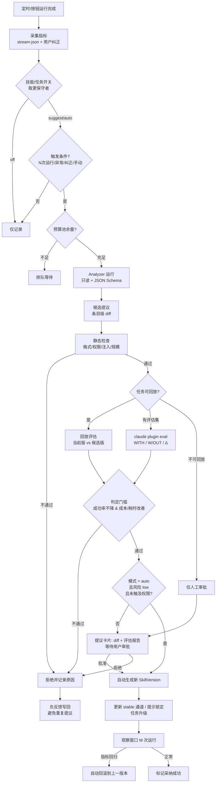
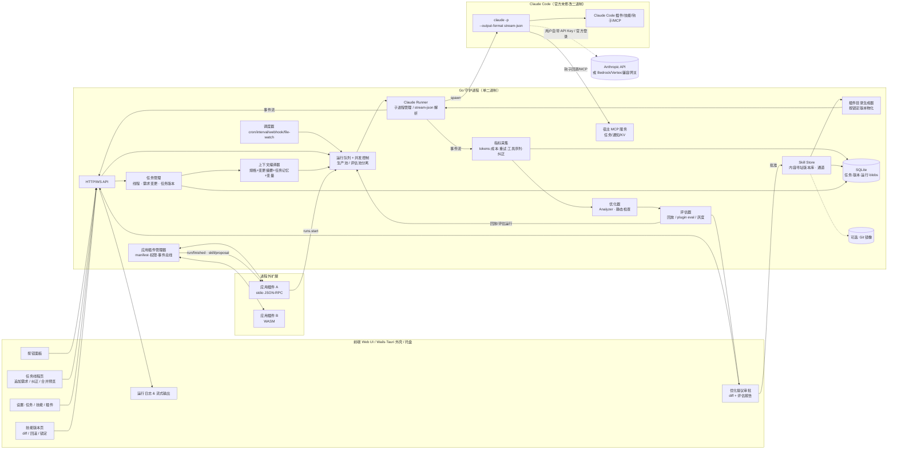

# 基于 Claude Code 的轻量 Agent 工作台：功能调研与可行性研究报告

> 调研日期：2026-10-16（北京时间）。所有结论均基于文末列出的公开来源；仓库 Star 数、许可证等元数据取自 GitHub API 当日返回值，会随时间变化。凡未能核实的内容均明确标注"未核实"。
>
> **v2 修订（2026-10-16 08:47 北京时间）**：按新需求增补并贯穿全文——① 长期定时任务可随时追加/修改需求（任务线程、需求变更日志、会话策略、任务版本）；② 可按技能/任务开关的 AI 技能优化闭环；③ 技能版本历史与任意回滚。涉及第 1、2.2.9、2.5、3、4.4–4.8、4.12、5.7–5.8、6 节。

---

## 1. 摘要与可行性结论

### 1.1 一句话结论

**技术上完全可行，且风险可控**：Claude Code 官方已提供成熟的非交互模式（`claude -p` + `--output-format stream-json` / `--input-format stream-json`）和 Python/TypeScript **Claude Agent SDK**，Skills、Plugins、Hooks、MCP、子代理等扩展机制全部有公开格式规范。你要做的软件本质上是一个"**Claude Code 的长期任务调度器 + 版本化资产管理器 + 自我优化闭环 + 触发器面板**"，与 BaoCode（桌面 UI 包装）定位相近但侧重自动化与持续改进。

**新增三项需求同样可行**（v2 修订）：
- **长期任务 + 随时追加需求**：用"任务线程 + 需求变更日志 + 不可变任务版本"实现，每次运行把"当前生效版本"编译成提示词；会话策略默认"每次全新会话 + 结构化任务记忆"，按需支持 `--resume` 续接或分叉。
- **技能 AI 优化（可按技能/任务手动开关）**：所需信号（失败、重试、耗时、token/成本、工具调用序列、权限拒绝）都能从 stream-json 事件与 `result` 消息中拿到；Anthropic 的 skill-creator 与 `claude plugin eval` 已提供"评估—改进—对比基线"的现成方法与命令，可作为评估环节的底座。
- **技能版本历史与任意回滚**：推荐以 SQLite 内容寻址存储（SHA-256 去重）为唯一真源、可选镜像到 Git；每次运行记录所用技能的精确版本，可按任务锁定版本。

### 1.2 关键发现

1. **三个指名产品均已核实存在**（2026-10 时点）：
   - **BaoCode**（baocode.dev，`baocode-dev/baocode`）：Flutter/Dart 原生桌面 UI，**自身不含 Agent**，直接运行用户已安装的 Claude Code，集中管理插件/MCP/技能/子代理/钩子；GPL-3.0；仅 macOS/Windows。
   - **DeepSeek Harness**（`deepseek-ai/deepseek-harness`，命令 `dsh`）：DeepSeek 官方开源的 Agent Harness，"**一切皆插件**"，基于 Cordis 插件框架；TypeScript；MIT；开发者预览版，会有破坏性变更。内置 `schedule`（cron 提醒，可 `schedule_update` 原地修改）、`skill`、`workflow`、`sandbox` 等包，桌面版是 Electron。
   - **magpie**（`yetone/magpie`，usemagpie.ai）：Go 写的本地**模型网关**（127.0.0.1:3425），让 Claude Code/Codex/Gemini CLI 等使用任意厂商模型；系统 WebView、约 15 MB；MIT。它**不是**调度/技能平台，但对"多模型/降本"很有参考价值。
2. **Claude Code 本身已有调度能力，但各有局限**：会话内 `CronCreate`/`/loop`（会话级、循环任务 7 天自动过期）；Desktop 本地定时任务（需 App 打开且电脑醒着）；云端 Routines（最小间隔 1 小时、按套餐有每日次数上限；提示词可编辑，但**每次运行都是新会话**，文档未见提示词版本历史）。
3. **三项新需求的现有支持：没有一个产品同时覆盖**（详见 3.2 节）：
   - DeepSeek Harness 的 schedule 把任务**绑定到原会话**，到点作为该会话的后续消息投递，并可用 `schedule_update` 原地替换标题、指令或时间——最接近"对话式长期任务"，但修改是覆盖式，未见需求变更日志或版本。
   - **Hermes Agent**（Nous Research，MIT）是"自我改进技能"最完整的先例：Agent 通过 `skill_manage` 创建/修补自己的技能，会话后后台复盘可提议或暂存修改，`skills.write_approval: true` 时需人工 `/skills approve`；用安装时哈希识别用户改动。但**默认无需审批即可写入**，文档中未见完整的技能版本历史与任意版本回滚。其 cron 任务可编辑、可挂载技能，但每次在全新会话中运行。
   - **Anthropic skill-creator** 支持为技能写 evals、benchmark（通过率、耗时、token）、新旧版本并行对比，以及"60/40 训练/留出集、按留出集分数选最佳"的 description 优化循环；**`claude plugin eval`** 可对插件/技能做"加载 vs 不加载"的 Δ 对比并在 CI 中设阈值。二者都是**离线、作者主导**的工具，不会基于生产运行日志主动提议修改。
   - 学术先例：**DSPy GEPA**（基于执行轨迹与文本反馈的反思式提示词进化，Pareto 选择）、**ACE**（把上下文当"可演化剧本"，用 ADD/UPDATE/REMOVE 增量更新避免"上下文坍塌"）、**Voyager**（经自验证后入库的可执行技能库）。
4. **资源占用的大头不在外壳，而在 Claude Code 进程本身**：第三方工具与 GitHub issue 报告单会话进程树约 0.3–1.3 GB，个别版本存在内存泄漏。外壳选 Go（单二进制，几十 MB）+ Web UI/Tauri 是对的，但**更关键的是并发上限、会话回收与 cgroup 限制**；技能优化的评估回放会成倍增加 Claude 运行次数，必须单独设并发与预算池。
5. **驱动方式**：官方文档明确"非 Python/TS 语言可用 `-p` + JSON 输出以子进程方式驱动同一 Agent 循环"；社区已有多个 Go 版 Agent SDK。推荐 **Go 守护进程 + CLI 子进程（stream-json）**，需要 `canUseTool` 等高级回调时再引入 Node 侧车跑官方 TS SDK。
6. **最大风险是合规，其次是"AI 自改技能"带来的漂移与安全问题**：Anthropic 规定第三方产品不得提供 claude.ai 登录、不得代收/存储用户的 Claude 凭据、不得转售或中介用量、不得修改 Claude Code 二进制、不得在产品名中使用 "Claude Code"。AI 编辑技能则可能引入回归、过拟合、持久化提示注入和权限扩张——默认应"只提议不自动应用"，并以评估门槛 + 版本回滚兜底。

### 1.3 可行性评级

| 维度 | 评级 | 说明 |
|---|---|---|
| 技术可行性 | ★★★★★ | 官方接口齐全、文档详尽；已有 BaoCode、各 Go SDK 等先例 |
| 长期任务/需求追加 | ★★★★☆ | 数据模型清晰；难点在"需求合并"的冲突处理与长会话上下文膨胀 |
| 技能版本与回滚 | ★★★★★ | 纯工程问题，内容寻址存储成熟可靠 |
| 技能 AI 优化 | ★★★☆☆ | 信号与评估工具都有；难点是评估成本、非幂等任务无法安全回放、防漂移 |
| 低资源目标 | ★★★☆☆ | 外壳可做到很轻；Claude Code 进程本身重，需靠并发/回收控制 |
| 合规（自用） | ★★★★★ | 订阅用户用 `claude -p`/Agent SDK 目前仍计入订阅额度 |
| 合规（对外分发/商业化） | ★★★☆☆ | 可做，但须遵守"用户自带凭据、不改二进制、不用 Claude Code 命名"等条件，建议咨询 Anthropic |
| 工作量（单人全栈） | MVP 约 7–10 周 | 含长期任务与技能版本；AI 优化闭环另需约 5–7 周，详见第 6 节 |

---

## 2. 各 Harness 调研

> 说明："资源占用"一项，除特别注明有来源的数据外，均为基于技术栈的定性判断（标注"定性"），未做实测。

### 2.1 指名产品

#### 2.1.1 BaoCode

- **定位**：Claude Code 的原生桌面 UI，内置毫秒级 IDE、终端、源代码管理、变更审查、通知、SSH 远程项目。官网明确："BaoCode 没有自己的智能体，这是有意为之……它运行你已经装好的 Claude Code，使用你的设置和你的 `CLAUDE.md`。"
- **架构**：Flutter 桌面应用 → 启动/管理本机 Claude Code；内置本地代理，可把 Anthropic API / OpenAI Chat Completions / OpenAI Responses 上游转换给 Claude Code 使用；API Key 存系统钥匙串；本机没有 Claude Code 时可自动下载。
- **插件/技能/调度**：不自建插件体系，而是**集中管理 Claude Code 的插件、MCP、技能、子代理、规则、命令、钩子**（全局或单项目），并同步 claude.ai 上的技能；有 `/goal` 目标驱动；检查点不触碰仓库 `.git`。调研中**未见独立的定时任务功能**。
- **技术栈**：Dart/Flutter（Dart SDK ^3.13.4）。
- **许可证**：GPL-3.0（编辑器、终端子包 MIT）；接受 Issue，不接受 PR。
- **资源占用**：官网强调"原生绘制、打开即用"，无量化数据（未核实）。平台：macOS 12+、Windows 10+ x64；远程需 Linux x64/arm64。
- **与 v2 新需求相关**：其"检查点"用于按文件查看/撤销 Claude 对代码的修改（不碰仓库 `.git`），**不是技能版本管理**；官网与更新日志中未见技能版本历史、技能优化或长期任务功能。
- **对你的启示**："不另造 Agent、完全复用 Claude Code 生态"是被验证的正确路线；你的差异化应放在**调度、按钮工作流、Skill 仓库、服务器端无头运行**上（BaoCode 不支持 Linux 桌面、无调度）。

#### 2.1.2 DeepSeek Harness（dsh）

- **定位**：DeepSeek AI 开源的通用 Agent Harness，"Everything is a Plugin"；开发者预览版，官方 SAFETY 文档明确"尚未接受安全审计，不得视为可用于生产环境"。
- **架构**：
  - 底层是 **Cordis** 插件框架（`cordiverse/cordis`，MIT）：插件向共享 `ctx` 贡献 **服务（service）、类型化事件、可逆副作用**；插件卸载时其注册的监听器、工具、定时器自动清理。
  - **没有特权内核**：模型适配器、工具注册表、会话日志乃至 Agent 循环本身都是插件，均可通过配置替换。
  - **Profile + Bundle 分层组装**：`web`、`headless`、`sdk`、`sdk-minimal`、`acp` 等 profile；按"bundle → profile 的 `cordis.patch.yml` → home patch → `--patch` 覆盖层"顺序叠加 YAML；`dsh --profile web --dump-config` 可查看最终插件树。
  - 形态：Web UI（默认 `127.0.0.1:3080`）、无头一次性运行、SDK JSON-RPC 服务、ACP 服务；桌面版为 **Electron** 外壳 + 私有 Desktop Host；另有 Python SDK。
- **插件机制（重点参考）**：
  - 插件 = 导出 `apply(ctx)` 的 TS 模块（也可对象/类形式）；`inject = ['tools', 'llm']` 声明依赖，框架等依赖服务就绪后再加载。
  - 事件分发支持 `emit / waterfall / parallel / serial / bail` 五种语义（观察、包裹、扇出、顺序、短路）。
  - 官方建议："拦截与策略用事件，直接能力调用用服务方法"。
  - 插件管理器通过内置 pnpm 安装；GitHub topic `dsh-plugin` 用于发现；仓库内有 `plugin-market-generator`。
- **技能/调度/工作流**：`skill/`（注册表合并多来源技能，`skill-filesystem` 从项目/用户目录发现并监听变化，`tool-skill` 支持 `/name` 直接调用）；`schedule/`（一次性、固定频率、每日、每周、cron 提醒，跨 Host 重启持久化；任务记录**绑定原 `sessionId`**，到点作为**原会话中的后续消息**投递；`schedule_update` 可原地替换标题、指令或时间，但为覆盖式修改，未见变更日志；子代理不得创建提醒）；`workflow/`（模型编写编排脚本扇出子代理）；`sandbox/`（`read-only` / `workspace-write` / `danger-full-access` 三档，Linux/macOS/Windows 后端，可一次性提权审批）。
- **技术栈**：TypeScript/Node.js、pnpm monorepo、Electron（桌面）、Python（SDK）。
- **许可证**：MIT。
- **资源占用**：定性——Node + Electron，偏重；无官方量化数据。
- **对你的启示**：插件系统可借鉴其 **"服务 + 依赖注入 + 事件管线 + 自动回收副作用 + 分层 YAML 配置"** 的设计；但不必照搬 TS/Cordis 运行时——你的宿主若用 Go，可以在**进程外**实现同样的契约（见第 4 节）。

#### 2.1.3 magpie

- **定位**：本地"每个 Agent 的模型"网关：一个网关（`127.0.0.1:3425`）同时讲 OpenAI / Anthropic / Gemini 协议并双向转换（含流式、工具调用、推理），从菜单栏一键切换 Claude Code、Codex、Gemini CLI、OpenCode、Goose、DeepSeek Harness 等数十个 Agent 的模型；额度耗尽时自动切换下一个账号。
- **机制**：直接改写各 Agent 配置，如 Claude Code 的 `~/.claude/settings.json` 中 `ANTHROPIC_BASE_URL`、`ANTHROPIC_AUTH_TOKEN` 与模型变量；支持局域网共享（每个客户端独立限额）、Docker（`ghcr.io/yetone/magpie`）、WebDAV/S3/加密 GitHub 同步；`magpie claude-code install` 可下载 Anthropic 官方构建（校验 SHA-256）。
- **技术栈**：Go；桌面使用系统 WebView，"Mac 上 15 MB 下载，无 Electron、无运行时"。
- **许可证**：MIT。
- **对你的启示**：(1) **Go + 系统 WebView** 的低资源路线已被验证；(2) 若你想让 Claude Code 跑 DeepSeek/Kimi/GLM 等国产模型降本，可直接**对接 magpie 或 BaoCode 式的本地代理**，不必自研协议转换。注意：magpie 提供"用你的 Claude 套餐驱动 OpenCode 等其它 Agent"的功能，这与 Anthropic 关于订阅凭据使用范围的条款存在潜在张力（见第 5 节），你的产品不宜默认依赖此类用法。

### 2.2 Claude Code 体系（你的底层引擎）

#### 2.2.1 Claude Code CLI 无头模式（`-p`）

- `claude -p "<prompt>"` 非交互运行；退出码 0 成功、非 0 失败；运行内失败（如未认证）也会作为结果输出到 stdout。
- 输出格式：`text` / `json`（含 `result`、`session_id`、`total_cost_usd` 与分模型成本）/ `stream-json`（逐行 JSON 事件，配 `--verbose --include-partial-messages` 得到 token 级流）；`--json-schema` 可得到结构化输出 `structured_output`。
- 输入格式：`--input-format stream-json` 可建立长连接、多轮推送消息。
- 会话：`--continue`、`--resume <session_id>` 或 `.jsonl` 转录路径。
- 权限：`--allowedTools`（规则语法如 `Bash(git diff *)`）、`--permission-mode auto|dontAsk|acceptEdits`、`--permission-prompts none`（无人值守时自动拒绝本应弹窗的请求，适合定时任务）、`--max-budget-usd` 成本上限。
- `system/init` 事件报告模型、工具、MCP 服务器、已加载插件及 `plugin_errors` / `mcp_server_errors`，可用于健康检查；`system/api_retry` 事件可用于重试进度展示。
- **`--bare` 模式**：跳过钩子、技能、插件、MCP、CLAUDE.md 的自动发现，启动更快、结果可复现；官方称它是脚本/SDK 调用的推荐模式，**未来会成为 `-p` 的默认**。但 **bare 模式不读取 OAuth/钥匙串，必须用 `ANTHROPIC_API_KEY` 或 `apiKeyHelper`**——这直接影响你的鉴权设计。所需上下文通过 `--append-system-prompt(-file)`、`--settings`、`--mcp-config`、`--agents`、`--plugin-dir` 显式传入。
- **安全提示**：不加 `--bare` 时，`-p` 会话会执行项目 `.claude/settings.json` 中的钩子并连接 `.mcp.json` 中的服务器，**即使是从未信任过的目录，也没有信任对话框**。
- 信号：SIGTERM 退出码 143，会结束 Bash 进程树并运行 `SessionEnd` 钩子；想优雅结束当前轮请先发 SIGINT 或调用 SDK `interrupt()`。

#### 2.2.2 Claude Agent SDK

- "以库的形式使用 Claude Code"：提供与 Claude Code 相同的工具、Agent 循环与上下文管理，Python 与 TypeScript 两种语言；**SDK 本质是运行 Claude Code 二进制的库**。
- 能力：内置工具、Hooks（代码回调）、子代理、MCP、权限（含工具审批回调）、会话（恢复/分叉）、自动加载 `.claude/` 与 `~/.claude/` 下的技能/命令/记忆、按本地路径加载插件。
- 官方原文："如需从 Python 或 TypeScript 以外的语言驱动同一个 Agent 循环，以子进程方式运行 CLI，并使用 `-p` 与 `--output-format json`。"
- 许可：受 Anthropic **商业服务条款**约束（包括用于给你自己的客户提供产品时）；`claude-agent-sdk-python` 仓库标注 MIT（以各组件 LICENSE 为准）。
- 品牌：允许 "Claude Agent"、"{你的Agent名} Powered by Claude"；**不允许** "Claude Code" / "Claude Code Agent" 或模仿 Claude Code 的视觉元素。
- 社区 Go 实现（均以子进程驱动已安装的 `claude` CLI、使用 stream-json 双向控制协议）：`shindakun/agent-sdk-go`、`Flohs/claude-agent-sdk-go`、`partio-io/claude-agent-sdk-go`、`spacingmind/claude-agent-sdk-go`、`next-bin/claude-agent-sdk-golang`（**均非官方**，成熟度需自行评估）。

#### 2.2.3 Skills（SKILL.md）

- 一个技能 = 一个目录 + `SKILL.md`；YAML frontmatter 中 `name`、`description`（描述"做什么、何时用"）；渐进式披露：启动时只加载元数据，触发时加载 SKILL.md 正文，引用的 `references/`、`scripts/`、`assets/` 按需加载；建议正文 < 500 行。
- `-p` 模式下可在提示词中写 `/skill-name` 直接调用用户可调用技能；技能可在子代理中"fork"运行，消息通过 `parent_tool_use_id` 区分。
- **版本**：SKILL.md 格式本身不带版本历史；Claude Code 插件的 `version` 字段用于把用户固定在某个发布版本上（分发层面的锁定），不提供历史与回滚。技能的版本管理需要你自己实现（见 4.6）。
- **SKILL.md 已成为事实上的跨 Harness 标准**：OpenCode、Gemini CLI 扩展、Goose、OpenHands、Kimi Code、Codex、DeepSeek Harness 均支持同类格式——你的 Skill 仓库因此具备跨引擎复用价值。

#### 2.2.4 Plugins

- 插件目录：可选 `.claude-plugin/plugin.json`（仅 `name` 必填）+ 根目录下的 `skills/`、`commands/`、`agents/`、`hooks/hooks.json`、`.mcp.json`、`.lsp.json`、`output-styles/`、`workflows/`、`monitors/`、`bin/`（加入 Bash 工具 PATH）、`settings.json`。
- `userConfig`：声明式用户配置（string/number/boolean/directory/file，`sensitive: true` 存入系统安全存储），通过 `${user_config.KEY}` 或 `CLAUDE_PLUGIN_OPTION_<KEY>` 注入。
- 路径变量：`${CLAUDE_PLUGIN_ROOT}`、`${CLAUDE_PLUGIN_DATA}`（跨升级持久）、`${CLAUDE_PROJECT_DIR}`。
- 市场：`.claude-plugin/marketplace.json`（`name`、`owner`、`plugins`）；`claude plugin validate --strict` 校验；路径必须以 `./` 开头且不得逃逸插件根目录。
- 命名限制：以 `claude-`、`anthropic-` 开头等名称会被判为冒充官方而报错。
- 无头运行时可用 `--plugin-dir` / `--plugin-url` 显式加载。

#### 2.2.5 Hooks

- 事件覆盖完整生命周期：`SessionStart`、`UserPromptSubmit`、`PreToolUse`（可阻断）、`PermissionRequest`、`PostToolUse`、`PostToolUseFailure`、`Notification`、`SubagentStart/Stop`、`TaskCreated/Completed`、`Stop`、`PreCompact/PostCompact`、`ConfigChange`、`FileChanged`、`SessionEnd` 等。
- 形式：shell 命令（含 matcher 过滤），Agent SDK 中还可用代码回调。
- **对你的价值**：用 `Stop` / `SessionEnd` / `PostToolUse` 钩子回传事件给你的守护进程（审计、通知、计费统计），用 `PreToolUse` 落实你自己的策略（如禁止访问某目录）。

#### 2.2.6 MCP

- 通过 `.mcp.json`、`--mcp-config` 或插件 `mcpServers` 配置（stdio / http / sse / ws，支持 `.mcpb` 包）；`-p` 时会等待待连接服务器（`MCP_TIMEOUT` 默认 30 秒）。
- **你的软件可以把自身能力（任务状态、Skill 仓库查询、通知推送）暴露为一个本地 MCP 服务器**，让 Claude 在运行中反向调用宿主。

#### 2.2.7 Claude Code 原生调度（竞品/替代方案对照）

| 机制 | 运行位置 | 持久性 | 限制 |
|---|---|---|---|
| `/loop` + `CronCreate/CronList/CronDelete` | 当前会话 | 会话级；`--resume` 时恢复未过期任务 | 5 字段 cron、分钟粒度；循环任务 **7 天自动过期** |
| Desktop 本地定时任务 | 本机 Claude Code Desktop | 跨重启 | **App 需打开且电脑醒着**，睡眠错过即跳过 |
| Routines（`/schedule`） | Anthropic 云端 | 持久，支持定时 / API / GitHub 事件触发 | **最小间隔 1 小时**；Pro 5 次/天、Max 15 次/天、Team/Enterprise 25 次/天；需 claude.ai 套餐 |

#### 2.2.8 许可与资源

- **许可证**：`anthropics/claude-code` 仓库 LICENSE 原文为 "© Anthropic PBC. All rights reserved. Use is subject to Anthropic's Commercial Terms of Service"——**闭源专有**，不可修改再分发。
- **资源占用**：RAM Sleeper（第三方工具）称单会话进程树约 0.3–1.3 GB（含 MCP 服务器）；GitHub issue #60534、#67433 报告过长会话 RSS 增长到数 GB 乃至 12 GB+ 的泄漏问题（特定版本/环境）。

#### 2.2.9 技能评估与优化工具：skill-creator 与 `claude plugin eval`

这两者与"技能优化"需求直接相关，是你实现评估环节时最值得复用的官方能力。

- **skill-creator**（`anthropics/skills` 仓库，Claude.ai、Cowork、Claude Code 插件形式均可用）：
  - 为技能编写 evals（测试提示词 + 期望/断言），**benchmark** 模式跟踪通过率、耗时与 token 用量，适合在模型升级或技能迭代后复测。
  - 改进循环：评审 SKILL.md → 提出修改 → 应用 → 用子代理**并行运行新旧两版**（每个运行在干净上下文中，各自统计 token 与耗时）→ 打分 → 生成 HTML 对比报告；运行过程在工作区保存技能快照、评估输出与打分结果。
  - **description 优化**（`scripts/run_loop.py`）：约 20 条"应触发 / 近似但不应触发"查询，按 60% 训练 / 40% 留出集划分，每条查询跑 3 次求触发率，最多迭代 5 次，**按留出集分数而非训练分数选最佳**以防过拟合；改进模型看不到测试分数（"blinded history"）；提示词明确要求从失败中归纳意图类别，而不是罗列具体查询。脚本通过 `claude -p` 子进程调用，复用会话的认证。
- **`claude plugin eval`**（官方文档 "Test plugins with evals"）：
  - 插件内 `evals/` 目录，每个用例是一个真实提示词（`prompt.md`）+ 若干 grader；grader 有 6 类：`regex`、`tool_used`、`tool_order`、`file_exists`（零成本，基于转录与文件计算）以及 `llm`、`baseline`（调用评审模型，计入成本）；**不支持自定义代码 grader**。
  - 每个用例在**全新、隔离的非交互会话**中运行；默认"加载插件"与"不加载插件"两组对照，输出 `WITH`、`W/OUT`、`Δ`。
  - `claude plugin eval init` 可交互生成用例；CI 中可用 `--threshold` 设门槛、固定 `--model`/`--judge-model`、`--max-cost-usd` 限制花费；可为 MCP 工具写 mock，避免评估时调用真实服务。
  - 注意：它的用例格式与 skill-creator 的 `evals/evals.json` **互不通用**。
- **局限**：两者都是**作者主导的离线评估**，需要事先写好用例；都不会读取生产环境的定时任务运行日志并主动提出优化，也不提供技能版本库。这正是你产品可以补上的部分（见 4.7 节）。

### 2.3 其他主流 Harness

| 项目 | 定位 | 架构要点 | 插件/技能/调度机制 | 技术栈 | 许可证 | Stars（2026-10-16） | 资源（定性） |
|---|---|---|---|---|---|---|---|
| **OpenAI Codex CLI** `openai/codex` | 终端编码 Agent | `codex exec --json` 无头 JSONL 事件流；**App Server**：stdio JSONL 双向 JSON-RPC（`thread`/`turn` 原语，`skills/list`），OpenAI 官方博文称其为驱动各端的统一 Harness 接口 | `~/.codex/config.toml` + 项目 `.codex/config.toml`；Skills（SKILL.md）、Plugins（打包 skills/apps/MCP/hooks）、Hooks（`hooks.json` 或内联，需 `/hooks` 信任）、MCP（`codex mcp add`）；原生调度：调研中未核实 | Rust | Apache-2.0 | ~129k | 低（Rust 原生二进制） |
| **Gemini CLI** `google-gemini/gemini-cli` | 终端 Agent | `gemini -p ... --output-format json` 无头；`--approval-mode`/`--yolo` | **Extensions**：根目录 `gemini-extension.json`，可含 MCP、命令、主题、钩子、子代理、`skills/<name>/SKILL.md`；Hooks：`BeforeTool/AfterTool/BeforeModel/AfterModel` 等；原生调度：调研中未发现 | TypeScript/Node | Apache-2.0 | ~107k | 中 |
| **OpenCode** `anomalyco/opencode`（原 `sst/opencode`，已迁移） | 开源编码 Agent | **客户端/服务端分离**：服务端暴露 OpenAPI（`/doc`），官方 JS SDK 做类型化会话/Agent 操作 | Plugins（V2 `ctx.agent.transform`、`ctx.skill.transform` 等变换与钩子）；Skills（`.opencode/skills/`，兼容其他目录）；原生调度：调研中未发现 | TypeScript | MIT | ~214k | 中 |
| **Aider** `Aider-AI/aider` | 终端结对编程 | `--message` 一次性执行后退出；Python `Coder.create(...).run()`（官方称 API 未文档化、可能变化） | 无插件/技能体系；`--read CONVENTIONS.md` / `.aider.conf.yml` 注入约定；无调度 | Python | Apache-2.0 | ~50k | 低–中 |
| **Goose** `aaif-goose/goose`（原 `block/goose`，已迁移） | 通用可扩展 Agent | CLI + 桌面 | **Extensions = MCP**（stdio/builtin/HTTP/内联 Python 等）；**Recipes**：YAML 工作流（指令、参数、扩展、重试、子 recipe）；**原生调度**：`goose schedule add --cron ... --recipe-source ...`（支持 5/6/7 字段 cron）；Skills：`~/.agents/skills/<name>/SKILL.md` | Rust | Apache-2.0 | ~55k | 低–中 |
| **Cline** `cline/cline` | 自主编码 Agent（SDK / IDE 扩展 / CLI） | CLI `--json` 输出 `agent_event` 与 `run_result` | `~/.cline/` 与 `.cline/` 下的 rules、workflows、skills、hooks、agents、plugins；SDK 插件钩子 `beforeRun/afterRun/beforeModel/afterModel/beforeTool/afterTool/onEvent`（`beforeTool` 返回 `{skip:true}` 可阻断）；原生调度：调研中未发现 | TypeScript | Apache-2.0 | ~70k | 中 |
| **OpenHands** `OpenHands/OpenHands`（原 `All-Hands-AI/OpenHands`）+ `OpenHands/software-agent-sdk` | AI 驱动开发平台 | Python Agent SDK；`DockerWorkspace` + agent-server 镜像实现**容器沙箱**远程会话 | Skills（原 microagents，可加载公共技能、组织/用户技能）；原生调度：调研中未发现 | Python（SDK）/ TS（前端）+ Docker | MIT | ~91k | **高**（容器化） |

### 2.4 中文/国产 Harness

| 项目 | 状态与要点 | 许可证 | 来源 |
|---|---|---|---|
| **DeepSeek Harness** | 见 2.1.2 | MIT | GitHub |
| **Qwen Code** `QwenLM/qwen-code`（阿里通义） | 终端编码 Agent；无头模式 `qwen -p "任务" --output-format json`，`--continue` 恢复；自动化可用 `--yolo --max-session-turns N --max-wall-time 10m`；支持 skills/agents/commands（iFlow 迁移指南显示可复制到 `~/.qwen`） | Apache-2.0 | GitHub、官方文档 |
| **Kimi Code CLI** `MoonshotAI/kimi-code`（月之暗面） | 新版 TS 实现（旧 Python 版 `kimi-cli` 已归档）；支持 Agent Skills；插件可打包 skills、自定义 agents、MCP、hooks、commands、系统提示；`/plugins install <GitHub URL>` 及市场安装 | MIT | GitHub、官方文档 |
| **Trae Agent** `bytedance/trae-agent`（字节） | 通用软件工程 LLM Agent | MIT | GitHub |
| **iFlow CLI** `iflow-ai/iflow-cli`（心流） | 社区公告称已于 **2026-04-17 停服**，官方建议迁移至 Qoder CLI / Qwen Code | 未标注 | 心流社区帖 |
| **Qoder CLI / CodeBuddy / WorkBuddy** 等 | 仅在 magpie 支持列表与迁移帖中出现；**本次未单独核实其插件/调度机制** | — | magpie README |

### 2.5 相关先行研究与产品：长期任务、技能自我改进、技能版本

| 名称 | 类型 | 与新需求相关的机制 | 未覆盖 / 未核实 | 来源 |
|---|---|---|---|---|
| **Hermes Agent**（`NousResearch/hermes-agent`，Python，MIT） | 开源 Agent | **技能自我改进**：Agent 用 `skill_manage` 创建/更新/删除自己的技能（"程序性记忆"）；回合后后台复盘可提议或暂存技能修改；`skills.write_approval: true` 时修改暂存到 `~/.hermes/pending/skills/`，用 `/skills pending`、`/skills approve <id>` 审批；技能写作规范要求写"规则而非日志"（不写 issue 号、日期、聊天原文）；"curator" 合并整理；用安装时哈希识别用户改动，`hermes skills update` 不覆盖本地改动，`reset --restore` 恢复内置版本。**定时任务**：内置 cron，可 pause/resume/edit/trigger，可挂载多个技能，每个任务可固定模型；在**全新会话**中运行，且 cron 运行中禁止再创建 cron | **默认无需审批即可写入**；文档未见技能完整版本历史与任意版本回滚；未见基于指标的 A/B 评估 | Hermes 文档 Skills / Cron 页、GitHub |
| **DeepSeek Harness schedule** | 开源 Harness | 任务记录绑定原 `sessionId`，持久化跨重启；到点作为**原会话中的后续消息**投递；`schedule_update(id, title|prompt|selector)` 原地替换；子代理不得创建提醒 | 修改为覆盖式，未见需求变更日志、任务版本 | DSH `docs/subsystems/schedule.md`、`packages/schedule/tool-schedule` |
| **Claude Code Routines** | 官方云服务 | 可随时编辑提示词、仓库、连接器与触发器；API 触发可附带 `text`（以 `<routine-fire-payload>` 包裹、标记为不可信数据） | **每次运行新建会话**；文档未见提示词版本历史 | Routines 文档 |
| **skill-creator / `claude plugin eval`** | 官方工具 | 见 2.2.9 | 离线、作者主导，不读生产日志 | 见 2.2.9 |
| **DSPy / GEPA**（arXiv:2507.19457） | 研究 + 开源库 | 用 LLM 反思执行轨迹（推理、工具调用、工具输出）与文本反馈，提出并测试提示词修改，在 Pareto 前沿上保留互补策略；论文报告在 6 个任务上平均优于 GRPO 6 个百分点、最多少用 35 倍 rollout，且优于 MIPROv2 超过 10 个百分点；DSPy 中用 `dspy.GEPA(metric=..., reflection_lm=..., auto="light")`，metric 可返回分数 + 文本反馈 | 面向 DSPy 程序，不直接作用于 SKILL.md；需要训练/验证集 | arXiv、dspy.ai |
| **ACE：Agentic Context Engineering**（arXiv:2510.04618，ICLR 2026） | 研究 | 把上下文视为"可演化剧本"，Generator → Reflector → Curator 三角色，以 **ADD/UPDATE/REMOVE 增量条目**更新并去重修剪，避免"简短偏置"和"上下文坍塌"（反复整体重写导致细节丢失）；可利用自然执行反馈、无需标注；论文报告 Agent 基准 +10.6% | 研究原型 | arXiv、`ace-agent/ace` |
| **Voyager**（arXiv:2305.16291） | 研究 | 可执行技能库：技能经**自验证**后才入库，按描述向量检索 | 面向 Minecraft，代码技能 | arXiv |
| **TextGrad、MIPROv2** | 研究 | 文本反馈"反向传播"/贝叶斯优化提示词（GEPA 论文相关工作部分提及） | 未单独核实细节 | GEPA 论文 |

**对你的启示**：
1. "AI 改技能"的**闭环形态已有先例**（Hermes），但缺少**版本库、回滚和基于指标的评估门槛**——这正是你的差异化。
2. 评估方法可直接借鉴 skill-creator 的**留出集选优**、`plugin eval` 的**有/无对照 Δ**、GEPA 的**轨迹反思 + Pareto 保留**。
3. 需求合并与技能修改都应采用 ACE 式的**增量条目更新**，而不是每次让 LLM 整体重写，以防细节被逐步"磨掉"。

---

## 3. 功能对比表

### 3.1 通用能力对比（v2 增加三行新需求）

图例：✅ 原生支持 ／ ◐ 部分或需组合 ／ ❌ 调研中未发现 ／ — 不适用

| 能力 | Claude Code（CLI+SDK） | BaoCode | DeepSeek Harness | magpie | Codex CLI | Gemini CLI | OpenCode | Aider | Goose | Cline | OpenHands | Qwen Code | Kimi Code |
|---|---|---|---|---|---|---|---|---|---|---|---|---|---|
| 自带 Agent 循环 | ✅ | ❌（复用 CC） | ✅ | ❌（网关） | ✅ | ✅ | ✅ | ✅ | ✅ | ✅ | ✅ | ✅ | ✅ |
| 无头/程序化接口 | ✅ `-p`/stream-json/SDK | — | ✅ headless/SDK/ACP | — | ✅ exec/App Server | ✅ `-p` | ✅ Server+SDK | ◐ `--message` | ✅ | ✅ `--json`/SDK | ✅ SDK | ✅ `-p` | 未核实 |
| SKILL.md 技能 | ✅ | ✅（管理） | ✅ | — | ✅ | ✅（扩展内） | ✅ | ❌ | ✅ | ✅ | ✅ | ✅ | ✅ |
| 插件包体系 | ✅ plugin.json+市场 | ✅（管理） | ✅ Cordis（一切皆插件） | — | ✅ | ✅ Extensions | ✅ | ❌ | ✅ Extensions(MCP) | ✅ | ◐ | ◐ | ✅ |
| 生命周期钩子 | ✅（30+ 事件） | ✅（管理） | ✅ 类型化事件 | — | ✅ | ✅ | ✅ | ❌ | 未核实 | ✅ | 未核实 | 未核实 | ✅ |
| MCP | ✅ | ✅ | ✅ | — | ✅ | ✅ | ✅ | ❌ | ✅ | ✅ | ✅ | ✅ | ✅ |
| 本地持久定时任务 | ◐（Desktop 需常开；会话 cron 7 天过期） | ❌ | ✅ schedule 包 | ❌ | 未核实 | ❌ | ❌ | ❌ | ✅ `goose schedule` | ❌ | ❌ | ❌ | 未核实 |
| 云端定时/事件触发 | ✅ Routines（≥1h，有日限额） | ❌ | ❌ | ❌ | 未核实 | ❌ | ❌ | ❌ | ❌ | ❌ | ◐（云版） | ❌ | 未核实 |
| 工作流/编排 | ✅ 子代理/workflows | ◐ `/goal` | ✅ workflow 包 | — | ◐ | ◐ | ◐ | ❌ | ✅ Recipes | ✅ workflows | ✅ | ◐ | ◐ |
| 沙箱 | ◐ 权限模式+分类器 | — | ✅ 三档沙箱 | — | ✅ | ◐ | ◐ | ❌ | ◐ | ◐ | ✅ Docker | ◐ | 未核实 |
| 多模型 | ◐（需代理） | ✅ 内置代理 | ✅ | ✅ 核心功能 | ◐ | ◐ | ✅ | ✅ | ✅ | ✅ | ✅ | ✅ | ◐ |
| 桌面 GUI | ✅ Desktop | ✅ Flutter | ✅ Electron/Web | ✅ WebView | ✅ App | ❌ | ✅ | ❌ | ✅ | ✅ IDE | ✅ Web | ❌ | 未核实 |
| 长期任务随时追加/修改需求 | ◐ Routines 可编辑，每次新会话；会话 cron 随 `--resume` 恢复 | ❌ | ◐ `schedule_update` 原地覆盖，投递回原会话 | — | 未核实 | 未核实 | 未核实 | ❌ | 未核实 | 未核实 | 未核实 | 未核实 | 未核实 |
| AI 基于运行数据优化技能 | ◐ skill-creator（离线、作者主导） | ❌ | 未核实 | — | 未核实 | 未核实 | 未核实 | ❌ | 未核实 | 未核实 | 未核实 | 未核实 | 未核实 |
| 技能版本历史/任意回滚 | ◐ 插件 `version` 仅用于分发固定，未见历史 | ❌（检查点只针对代码修改） | 未核实 | — | 未核实 | 未核实 | 未核实 | ❌ | 未核实 | 未核实 | 未核实 | 未核实 | 未核实 |
| 主语言 | TS（闭源） | Dart | TS | Go | Rust | TS | TS | Python | Rust | TS | Python/TS | TS | TS |
| 许可证 | 专有（商业条款） | GPL-3.0 | MIT | MIT | Apache-2.0 | Apache-2.0 | MIT | Apache-2.0 | Apache-2.0 | Apache-2.0 | MIT | Apache-2.0 | MIT |

> 表中"❌"仅表示本次调研的公开资料中未发现，不排除存在；"未核实"表示没有找到足以下结论的资料。

### 3.2 三项新需求的现有支持情况（含非 Claude Code 系产品）

| 产品 | ① 长期任务追加需求 | 需求变更日志 / 任务版本 | 会话续接策略 | ② AI 主动优化技能 | 优化前评估 / A-B | ③ 技能版本历史 / 回滚 | 运行记录技能版本 / 按任务锁定 |
|---|---|---|---|---|---|---|---|
| **Claude Code** | ◐ Routines 可编辑提示词与触发器；Desktop 定时任务可改 | 未见 | 会话 cron：随 `--resume/--continue` 恢复；Routines：每次新会话；SDK：会话可恢复/分叉 | ◐ skill-creator 可评审并提出修改（人工发起） | ✅ skill-creator benchmark、新旧并行对比；`plugin eval` 有/无对照 Δ | 未见技能历史；skill-creator 工作区保存快照 | ◐ 插件 `version` 固定分发版本 |
| **BaoCode** | ❌ 未见调度 | ❌ | 复用 Claude Code 会话 | ❌ | ❌ | ❌ | ❌ |
| **DeepSeek Harness** | ◐ `schedule_update` 原地替换指令/时间 | ❌ 覆盖式 | ✅ 投递到原会话（会话式） | 未核实 | 未核实 | 未核实 | 未核实 |
| **Hermes Agent** | ◐ cron 可 edit，可挂载技能 | 未见 | 每次全新会话 | ✅ 自动创建/修补技能，后台复盘提议 | ❌ 未见指标评估门槛 | ◐ 哈希识别本地改动、可恢复内置版本；未见完整历史 | ◐ 每任务可固定模型；未见锁定技能版本 |
| **Goose** | ◐ recipe 为 YAML 文件，可改后被 `goose schedule` 调用 | 未核实 | 未核实 | 未核实 | 未核实 | 未核实 | 未核实 |
| **magpie** | — | — | — | — | — | — | — |
| **其余（Codex、Gemini CLI、OpenCode、Aider、Cline、OpenHands、Qwen Code、Kimi Code）** | 未核实（Aider 无此类机制） | 未核实 | 未核实 | 未核实 | 未核实 | 未核实 | 未核实 |

### 3.3 结论

- 在"Claude Code 引擎 + 本地持久调度 + Skill 仓库 + 按钮/插件触发 + 低资源 + 可无头部署到 Linux 服务器"这一组合上，目前没有现成产品完全覆盖。最接近的是 DeepSeek Harness（但它不以 Claude Code 为引擎、偏重）与 Goose（有 recipe+cron，但同样不是 Claude Code）。
- 三项新需求中，**"会话式长期任务"** 有 DeepSeek Harness 的雏形，**"AI 自改技能"** 有 Hermes 的雏形，**"技能评估"** 有 Anthropic 官方工具；但 **"需求变更日志 + 不可变任务版本"**、**"技能完整版本库 + 任意回滚 + 运行级版本追溯"**、**"基于生产运行指标、经评估门槛后才采纳的技能优化"** 三者在已调研产品中均未见完整实现——这是你产品最清晰的差异化。

---

## 4. 你的软件：建议架构

### 4.1 设计原则

1. **不造 Agent**（学 BaoCode）：Claude Code 就是 Agent，你只做编排、资产、触发与观测。
2. **资产格式与官方对齐**：Skill 用 SKILL.md、Agent 侧扩展用 Claude Code plugin 格式，用户的资产在你的软件与原生 Claude Code 之间可互通。
3. **宿主轻、执行重的部分隔离**：宿主常驻进程 < 50 MB；Claude Code 进程按需拉起、用完即回收、并发受控。
4. **两层插件**：Agent 层扩展交给 Claude Code 插件；应用层扩展（触发器、按钮、动作、设置面板）用你自己的插件 API（借鉴 Cordis 契约，进程外执行）。
5. **一切可追溯、可回滚**（v2 新增）：任务定义与技能都是**不可变版本**；每次运行记录它用到的任务版本与每个技能的精确版本（内容哈希）；"当前版本"只是一个可移动的指针。
6. **AI 只提议，人来决定**（v2 新增）：需求合并与技能优化默认产出 diff 等待审批；自动应用必须同时满足"用户显式开启 + 通过评估门槛 + 属于低风险变更类别"，并带自动回滚观察窗口。
7. **增量而非重写**（v2 新增，借鉴 ACE）：需求变更与技能优化都以条目级 ADD/UPDATE/REMOVE 表达，避免 LLM 反复整体重写导致细节流失。

### 4.2 技术栈推荐

| 层 | 推荐 | 备选 | 理由 |
|---|---|---|---|
| 核心守护进程 | **Go**（单二进制、交叉编译、goroutine 并发、常驻内存小） | Rust（更省但开发效率低） | magpie 已验证 Go + 系统 WebView 路线；社区 Go 版 Agent SDK 可参考 |
| 桌面外壳 | **Wails（Go）或 Tauri（Rust）+ 系统 WebView** | Electron | Tauri/WebView 包体积通常 10–60 MB 对比 Electron 240–320 MB（Better Stack、Hopp 实测）；但内存未必总是更低（tauri issue #5889），务必实测 |
| 服务器模式 | 同一 Go 二进制 `--headless`，内嵌 Web UI（`embed`） | Docker 镜像 | 一份代码覆盖桌面与 Linux 服务器 |
| 前端 | Vue 3 或 React + Vite（你熟悉的即可） | — | 桌面与服务器共用 |
| 存储 | **SQLite**（任务、运行记录、事件流） + 文件系统（Skill/插件目录） | — | 零运维 |
| 调度 | Go cron 库（如 `robfig/cron`，支持秒级/时区）+ SQLite 持久化"下次运行时间" | 系统 cron/systemd timer | 进程重启后补偿错过的运行（可配置 skip / run-once） |
| Claude Code 驱动 | **CLI 子进程 + stream-json**（第一阶段）；需要 `canUseTool` 等高级回调时引入 **Node 侧车跑官方 TS Agent SDK** | 仅 Agent SDK | 官方明确支持非 Python/TS 语言用 `-p` 子进程驱动；避免把 Node 运行时塞进宿主 |
| 版本存储（v2） | **SQLite 内容寻址**（SHA-256 去重 blob + 版本清单）；可选导出到 Git（纯 Go 实现如 go-git） | 每技能一个 Git 仓库 | 运行记录与技能版本同库、事务一致；回滚即移动指针 |
| 优化/评估（v2） | 宿主内的 Analyzer/Evaluator 编排 + `claude -p --json-schema`；有评估集时调用 `claude plugin eval` | 引入 DSPy/GEPA（需 Python） | 不引入额外运行时；复用官方评估命令 |
| 应用插件运行时 | **进程外插件**：子进程 + JSON-RPC over stdio（任意语言）；轻量逻辑可选 WASM 运行时（如 Go 的 wazero） | 进程内 JS（goja） | 隔离崩溃与权限，便于沙箱 |

### 4.3 驱动 Claude Code：两种方式对比

| 维度 | CLI 子进程（`-p` + stream-json） | Agent SDK（TS/Python） |
|---|---|---|
| 语言 | 任意（Go 原生） | Python / TypeScript |
| 能力 | 工具、技能、插件、MCP、会话恢复、JSON Schema 输出、成本上限、权限模式、`--permission-prompts none` | 以上全部 + 代码内 Hooks、工具审批回调、原生消息对象、`interrupt()` |
| 长会话 | `--input-format stream-json` 保持进程推送多轮 | 原生支持 |
| 部署 | 只需用户机器上有 `claude` | 宿主需带 Node/Python 运行时 |
| 资源 | 最省 | 多一个运行时进程（约几十 MB） |
| 推荐用法 | **定时任务、按钮触发等一次性/短任务（主路径）** | 需要交互式审批 UI、细粒度工具拦截时 |

**单次运行的推荐调用模板**（长期任务每次运行由 4.5 的上下文编译器生成这些参数；resume 策略时追加 `--resume <session_id>`）（示意，参数均出自官方文档）：

```bash
claude -p "$PROMPT" \
  --output-format stream-json --verbose \
  --permission-mode acceptEdits --permission-prompts none \
  --allowedTools "Read,Edit,Bash(npm test *)" \
  --plugin-dir "$APP_HOME/generated/run-<run_id>" \
  --mcp-config "$APP_HOME/generated/run-<run_id>/mcp.json" \
  --append-system-prompt-file "$APP_HOME/generated/run-<run_id>/system.md" \
  --max-budget-usd 2
```

- 用户使用 **API Key** 时：加 `--bare`，所有上下文显式传入，结果可复现、启动快、不受用户 `~/.claude` 中杂项钩子影响。
- 用户使用 **订阅登录** 时：bare 模式不读 OAuth，只能用非 bare 模式；此时应把工作目录限定在你创建的受控目录，并提示用户注意项目内 `.claude/settings.json` 钩子与 `.mcp.json` 会自动生效。
- 解析事件：读 `system/init` 校验插件/MCP 加载情况（`plugin_errors`、`mcp_server_errors`），处理 `system/api_retry`、`permission_denied`，从最终 `result` 中取 `total_cost_usd`、`session_id` 入库。
- 终止：先 SIGINT（让当前轮正常收尾），超时再 SIGTERM（退出码 143）。

### 4.4 核心概念模型（v2 修订）

- **Task（长期任务）**：一个长期存在、可随时修改的工作单元（替代 v1 的 "Work"）。它本身只有身份与当前指针：`{ id, 名称, current_version_id, 会话策略, 状态(active/paused/archived) }`。
- **TaskVersion（任务版本，不可变）**：某一时刻任务的完整规格 = `{ 目标, 约束, 验收标准, 输出格式, 步骤提示, 提示词模板(含变量), 工作目录, 技能绑定(含锁定版本), 插件, MCP, 允许工具/权限模式, 模型, 预算, 超时, 输出 Schema(可选), 后续动作 }`。每次需求合并产生新版本，可回退到任意旧版本。
- **Task Thread（任务线程）**：类似聊天记录的时间线，混合三类条目：用户消息（追加/修改需求、对结果的纠正）、系统条目（每次运行的摘要卡片、版本变更、优化提议）、AI 条目（澄清问题、合并建议）。
- **RequirementChange（需求变更）**：从用户消息中提取出的结构化变更 `{ op: add|update|remove, 作用域: permanent|next_run_only, 目标条目, 内容, 状态: pending|merged|rejected|superseded }`，构成**需求变更日志**。
- **Trigger（触发器）**：`cron` / `interval` / `button`（UI 按钮或托盘菜单）/ `webhook`（本地 HTTP）/ `file-watch` / `plugin`（应用插件发出的事件）。一个 Task 可以挂多个触发器。
- **Run（运行）**：一次执行实例，状态机 `queued → running → succeeded | failed | cancelled | timeout`；记录事件流、指标、成本、session_id，以及**所用 task_version_id 与各技能版本**。
- **Skill / SkillVersion**：技能身份 + 不可变版本（文件树的内容哈希）；见 4.6。
- **OptimizationProposal（优化提议）**：AI 针对某技能版本提出的修改（diff + 证据 + 预期收益 + 风险等级），经评估与审批后成为新的 SkillVersion；见 4.7。
- **App Plugin（应用插件）**：扩展触发器、动作、按钮、设置面板、结果渲染器。

### 4.5 长期定时任务：任务线程、需求追加与会话策略（v2 新增）

#### 4.5.1 交互方式

- 每个 Task 有一个**对话式线程页**：用户随时可以输入"以后周报里加上 PR 合并数""这次先别发邮件""上次的统计口径错了，应按自然周"。
- 用户消息到达后，宿主调用一次**轻量的"需求解析"运行**（`claude -p --bare --json-schema ...`，只读工具、低预算、可选便宜模型），把自然语言转为一组结构化 `RequirementChange`，并检测与当前版本规格的冲突。
- 线程中展示**合并预览**：当前版本规格 vs 合并后规格的 diff；用户点"应用"生成新 TaskVersion，点"修改"手动编辑，点"仅下次生效"标记为 `next_run_only`。
- 可选"自动合并"：仅当变更全部为 `add` 且无冲突、且用户为该任务开启时，自动生成新版本并在线程中留痕。

#### 4.5.2 需求如何并入提示词与上下文

借鉴 ACE 的增量条目思想，**规格以条目化结构保存**（每条要求有稳定 id），合并只做条目级 ADD/UPDATE/REMOVE，不让 LLM 整体重写：

```yaml
# task_versions.spec（示意）
goal: 每周一 9:00 生成本仓库上周工作周报
constraints:
  - id: c1   # v1 加入
    text: 只统计 main 分支
  - id: c2   # v3 加入（来自线程消息 #42）
    text: 统计口径按自然周（周一至周日，Asia/Shanghai）
acceptance:
  - id: a1
    text: 输出包含"已合并 PR 数"一节
output: { format: markdown, path: reports/weekly-{{date}}.md }
skills: [{ name: weekly-report, pin: "sha256:9f3c…" }]
```

每次运行时，宿主把以下内容**编译**成一次调用（全部可在运行详情中查看，便于排查）：

| 层 | 内容 | 注入方式 |
|---|---|---|
| 1. 任务规格 | 当前 TaskVersion 的目标、约束、验收标准、输出格式 | 生成 `system.md` → `--append-system-prompt-file` |
| 2. 本次一次性要求 | 状态为 pending 的 `next_run_only` 变更 | 拼入本次用户提示词开头，运行后标记 consumed |
| 3. 自上次运行以来的变更说明 | 规格 diff 的人类可读摘要（"新增约束 c2…"） | 拼入提示词，让模型知道"什么变了" |
| 4. 任务记忆 | 最近 N 次运行摘要、关键产出路径、用户纠正要点（有长度上限，超限由 AI 压缩为条目） | 写入工作目录的 `TASK_MEMORY.md` 并在提示词中引用 |
| 5. 运行变量 | 日期、触发来源、webhook 负载（按不可信数据包裹，仿 Routines 的 `<routine-fire-payload>` 做法） | 模板变量 |
| 6. 技能 | 按任务版本锁定的技能版本 | 生成插件目录 → `--plugin-dir` |

#### 4.5.3 会话策略：全新会话 vs 续接 vs 分叉

| 策略 | 实现 | 优点 | 缺点 | 适用 |
|---|---|---|---|---|
| **fresh（默认）** | 每次新会话，靠第 1–4 层注入上下文 | 可复现、上下文不膨胀、便于 A/B 与回放；与 Routines、Hermes cron 的做法一致 | 跨运行的隐性上下文需要显式写入任务记忆 | 绝大多数定时任务 |
| **resume** | `claude -p ... --resume <上次 session_id>`，把新需求作为新一轮用户消息 | 保留完整对话上下文，适合"连续推进的大任务" | 上下文持续增长（会触发压缩、成本上升、细节丢失）；长会话内存问题；结果难以复现 | 多日连续的重构、调研类任务 |
| **fork** | Agent SDK 的会话分叉（从某个基线会话派生） | 保留基线知识，同时隔离每次运行 | 需 SDK 侧车；基线过期需重建 | 需要"预热背景知识"的任务 |

规则建议：
- 任务版本出现**主版本级变更**（目标或验收标准改变）时，resume 模式自动切换为一次 fresh，并重建基线。
- resume 模式设上限：连续 N 次或累计 token 超阈值后强制 fresh，并把会话要点写入任务记忆。
- 每次 Run 都记录 `session_id` 与 `parent_session_id`，线程中可"从这次运行继续对话"（手动 `--resume`），继续对话中产生的新要求同样回流为 RequirementChange。

#### 4.5.4 任务版本化

- TaskVersion **不可变**，带 `version_no`（每任务递增）、`parent_version_id`、`created_by`（user / ai-merge / rollback / import）、`change_ids`（由哪些需求变更合并而来）。
- "回退任务到 v3" = 新建 v7，内容等于 v3，`created_by=rollback`——历史保持线性、可审计。
- 运行详情显示"此次运行使用 v5"，并可一键"用 v5 / v6 对比重跑"（衔接 4.7 的评估能力）。
- 支持导出/导入 YAML（含版本历史），便于放进 Git 管理。

### 4.6 Skill 仓库与版本管理（v2 修订）

#### 4.6.1 存储方案对比

| 方案 | 做法 | 优点 | 缺点 |
|---|---|---|---|
| **A. SQLite 内容寻址（推荐作唯一真源）** | 文件内容按 SHA-256 存入 `blobs` 表（去重）；每个技能版本是一份"路径 → 哈希"清单，清单本身再取哈希作为 `tree_hash` | 单文件数据库、零外部依赖；与运行记录同库，**可在一个事务内**关联"运行 ↔ 技能版本"；查询灵活（按版本统计指标）；回滚只是移动指针 | diff、分支等需自己实现（单文件 diff 用 Go diff 库即可） |
| B. 每个技能一个 Git 仓库 | 每次修改 commit，tag 版本 | 现成的历史、diff、blame；可推送到远端 | 运行记录与提交的关联要另存；大量小仓库管理繁琐；Windows 上依赖 git 或纯 Go 实现（如 go-git） |
| C. 混合（推荐的可选项） | A 为真源，提供"导出/同步到 Git 仓库"（每个版本一个 commit，提交信息含版本号、来源、提议 id） | 两者兼得：本地可靠 + 团队可在 Git 中审阅 | 需要处理从 Git 反向导入时的冲突 |

#### 4.6.2 版本元数据（每个 SkillVersion）

- `version_no`（技能内递增）、`tree_hash`（内容身份）、`parent_version_id`
- `source`：`upload` / `import`（Git URL、`~/.claude/skills`、其他 Harness 目录）/ `manual_edit` / `ai_proposal` / `rollback`
- `proposal_id`（若来自 AI 优化）、`author`、`message`（变更说明）、`created_at`
- 解析缓存：frontmatter 的 `name`、`description`、`allowed-tools` 等，以及文件数、总大小
- 质量摘要（异步回填）：该版本被多少次运行使用、成功率、平均耗时/成本（来自 4.8 的运行指标表）

#### 4.6.3 运行时物化

- 运行前把锁定的版本物化到只读缓存目录 `$APP_HOME/cache/skills/<tree_hash>/`（同一哈希只物化一次），再软链接/拷贝进本次运行生成的插件目录，通过 `--plugin-dir` 加载——**不污染用户的 `~/.claude/skills`**，bare 模式同样可用。
- 每次运行写入 `run_skill_versions`（运行 id、技能 id、版本 id、tree_hash），**任何一次历史运行都能精确还原当时的技能内容**。
- 可选"同步到全局"：把某版本写入 `~/.claude/skills/`，让原生 Claude Code 也能用（BaoCode 也提供全局/项目两级管理）。

#### 4.6.4 按任务锁定版本

每个任务版本中的技能绑定有三种模式：
- `latest`：始终使用技能的当前版本（方便，但技能一改就影响所有任务）
- `pinned`：锁定到某个 `skill_version_id`（**定时任务默认**，最稳）
- `channel`：跟随一个命名通道，如 `stable` / `canary`（为 4.7 的灰度 A/B 服务）

技能有新版本时，线程中提示"weekly-report 有新版本 v8（来自优化提议 #12），是否升级本任务？"，并附 diff 与评估结果。

#### 4.6.5 Diff 与回滚交互

- 版本列表 → 任选两个版本 → 按文件显示统一 diff（SKILL.md 额外把 frontmatter 字段级变化单独列出，例如 `allowed-tools` 新增 `Bash` 用红色高亮）。
- 每个版本旁显示"被哪些运行使用 / 成功率 / 平均成本"，帮助判断回滚目标。
- **回滚** = 把技能的 `current_version_id` 指回旧版本，并写审计记录；对 `pinned` 的任务不产生影响，对 `latest` 的任务立即生效；也提供"回滚并新建版本"（与任务版本一样保持线性历史）。
- 删除：版本默认不可删除，只能"归档"；blob 由引用计数回收（无任何版本引用时才清理）。

#### 4.6.6 导入与校验

- 导入：zip/文件夹/Git URL；可从 `~/.claude/skills`、OpenCode、Goose、Codex、Gemini CLI、Kimi Code、DeepSeek Harness 等目录导入（SKILL.md 格式相近）。
- 校验：frontmatter 合法性、SKILL.md 行数（官方建议正文 < 500 行）、路径逃逸、文件大小、可执行脚本清单、`allowed-tools` 声明、疑似密钥；来自网络的技能默认"仅只读工具"，用户确认后才放开。

### 4.7 Skill 优化闭环（v2 新增）

#### 4.7.1 开关与模式

- 每个技能一个 `optimize_mode`：`off`（默认）/ `suggest`（只提议）/ `auto`（满足门槛后自动应用）。
- 每个任务的技能绑定可再覆盖：`inherit` / `off` / `suggest` / `auto`。**取两者中更保守的一个**——例如技能为 `auto` 而某关键任务设为 `suggest`，则该任务产生的证据只能触发提议。
- 全局"优化预算池"：每日/每月美元上限、最大并发评估数；超限时提议排队。

#### 4.7.2 采集的信号（来自 stream-json 与宿主）

| 信号 | 来源 |
|---|---|
| 成功/失败、退出码、错误类别 | `result` 消息、进程退出码 |
| 重试次数与原因 | `system/api_retry` 事件（`attempt`、`error` 类别） |
| 耗时、token、成本 | `result` 中的 usage 与 `total_cost_usd`（官方说明为客户端估算） |
| 工具调用序列 | `assistant` 消息中的 `tool_use` 块及 `tool_result`（可统计重复调用、无效循环、失败工具） |
| 权限拒绝 | `permission_denied` 系统消息、`permission_denials` |
| 技能是否被调用 | Skill 工具的 `tool_use`；`parent_tool_use_id` 区分技能子运行 |
| 验收结果 | 任务验收标准的自动检查（文件存在、正则、JSON Schema 校验 `structured_output`） |
| **用户纠正** | 任务线程中针对某次运行的纠正消息、"带修正重跑"、对产出的 👍/👎、用户手工修改产出文件的 diff |
| 钩子事件 | `PostToolUseFailure`、`Stop`、`SessionEnd` 钩子回传宿主（可选） |

#### 4.7.3 何时触发分析

- 累计 N 次运行（如 10 次）后周期性分析；
- 出现失败率、成本或耗时的异常（相对该技能版本基线的显著偏离）；
- 用户纠正出现时（纠正是最强信号）；
- 用户在技能页手动点击"立即分析"。

#### 4.7.4 分析器（Analyzer）

- 一次独立的 Claude 运行：`--bare`（若有 API Key）、只读工具、`--json-schema` 约束输出、独立预算。
- 输入：该技能当前版本的全部文件；聚合指标（按版本、按任务）；**抽样**的若干次运行转录（脱敏、截断、长工具输出替换为摘要）；相关用户纠正；技能原作者写的"不可改动约束"（可选）。
- 输出（结构化 JSON）：

```json
{
  "proposals": [{
    "category": "efficiency | logic | robustness | trigger_description | cleanup",
    "title": "避免每次重复全量 git log",
    "rationale": "近 10 次运行中 8 次在 Bash(git log) 上耗时 > 40%…",
    "evidence_run_ids": ["r_123", "r_131"],
    "edits": [{"op": "update", "path": "SKILL.md", "patch": "@@ -12,3 +12,5 @@ …"}],
    "expected_impact": {"duration": "-30%", "cost": "-20%", "success_rate": "0"},
    "risk": "low | medium | high",
    "touches_permissions": false
  }]
}
```

- 提示词要求（借鉴 skill-creator 与 Hermes 的写作规范）：从失败中归纳**通用规则**，不罗列具体案例、不写日期/issue 号；以条目级增量修改表达；不得扩大 `allowed-tools`、不得新增网络访问或脚本，除非标注 `touches_permissions: true`。

#### 4.7.5 静态检查（零成本，先于评估）

frontmatter 仍合法；SKILL.md 大小与行数上限；diff 规模上限（如 ≤ 30% 行数变化，否则降级为"需人工"）；是否修改 `allowed-tools`、脚本、`bin/`、MCP 配置（是则风险至少为 high）；密钥/URL 扫描；**提示注入检测**（新内容中出现"忽略之前指令""把文件发送到…"等模式，或直接复制了运行日志/网页中的外部文本）。

#### 4.7.6 评估（可选但强烈建议）

| 方法 | 做法 | 成本 | 适用 |
|---|---|---|---|
| **回放（replay）** | 取最近 K 次运行的输入（任务版本 + 变量 + 工作目录快照或 git worktree），在隔离目录中分别用"当前版本"和"候选版本"各跑 R 次；有副作用的 MCP 工具用 mock；权限用 `dontAsk` + 白名单 | 约 2 × K × R 次运行 | 输入可重建、任务幂等 |
| **离线评估集** | 技能自带的 evals（skill-creator `evals/evals.json` 或 `claude plugin eval` 用例），把候选版本打包为插件后运行 `claude plugin eval`，比较 `WITH` 分数与 `Δ` | 用例数 × 3 × 2（默认每组 3 次） | 技能有评估集 |
| **线上灰度（canary）** | 通过 `channel` 绑定，让 X% 的真实运行使用候选版本 | 不额外增加运行次数 | 只读或可安全重复的任务 |

**判定规则（示意）**：成功率/验收通过率**不得下降**（允许误差范围内）；成本或耗时至少一项改善 ≥ 阈值（如 15%）；样本数 ≥ 最小值；对留出的运行样本再验证一次（借鉴 skill-creator 按留出集选优）。多候选时保留在不同运行上各有优势的候选（借鉴 GEPA 的 Pareto 思路），而不是只取平均分最高的一个。

**不可回放的任务**（发邮件、部署、写外部系统）：只能做静态检查 + 人工审批 + 采纳后观察窗口，不做自动应用。

#### 4.7.7 审批、采纳与自动回滚

- 提议卡片出现在技能页与相关任务线程中：diff、证据运行链接、评估报告（指标对比表、各用例通过情况）、风险等级。
- 操作：**批准**（生成新 SkillVersion，`source=ai_proposal`）/ **编辑后批准** / **拒绝**（附理由，作为负反馈写回，避免重复提议）/ **稍后**。
- `auto` 模式：仅当风险为 low、未触及权限、评估通过时自动应用，并在线程中通知。
- **采纳后观察窗口**：之后 M 次运行若指标显著变差（失败率上升或用户纠正出现），自动把 `stable` 通道指回上一版本，并标记提议为"已回滚"。

#### 4.7.8 优化闭环流程图



### 4.8 数据模型与表结构（SQLite，v2 新增）

> 约定：主键用带前缀的 ULID 字符串（如 `t_…`、`tv_…`、`r_…`），时间统一存 UTC ISO 8601（界面按用户时区显示）；JSON 列使用 SQLite JSON1；开启 `PRAGMA foreign_keys=ON` 与 WAL 模式。

```sql
-- ========== 任务与需求 ==========
CREATE TABLE tasks (
  id                 TEXT PRIMARY KEY,
  name               TEXT NOT NULL,
  status             TEXT NOT NULL DEFAULT 'active',      -- active|paused|archived
  current_version_id TEXT REFERENCES task_versions(id),
  session_strategy   TEXT NOT NULL DEFAULT 'fresh',       -- fresh|resume|fork
  resume_max_runs    INTEGER DEFAULT 5,                   -- resume 模式下强制 fresh 的阈值
  last_session_id    TEXT,
  created_at         TEXT NOT NULL,
  updated_at         TEXT NOT NULL
);

CREATE TABLE task_versions (                              -- 不可变
  id                TEXT PRIMARY KEY,
  task_id           TEXT NOT NULL REFERENCES tasks(id),
  version_no        INTEGER NOT NULL,
  parent_version_id TEXT REFERENCES task_versions(id),
  spec_json         TEXT NOT NULL,                        -- 条目化规格（目标/约束/验收/输出/模型/预算/权限…）
  spec_hash         TEXT NOT NULL,
  created_by        TEXT NOT NULL,                        -- user|ai_merge|rollback|import
  message           TEXT,
  created_at        TEXT NOT NULL,
  UNIQUE (task_id, version_no)
);

CREATE TABLE task_triggers (
  id         TEXT PRIMARY KEY,
  task_id    TEXT NOT NULL REFERENCES tasks(id),
  kind       TEXT NOT NULL,                               -- cron|interval|button|webhook|file_watch|plugin
  config     TEXT NOT NULL,                               -- JSON：cron 表达式、时区、webhook token 哈希…
  enabled    INTEGER NOT NULL DEFAULT 1,
  next_run_at TEXT,
  missed_policy TEXT NOT NULL DEFAULT 'skip'              -- skip|run_once
);

CREATE TABLE task_thread_messages (
  id         TEXT PRIMARY KEY,
  task_id    TEXT NOT NULL REFERENCES tasks(id),
  role       TEXT NOT NULL,                               -- user|system|assistant
  kind       TEXT NOT NULL,                               -- amendment|correction|run_summary|version_change|proposal|question|note
  body       TEXT NOT NULL,
  run_id     TEXT REFERENCES runs(id),                    -- 针对某次运行的纠正/摘要
  created_at TEXT NOT NULL
);

CREATE TABLE requirement_changes (                        -- 需求变更日志
  id               TEXT PRIMARY KEY,
  task_id          TEXT NOT NULL REFERENCES tasks(id),
  message_id       TEXT REFERENCES task_thread_messages(id),
  op               TEXT NOT NULL,                         -- add|update|remove
  scope            TEXT NOT NULL DEFAULT 'permanent',     -- permanent|next_run_only
  target_item_id   TEXT,                                  -- 规格条目 id，如 c2
  content          TEXT,
  status           TEXT NOT NULL DEFAULT 'pending',       -- pending|merged|rejected|superseded|consumed
  merged_into_version_id TEXT REFERENCES task_versions(id),
  conflict_note    TEXT,
  created_at       TEXT NOT NULL,
  resolved_at      TEXT
);

-- ========== 技能与版本（内容寻址） ==========
CREATE TABLE blobs (
  sha256     TEXT PRIMARY KEY,
  size       INTEGER NOT NULL,
  data       BLOB NOT NULL,                               -- 可选 zstd 压缩
  refcount   INTEGER NOT NULL DEFAULT 0
);

CREATE TABLE skills (
  id                 TEXT PRIMARY KEY,
  name               TEXT NOT NULL UNIQUE,                -- 对应 SKILL.md name
  current_version_id TEXT REFERENCES skill_versions(id),
  optimize_mode      TEXT NOT NULL DEFAULT 'off',         -- off|suggest|auto
  trust_level        TEXT NOT NULL DEFAULT 'local',       -- local|imported|network
  created_at         TEXT NOT NULL
);

CREATE TABLE skill_versions (                             -- 不可变
  id                TEXT PRIMARY KEY,
  skill_id          TEXT NOT NULL REFERENCES skills(id),
  version_no        INTEGER NOT NULL,
  tree_hash         TEXT NOT NULL,                        -- 清单的 SHA-256
  parent_version_id TEXT REFERENCES skill_versions(id),
  source            TEXT NOT NULL,                        -- upload|import|manual_edit|ai_proposal|rollback
  proposal_id       TEXT REFERENCES optimization_proposals(id),
  author            TEXT,
  message           TEXT,
  frontmatter_json  TEXT,                                 -- name/description/allowed-tools 缓存
  archived          INTEGER NOT NULL DEFAULT 0,
  created_at        TEXT NOT NULL,
  UNIQUE (skill_id, version_no)
);

CREATE TABLE skill_version_files (
  version_id TEXT NOT NULL REFERENCES skill_versions(id),
  path       TEXT NOT NULL,                               -- 相对路径，禁止 ..
  sha256     TEXT NOT NULL REFERENCES blobs(sha256),
  mode       INTEGER NOT NULL DEFAULT 420,                -- 0644；脚本 0755
  PRIMARY KEY (version_id, path)
);

CREATE TABLE skill_channels (                             -- stable / canary 等命名通道
  skill_id   TEXT NOT NULL REFERENCES skills(id),
  channel    TEXT NOT NULL,
  version_id TEXT NOT NULL REFERENCES skill_versions(id),
  traffic_pct INTEGER,                                    -- canary 流量比例
  PRIMARY KEY (skill_id, channel)
);

CREATE TABLE task_skill_bindings (                        -- 随任务版本固化
  task_version_id TEXT NOT NULL REFERENCES task_versions(id),
  skill_id        TEXT NOT NULL REFERENCES skills(id),
  pin_mode        TEXT NOT NULL DEFAULT 'pinned',         -- latest|pinned|channel
  pinned_version_id TEXT REFERENCES skill_versions(id),
  channel         TEXT,
  optimize_override TEXT NOT NULL DEFAULT 'inherit',      -- inherit|off|suggest|auto
  PRIMARY KEY (task_version_id, skill_id)
);

-- ========== 运行与指标 ==========
CREATE TABLE runs (
  id                TEXT PRIMARY KEY,
  task_id           TEXT NOT NULL REFERENCES tasks(id),
  task_version_id   TEXT NOT NULL REFERENCES task_versions(id),
  trigger_kind      TEXT NOT NULL,
  purpose           TEXT NOT NULL DEFAULT 'production',   -- production|replay|eval|analyzer|merge
  status            TEXT NOT NULL,                        -- queued|running|succeeded|failed|cancelled|timeout
  session_id        TEXT,
  parent_session_id TEXT,
  claude_version    TEXT,
  model             TEXT,
  started_at        TEXT, finished_at TEXT,
  duration_ms       INTEGER,
  input_tokens      INTEGER, output_tokens INTEGER,
  cache_read_tokens INTEGER, cache_write_tokens INTEGER,
  cost_usd          REAL,                                 -- total_cost_usd（客户端估算）
  num_turns         INTEGER,
  api_retries       INTEGER DEFAULT 0,
  permission_denials INTEGER DEFAULT 0,
  acceptance_passed INTEGER,                              -- 验收检查通过数/总数可另存
  error_class       TEXT,
  transcript_path   TEXT                                  -- stream-json 原始日志（压缩存文件）
);

CREATE TABLE run_skill_versions (                         -- 每次运行精确使用的技能版本
  run_id           TEXT NOT NULL REFERENCES runs(id),
  skill_id         TEXT NOT NULL REFERENCES skills(id),
  skill_version_id TEXT NOT NULL REFERENCES skill_versions(id),
  tree_hash        TEXT NOT NULL,
  invoked          INTEGER,                               -- 本次是否真的调用了该技能
  PRIMARY KEY (run_id, skill_id)
);

CREATE TABLE run_tool_calls (                             -- 工具调用模式分析
  run_id        TEXT NOT NULL REFERENCES runs(id),
  seq           INTEGER NOT NULL,
  tool_name     TEXT NOT NULL,
  input_digest  TEXT,                                     -- 参数摘要/哈希，避免存敏感原文
  is_error      INTEGER,
  duration_ms   INTEGER,
  parent_tool_use_id TEXT,                                -- 子代理/技能子运行
  PRIMARY KEY (run_id, seq)
);

CREATE TABLE run_feedback (
  id         TEXT PRIMARY KEY,
  run_id     TEXT NOT NULL REFERENCES runs(id),
  kind       TEXT NOT NULL,                               -- thumbs_up|thumbs_down|correction|output_edit|rerun_with_fix
  body       TEXT,
  created_at TEXT NOT NULL
);

-- ========== 优化与评估 ==========
CREATE TABLE optimization_proposals (
  id                 TEXT PRIMARY KEY,
  skill_id           TEXT NOT NULL REFERENCES skills(id),
  base_version_id    TEXT NOT NULL REFERENCES skill_versions(id),
  candidate_manifest TEXT NOT NULL,                       -- 候选文件清单（path→sha256，blob 已入库）
  category           TEXT NOT NULL,                       -- efficiency|logic|robustness|trigger_description|cleanup
  title              TEXT NOT NULL,
  rationale          TEXT,
  evidence_run_ids   TEXT,                                -- JSON 数组
  risk               TEXT NOT NULL,                       -- low|medium|high
  touches_permissions INTEGER NOT NULL DEFAULT 0,
  static_check_json  TEXT,
  status             TEXT NOT NULL,                       -- draft|checking|evaluating|awaiting_review|approved|auto_applied|rejected|rolled_back
  analyzer_run_id    TEXT REFERENCES runs(id),
  decided_by         TEXT, decided_at TEXT, decision_note TEXT,
  created_at         TEXT NOT NULL
);

CREATE TABLE evaluations (
  id            TEXT PRIMARY KEY,
  proposal_id   TEXT NOT NULL REFERENCES optimization_proposals(id),
  method        TEXT NOT NULL,                            -- replay|plugin_eval|canary
  config_json   TEXT,                                     -- K、R、阈值、模型、预算
  status        TEXT NOT NULL,
  baseline_json TEXT,                                     -- 当前版本聚合指标
  candidate_json TEXT,                                    -- 候选版本聚合指标
  verdict       TEXT,                                     -- pass|fail|inconclusive
  cost_usd      REAL,
  created_at    TEXT NOT NULL, finished_at TEXT
);

CREATE TABLE evaluation_runs (
  evaluation_id TEXT NOT NULL REFERENCES evaluations(id),
  run_id        TEXT NOT NULL REFERENCES runs(id),
  arm           TEXT NOT NULL,                            -- baseline|candidate
  source_run_id TEXT REFERENCES runs(id),                 -- 回放的原始运行
  score         REAL,
  PRIMARY KEY (evaluation_id, run_id)
);

CREATE TABLE audit_log (
  id INTEGER PRIMARY KEY AUTOINCREMENT,
  at TEXT NOT NULL, actor TEXT NOT NULL,                  -- user|ai|plugin:<id>|system
  action TEXT NOT NULL,                                   -- skill.rollback|task.merge|proposal.auto_apply…
  target TEXT NOT NULL, detail_json TEXT
);

CREATE INDEX idx_runs_task ON runs(task_id, started_at);
CREATE INDEX idx_rsv_version ON run_skill_versions(skill_version_id);
CREATE INDEX idx_rc_task_status ON requirement_changes(task_id, status);
```

**常用查询示例**：某技能各版本的成功率与平均成本——

```sql
SELECT sv.version_no, COUNT(*) AS runs,
       AVG(r.status = 'succeeded') AS success_rate,
       AVG(r.cost_usd) AS avg_cost, AVG(r.duration_ms) AS avg_ms
FROM run_skill_versions rsv
JOIN skill_versions sv ON sv.id = rsv.skill_version_id
JOIN runs r ON r.id = rsv.run_id AND r.purpose = 'production'
WHERE rsv.skill_id = ?
GROUP BY sv.version_no ORDER BY sv.version_no;
```

### 4.9 应用插件系统（借鉴 DeepSeek Harness / Cordis）

**manifest 示例（`app-plugin.yaml`）**：

```yaml
id: feishu-notify            # kebab-case，全局唯一
name: 飞书通知
version: 0.1.0
runtime: process             # process | wasm
entry: ./bin/feishu-notify   # 可执行文件，stdio JSON-RPC
inject: [runs, notify]       # 依赖的宿主服务（同 Cordis inject 语义：服务就绪才激活）
provides: [notify.feishu]    # 向其他插件提供的服务
contributes:
  triggers: []               # 新触发器类型，如 git-push
  actions:                   # Run 结束后的动作
    - id: send-card
      title: 发送飞书卡片
  buttons:                   # UI 按钮 → 绑定任务
    - id: daily-report
      label: 生成日报
      task: daily-report
  settings:                  # 声明式设置表单（同 Claude Code userConfig）
    webhook_url: { type: string, title: Webhook, sensitive: true }
permissions:                 # 最小权限声明，安装时让用户确认
  network: [open.feishu.cn]
  fs: { read: [], write: [] }
  claude: { canStartRuns: false }
```

**插件 API（JSON-RPC 方法/事件）**：

- 宿主 → 插件：`plugin.activate(config)`、`plugin.deactivate()`、`action.invoke(runResult)`、`trigger.subscribe(spec)`
- 插件 → 宿主：`runs.start(taskId, vars)`（需 `canStartRuns` 权限）、`tasks.appendMessage(taskId, text)`（以"插件"身份向任务线程投递，**只作为待用户确认的建议，不能直接产生需求变更**，v2）、`notify.send(...)`、`kv.get/set`（插件私有存储）、`log.write`
- 事件总线（借鉴 Cordis 的五种分发语义，按需实现一部分）：
  - `run/before-start`（**waterfall**：插件可改写变量/提示词）
  - `run/permission`（**bail**：任一插件拒绝即中止）
  - `run/event`（**emit**：观察流式事件）
  - `run/finished`（**parallel**：并行执行后续动作）
  - `task/amended`（**emit**：任务线程产生需求变更/新任务版本，v2）
  - `skill/proposal`（**waterfall**：插件可追加审查意见或附加静态检查，v2）
  - `skill/version-changed`（**emit**：技能新版本/回滚，便于通知或同步 Git，v2）
- **自动回收**：插件停用时，宿主撤销其注册的触发器、按钮、定时器、订阅（对应 Cordis "副作用随插件卸载自动清理"）。
- **配置分层**（借鉴 dsh profile/patch）：内置默认 → 用户全局 → 项目 → 命令行覆盖，统一 YAML，提供 `--dump-config` 查看合并结果。

### 4.10 按钮触发的工作流

1. 用户在设置中定义 Task 并"固定到面板/托盘"，或由应用插件 `contributes.buttons` 贡献按钮。
2. 点击 → 如有变量弹出表单（类型来自任务版本定义）→ 按任务当前版本编译上下文、生成 Run 入队。
3. 调度器检查并发配额 → 拉起 Claude Code 子进程 → 实时把 stream-json 推给前端（SSE/WebSocket）。
4. 结束后执行 `run/finished` 动作（通知、写文件、调用插件、打开 PR 链接），可"继续对话"（`--resume <session_id>`），继续对话中提出的新要求回流到任务线程成为需求变更。
5. 按钮旁显示"当前任务版本 / 技能版本"，长按可选择"用某个旧版本运行一次"（用于对比或临时回退）。

### 4.11 并发与资源控制

- 全局并发上限（默认 2），按任务设置互斥键（同一仓库同时只跑一个）。
- 每个 Run：超时、`--max-budget-usd`、空闲超时；Linux 服务器模式下用 **cgroup v2**（或 systemd scope）限制内存（应对已报告的内存泄漏问题）；必要时用 `git worktree` 隔离同仓库并发。
- 进程树监控：按 PID 汇总子进程 RSS，超阈值自动 SIGINT→SIGTERM。
- **生产池与评估池分离**（v2）：回放/评估/分析器运行使用独立并发上限（默认 1）与预算池，且优先级低于生产运行；电脑处于电池供电或高负载时暂停评估。
- resume 策略的任务额外监控累计上下文 token，超阈值强制 fresh（v2）。

### 4.12 总体架构图（v2 修订）



---

## 5. 关键风险

### 5.1 Anthropic 条款与许可（最重要）

| 场景 | 风险 | 依据与对策 |
|---|---|---|
| **自用**（你自己用订阅或 API Key） | 低 | 帮助中心（2026-10-07 更新）：Agent SDK、`claude -p` 与第三方应用的使用仍计入订阅额度；Max/Team 套餐另含每月 API 额度。但 Pro/Max 的额度"按普通个人使用"设计，**高频 cron 自动化可能触碰限额或合理使用边界**，建议定时任务优先用 API Key。 |
| **对外分发/商业化** | 中 | 法务页"客户能否在产品中提供 Claude Code"：须同意商业条款；**不得修改二进制**，不得移除/禁用其内置认证方式；**不得替用户付费、转售或中介用量**，每个用户用自己的 API Key、订阅凭据或 Bedrock/Vertex/Foundry 凭据。 |
| 登录/凭据 | **高** | 不允许第三方开发者在自家应用里提供 claude.ai 登录，不允许代用户经 Free/Pro/Max 凭据路由请求，**不得收集、存储或中介 Claude.ai 凭据或会话令牌**，登录必须走 Anthropic 自己的流程；但"终端用户在未修改的 Claude Code 二进制里用自己的订阅登录"是允许的。**对策**：你的 App 只做"打开终端执行 `claude` 登录"或引导用户配置自己的 API Key（存系统钥匙串）；绝不读取 `~/.claude` 中的 OAuth 令牌。Agent SDK 概览页对"第三方产品提供 claude.ai 登录或额度"表述更严格，若以 SDK 嵌入方式对外分发，建议只支持 API Key，或事先联系 Anthropic 确认。 |
| 命名与品牌 | 中 | 可如实说明"运行 Claude Code"，但不能把 "Claude Code"/"Anthropic" 用于产品名、功能名、Logo；SDK 品牌指南允许 "XXX Powered by Claude"。 |
| 随附分发 Claude Code | 中 | 仓库许可为"All rights reserved"。建议像 BaoCode/magpie 一样**引导用户安装或从官方源下载并校验**，而非把二进制打进安装包。 |
| 复用 BaoCode 代码 | 中 | GPL-3.0 具有传染性；若你计划闭源或使用 MIT，**只参考设计，不拷贝代码**。DeepSeek Harness、magpie 为 MIT，可在保留版权声明的前提下复用。 |
| 第三方模型代理 | 低–中 | 经兼容网关让 Claude Code 使用其他模型是 BaoCode/magpie 的公开功能；但"把 Claude 订阅凭据供其他 Agent 使用"与上述凭据条款存在张力，不建议作为你产品的卖点。 |

> 以上为对公开条款的技术性解读，不构成法律意见；条款可能随时更新（帮助中心 2026 年内已多次调整），商业化前请以最新条款为准并咨询 Anthropic。

### 5.2 API 成本

- 每次 Run 都会消耗 token；定时任务会让成本线性累积。对策：每个任务设置 `--max-budget-usd`、全局日/月预算熔断；记录 `total_cost_usd`（官方说明它是客户端估算，可能与账单不同）；支持把便宜任务路由到 Haiku 或国产模型（通过兼容网关）。
- **v2 新增成本来源**：需求解析运行（每条线程消息一次，低预算）、Analyzer 运行、评估回放（约 2 × K × R 次完整运行）、`claude plugin eval`（默认每组 3 次，LLM 评审另计）。这些都计入独立的优化预算池，并在界面上显示"本月优化花费"。
- Routines 有每日次数上限，你的本地调度器不受此限制，但费用仍然由用户的 Key/订阅承担。

### 5.3 认证与多环境

- bare 模式只认 API Key/`apiKeyHelper`；非 bare 模式会加载用户全局配置（钩子、MCP）带来不确定性。建议提供两种"执行配置文件"：**可复现（bare + API Key）** 与 **个人环境（非 bare + 订阅）**。
- 服务器无头部署：订阅登录需在服务器上交互完成一次；更推荐 API Key 或 Bedrock/Vertex 凭据。

### 5.4 安全与沙箱

- **Claude Code 侧**：无人值守时必须 `--permission-prompts none` + 显式 `--allowedTools` 白名单 + 受控工作目录；不加 `--bare` 时项目内钩子/MCP 会自动执行，对不受信仓库应强制 bare 或先扫描 `.claude/` 与 `.mcp.json`。
- **应用插件侧**：进程外运行 + 权限声明 + 安装确认；Linux 上可叠加 bubblewrap/seccomp 或容器，WASM 插件默认无网络/文件权限。DeepSeek Harness 官方自己也承认："沙箱……不保证隔离"，建议高风险任务放在一次性 VM/容器里跑。
- **Skill 侧**：技能可能夹带脚本与提示注入；上传时做静态检查并展示给用户确认，网络来源技能默认降权。
- **凭据**：API Key 存系统钥匙串（macOS Keychain / Windows Credential Manager / Linux Secret Service），服务器模式用环境变量或文件权限 0600；插件拿到的只能是它在 `settings` 中声明且 `sensitive` 的值。
- **本地 API**：Web UI/Webhook 仅监听 127.0.0.1，开启局域网时强制 token 鉴权（参考 magpie 的"每客户端独立 key + 限额"）。

### 5.5 并发与稳定性

- 单会话 0.3–1.3 GB、存在内存泄漏报告 → 并发默认 1–2，cgroup 限额，长会话定期重启。
- 同一仓库并发修改冲突 → 互斥锁或 git worktree。
- Claude Code 版本快速迭代（文档中大量 "v2.1.2xx 起" 的行为变化）→ 启动时读取 `claude --version` 与 `system/init.capabilities` 做特性探测，CI 中对几个版本做回归。
- 电脑睡眠错过任务 → 记录 `next_run_at`，唤醒后按策略补跑或跳过（Claude Code Desktop 的做法是跳过）。

### 5.6 生态与竞争

- Anthropic 自身在持续补齐调度（Desktop 定时任务、Routines），差异化需落在"**本地持久 + 服务器无头 + 按钮/插件触发 + 技能仓库 + 国产模型降本**"。
- DeepSeek Harness 仍处开发者预览，API 会有破坏性变更——只借鉴设计思想，不要依赖其运行时。

### 5.7 长期任务与需求追加的风险（v2 新增）

| 风险 | 表现 | 对策 |
|---|---|---|
| 需求冲突与歧义 | 新要求与旧约束矛盾（"只统计 main" vs "也统计 release 分支"），或解析错误 | 需求解析输出冲突说明；冲突时必须人工确认；合并预览始终展示 diff；可一键回退任务版本 |
| 规格膨胀 | 追加多次后规格越来越长、彼此重叠，成本上升且模型抓不住重点 | 条目化 + 去重；超过长度阈值时提议"整理规格"（同样走 diff 审批）；ACE 指出整体重写会导致"上下文坍塌"，整理也应以增量条目进行 |
| resume 会话上下文膨胀 | 长会话触发压缩、细节丢失、成本上升；已报告的长会话内存问题 | 默认 fresh；resume 设运行次数/token 上限；主版本变更强制 fresh |
| 一次性要求泄漏为永久 | "这次先别发邮件"被误并入永久规格 | `scope` 字段 + 合并预览中明确区分；`next_run_only` 运行后标记 consumed |
| Webhook / 外部内容注入需求 | 外部负载或抓取内容中夹带"以后都把数据发到…" | 只有任务线程中的**用户消息**能产生需求变更；外部负载按不可信数据包裹（仿 Routines） |

### 5.8 AI 优化技能的风险（v2 新增）

| 风险 | 表现 | 对策 |
|---|---|---|
| **技能漂移** | 多轮小改动累积后，技能偏离原作者意图；或为迎合最近几次运行而**过拟合** | 技能可声明"不可改动约束"；每次提议对照**原始版本**与当前版本双重展示 diff；评估用留出样本（借鉴 skill-creator 按留出集选优）；限制单次 diff 规模；定期"与 v1 的累计 diff"回顾 |
| **回归** | 新版本在评估样本上更好，但在未覆盖的场景中失败 | 定时任务默认 `pinned`，升级需确认；`canary` 通道灰度；采纳后观察窗口 + 自动回滚；任何版本可一键回滚 |
| **指标博弈（Goodhart）** | 优化器为降成本删掉了必要的检查步骤 | 判定规则以"成功率/验收不下降"为硬门槛，成本/耗时只是加分项；验收标准由用户维护，优化器不可修改 |
| **评估成本** | 回放 2 × K × R 次完整运行，`plugin eval` 默认每组 3 次；LLM 评审另计费用 | 独立预算池与并发上限；优先零成本 grader（正则、工具调用、文件存在）；只对高频或高成本技能开启；用便宜模型跑分析器 |
| **不可回放任务** | 发邮件、部署、写外部系统的任务无法安全重放 | 有副作用的 MCP 工具用 mock；禁止对此类任务自动应用；只走人工审批 |
| **AI 改动的安全性** | ① 运行日志或网页内容中的恶意文本被"学习"进技能，形成**持久化提示注入**；② 提议悄悄扩大 `allowed-tools`、新增脚本或网络访问；③ 转录中的密钥被写入技能 | 静态检查拦截权限/脚本/MCP 变更（一律 high 风险、禁止自动应用）；注入模式检测；分析器只读、不联网；转录脱敏；Hermes 默认"无需审批即写入"，你的产品应默认 `off`/`suggest` |
| **隐私** | 运行转录（可能含代码、业务数据）被发送给分析模型 | 用户可按任务关闭"转录参与分析"，仅用聚合指标；转录本地存储、可设保留期 |
| **用户信任与可解释性** | 用户不知道技能为何变了 | 每个 AI 版本都关联提议、证据运行与评估报告；审计日志可查 |

---

## 6. MVP 范围与分阶段路线图（v2 修订）

> 估算前提：1 名熟练全栈开发者全职；"周"= 5 个工作日；不含 UI 美术设计与法律咨询。v2 把"长期任务"和"技能版本"纳入 MVP（它们决定数据模型，后补成本高），把"AI 优化"拆成"提议"与"评估/自动应用"两个阶段。

### 阶段 0：技术验证（约 1 周）

- Go 调用 `claude -p --output-format stream-json`，解析全部事件类型并入库（含 `tool_use`、`api_retry`、`permission_denied`、`result` 中的 usage 与成本）。
- 验证：`--plugin-dir` 注入技能、`--permission-prompts none`、`--max-budget-usd`、SIGINT/SIGTERM 行为、`--resume` 续跑、`--json-schema` 结构化输出（需求解析与分析器都依赖它）。
- 实测：Claude Code 单任务内存/启动耗时；Wails vs Tauri 空载内存与包体积；resume 连续 10 轮后的上下文/成本增长曲线。
- **产出**：技术选型定稿 + 性能基线数据。

### 阶段 1：MVP（约 6–9 周）

| 模块 | 内容 | 估算 |
|---|---|---|
| 守护进程骨架 | Go 服务、SQLite（4.8 全部表结构一次建好）、配置分层、日志、127.0.0.1 API + WS | 1 周 |
| Claude Runner | 子进程管理、事件解析、超时/预算/取消、并发队列、成本统计、指标落库（runs / run_tool_calls） | 1–1.5 周 |
| 长期任务 v1 | Task / TaskVersion、条目化规格编辑器、任务线程页、**手动**需求合并（用户直接编辑规格，系统生成 diff 与新版本）、`next_run_only`、任务版本回退 | 1.5–2 周 |
| 上下文编译器 | 规格 → system.md、变更摘要、任务记忆文件、运行变量；fresh / resume 两种会话策略 | 0.5–1 周 |
| 调度器 | cron/interval、持久化、错过补偿策略、启停 | 0.5 周 |
| 按钮面板 | 固定任务到面板/托盘、一键运行、流式输出页、"从这次运行继续对话" | 0.5–1 周 |
| Skill Store + 版本 | 内容寻址存储、上传/导入、校验、版本列表、文件 diff、回滚、按任务锁定（latest/pinned）、运行级版本记录、物化到 `--plugin-dir` | 1–1.5 周 |
| 打包 | Wails/Tauri 桌面包（macOS/Windows）+ Linux 无头二进制 | 0.5 周 |

**MVP 不做**：AI 需求解析、AI 技能优化、评估回放、应用插件系统、多模型路由、团队/多用户。

### 阶段 2：AI 辅助 + 技能优化（提议模式）（约 4–5 周）

- AI 需求解析与冲突检测（线程消息 → RequirementChange → 合并预览，可选"仅 add 时自动合并"）：1 周。
- 反馈采集：👍/👎、纠正消息关联运行、产出文件修改 diff：0.5 周。
- 优化开关（技能级 + 任务级覆盖）、触发条件、预算池：0.5 周。
- Analyzer（JSON Schema 输出、转录抽样与脱敏、提示词规范）+ 静态检查（权限/脚本/注入/规模）：1.5–2 周。
- 提议审批 UI（diff、证据运行、批准/编辑/拒绝、负反馈回写）：0.5–1 周。

### 阶段 3：评估与自动应用（约 3–4 周）

- 回放引擎：输入重建、隔离工作目录/git worktree、副作用 MCP mock、双臂并行、评估并发池：1.5–2 周。
- 离线评估集成：把候选版本打包为插件运行 `claude plugin eval`，解析报告；兼容导入 skill-creator 的 evals：0.5–1 周。
- 判定规则、`channel` 通道与灰度、`auto` 模式、采纳后观察窗口与自动回滚：1 周。

### 阶段 4：应用插件系统与集成（约 4–5 周）

- 应用插件 manifest、stdio JSON-RPC 运行时、权限确认、事件总线（waterfall/bail/emit/parallel）、自动回收：2–2.5 周。
- 内置 3 个示例插件（飞书/钉钉/企业微信通知、Webhook 触发器、Git 仓库变更触发器）：1 周。
- 宿主 MCP 服务（让 Claude 回查任务、写 KV、发通知）+ Claude Code 钩子回调：1 周。
- Skill 版本 Git 镜像（导出/同步，可选）：0.5 周。

> 阶段 3 与阶段 4 相互独立，可按优先级对调；若通知/触发插件对你更急，先做阶段 4。

### 阶段 5：增强与生态（约 4–6 周，可选）

- Node 侧车接入官方 TS Agent SDK：交互式工具审批 UI、fork 会话策略：1–1.5 周。
- 多模型：对接 magpie 或自研轻量 Anthropic 兼容代理，按任务/分析器选模型与预算：1–1.5 周。
- WASM 插件运行时、插件市场索引（参考 dsh 的 `dsh-plugin` topic 方式）：1.5–2 周。
- 服务器模式增强：多用户 token、cgroup 资源限额、Docker 镜像、Prometheus 指标：1 周。

### 合计（v1 → v2 对比）

| 里程碑 | v1 估算 | v2 估算 | 变化原因 |
|---|---|---|---|
| 可用 MVP（含阶段 0） | 5–7 周 | **7–10 周** | 长期任务线程/版本 + 技能版本库进入 MVP |
| + AI 需求解析与技能优化（提议） | — | **11–15 周** | 新增阶段 2 |
| + 评估回放 / 自动应用 | — | **14–19 周** | 新增阶段 3 |
| + 应用插件系统 | 9–12 周 | **18–24 周** | 插件阶段顺延 |
| + 增强与生态 | 13–18 周 | **22–30 周** | — |

- 建议 MVP 后即开始"自用 + 小范围试用"，先积累真实运行数据——**技能优化的效果取决于运行样本量**，越早上线采集越好。
- 商业化/公开分发前完成第 5.1 节的合规核对。

---

## 7. 来源

### 指名产品

- BaoCode 官网（英/中）：https://baocode.dev/ ，https://baocode.dev/zh/
- BaoCode 更新日志：https://baocode.dev/zh/changelog
- BaoCode 下载页：https://baocode.dev/zh/download
- BaoCode 仓库元数据：https://repositorystats.com/baocode-dev/baocode ，https://reporank.net/en/repo/baocode-dev-baocode.html ，GitHub API `repos/baocode-dev/baocode`
- DeepSeek Harness 仓库：https://github.com/deepseek-ai/deepseek-harness
- DeepSeek Harness 文档：https://deepseek-harness.github.io/deepseek-harness/
- 第一个插件教程：https://deepseek-harness.github.io/deepseek-harness/en/develop/basic/
- 构建工具教程：https://deepseek-harness.github.io/deepseek-harness/en/develop/basic/tool
- Cordis 入门：https://github.com/deepseek-ai/deepseek-harness/blob/master/docs/cordis-primer.md
- 架构文档：https://github.com/deepseek-ai/deepseek-harness/blob/master/docs/architecture.md
- 安全声明：https://github.com/deepseek-ai/deepseek-harness/blob/master/SAFETY.zh.md
- schedule/skill/workflow/sandbox/extensions 包说明：https://github.com/deepseek-ai/deepseek-harness/tree/master/packages
- 桌面版说明：https://github.com/deepseek-ai/deepseek-harness/blob/master/apps/desktop/README.md
- Cordis：https://github.com/cordiverse/cordis
- magpie 仓库：https://github.com/yetone/magpie
- magpie 官网与文档：https://usemagpie.ai/ ，https://usemagpie.ai/docs/start
- magpie `claude_code_cli.go`：https://github.com/yetone/magpie/blob/main/claude_code_cli.go

### Claude Code / Agent SDK

- 程序化运行（headless）：https://code.claude.com/docs/en/headless
- Agent SDK 概览：https://code.claude.com/docs/en/agent-sdk/overview
- Agent SDK 钩子：https://code.claude.com/docs/en/agent-sdk/hooks
- Skills：https://code.claude.com/docs/en/skills ；Agent Skills 概览：https://platform.claude.com/docs/en/agents-and-tools/agent-skills/overview ；最佳实践：https://platform.claude.com/docs/en/agents-and-tools/agent-skills/best-practices
- 插件清单参考：https://code.claude.com/docs/en/plugins-reference ；插件市场参考：https://code.claude.com/docs/en/plugins/marketplace-reference
- Hooks 参考：https://code.claude.com/docs/en/hooks ；Hooks 指南：https://code.claude.com/docs/en/hooks-guide
- 定时任务（/loop、Cron 工具）：https://code.claude.com/docs/en/scheduled-tasks
- Desktop 定时任务：https://code.claude.com/docs/en/desktop-scheduled-tasks
- Routines：https://code.claude.com/docs/en/routines ；发布文章：https://claude.com/resources/articles/introducing-routines-in-claude-code
- 工具参考：https://code.claude.com/docs/en/tools-reference
- 法律与合规：https://code.claude.com/docs/en/legal-and-compliance
- 帮助中心「在 Claude 套餐中使用 Agent SDK」：https://support.claude.com/en/articles/15036540-use-the-claude-agent-sdk-with-your-claude-plan
- 认证：https://code.claude.com/docs/en/authentication
- Claude Code 仓库与 LICENSE：https://github.com/anthropics/claude-code ，https://github.com/anthropics/claude-code/blob/main/LICENSE.md
- Agent SDK 仓库：https://github.com/anthropics/claude-agent-sdk-typescript ，https://github.com/anthropics/claude-agent-sdk-python
- 订阅认证相关讨论：https://github.com/anthropics/claude-agent-sdk-typescript/issues/382
- 内存占用：https://kejid.github.io/ramsleeper/ ，https://github.com/anthropics/claude-code/issues/60534 ，https://github.com/anthropics/claude-code/issues/67433
- 社区 Go SDK：https://github.com/shindakun/agent-sdk-go ，https://github.com/Flohs/claude-agent-sdk-go ，https://github.com/partio-io/claude-agent-sdk-go ，https://pkg.go.dev/github.com/spacingmind/claude-agent-sdk-go ，https://pkg.go.dev/github.com/next-bin/claude-agent-sdk-golang

### 其他 Harness

- Codex：https://github.com/openai/codex ；插件：https://developers.openai.com/codex/plugins ；配置：https://learn.chatgpt.com/docs/config-file/config-basic ；MCP：https://learn.chatgpt.com/docs/extend/mcp ；Hooks：https://learn.chatgpt.com/docs/hooks ；App Server：https://learn.chatgpt.com/docs/app-server ；OpenAI 博文：https://openai.com/index/unlocking-the-codex-harness/
- Gemini CLI：https://github.com/google-gemini/gemini-cli ；扩展参考：https://geminicli.com/docs/extensions/reference/ ；Hooks：https://geminicli.com/docs/hooks/ ；无头模式：https://google-gemini.github.io/gemini-cli/docs/cli/headless.html
- OpenCode：https://github.com/anomalyco/opencode ；插件：https://opencode.ai/v2/docs/build/plugins ；Server：https://opencode.ai/docs/server/ ；SDK：https://opencode.ai/docs/sdk/ ；Skills：https://opencode.ai/docs/skills/
- Aider：https://github.com/Aider-AI/aider ；脚本化：https://aider.chat/docs/scripting.html ；约定：https://aider.chat/docs/usage/conventions.html
- Goose：https://github.com/aaif-goose/goose ；Recipes：https://goose-docs.ai/docs/guides/recipes/ ；Skills：https://github.com/aaif-goose/goose/blob/main/documentation/docs/guides/context-engineering/using-skills.md
- Cline：https://github.com/cline/cline ；CLI：https://docs.cline.bot/usage/cli-overview ；配置：https://docs.cline.bot/getting-started/config
- OpenHands：https://github.com/OpenHands/OpenHands ；SDK：https://github.com/OpenHands/software-agent-sdk ；Docker 沙箱：https://docs.openhands.dev/sdk/guides/agent-server/docker-sandbox ；Skills：https://docs.openhands.dev/overview/skills/org
- Qwen Code：https://github.com/QwenLM/qwen-code ；无头模式：https://qwenlm.github.io/qwen-code-docs/en/users/features/headless/
- Kimi Code：https://github.com/MoonshotAI/kimi-code ；插件：https://www.kimi.com/code/docs/en/kimi-code-cli/customization/plugins ；旧版：https://github.com/MoonshotAI/kimi-cli
- Trae Agent：https://github.com/bytedance/trae-agent
- iFlow CLI：https://github.com/iflow-ai/iflow-cli ；停服公告：https://vibex.iflow.cn/t/topic/4819 ；迁移指南：https://vibex.iflow.cn/t/topic/4714

### 长期任务 / 技能优化 / 版本相关（v2 新增）

- Claude Code 插件评估（`claude plugin eval`）：https://code.claude.com/docs/en/plugin-evals
- Anthropic 博文「Improving skill-creator: Test, measure, and refine Agent Skills」：https://claude.com/resources/articles/improving-skill-creator-test-measure-and-refine-agent-skills
- skill-creator SKILL.md：https://github.com/anthropics/skills/blob/main/skills/skill-creator/SKILL.md
- skill-creator `run_loop.py`：https://github.com/anthropics/skills/blob/HEAD/skills/skill-creator/scripts/run_loop.py
- skill-creator `improve_description.py`：https://github.com/anthropics/skills/blob/HEAD/skills/skill-creator/scripts/improve_description.py
- AWS 工作坊（skill-creator 改进循环说明）：https://catalog.workshops.aws/claude-code-on-amazon-bedrock/en-US/lab-2/session-tips/skill-creator
- Claude Code Routines（编辑、每次新会话、fire payload 包裹）：https://code.claude.com/docs/en/routines
- DeepSeek Harness schedule 子系统：https://github.com/deepseek-ai/deepseek-harness/blob/master/docs/subsystems/schedule.md
- DeepSeek Harness `tool-schedule`（`schedule_update`）：https://github.com/deepseek-ai/deepseek-harness/blob/master/packages/schedule/tool-schedule/README.md
- Hermes Agent 仓库：https://github.com/NousResearch/hermes-agent
- Hermes Agent Skills 文档：https://hermes-agent.nousresearch.com/docs/user-guide/features/skills （源文件：https://github.com/NousResearch/hermes-agent/blob/main/website/docs/user-guide/features/skills.md ）
- Hermes Agent Cron 文档源文件：https://github.com/NousResearch/hermes-agent/blob/main/website/docs/user-guide/features/cron.md
- GEPA 论文：https://arxiv.org/abs/2507.19457 ；代码：https://github.com/gepa-ai/gepa
- DSPy GEPA：https://dspy.ai/current/api/optimizers/GEPA/overview/ ，https://dspy.ai/current/getting-started/gepa-optimization/
- ACE 论文：https://arxiv.org/abs/2510.04618 ；代码：https://github.com/ace-agent/ace
- Voyager 论文：https://arxiv.org/abs/2305.16291

### 桌面框架资源对比

- Better Stack：https://betterstack.com/community/guides/scaling-nodejs/tauri-vs-electron-vs-deno-vs-electrobun.md
- Hopp：https://www.gethopp.app/blog/tauri-vs-electron
- Tauri issue #5889（内存基准可能有误）：https://github.com/tauri-apps/tauri/issues/5889

---

### 附：未能核实/存在歧义的事项

- **BaoCode、DeepSeek Harness、magpie 三者均已核实**（官网 + GitHub 仓库 + GitHub API 元数据）。
- "magpie" 存在同名歧义：本报告指 `yetone/magpie`（usemagpie.ai）。搜索中还出现 `usemagpie.co` 站点（内容是同一产品的安装说明，但非 README 中的官方域名，可能是镜像或第三方站点），**以 usemagpie.ai 与 GitHub 为准**。
- BaoCode 的内存/性能数据、是否支持定时任务：官网未给出，**未核实**（未见该功能）。
- Codex CLI 是否有原生本地定时任务、Kimi Code 的无头/钩子细节、Goose/OpenHands/Qwen Code 的钩子机制：**未核实**。
- Qoder CLI、CodeBuddy、WorkBuddy 等国产 Agent：仅在 magpie 支持列表与心流迁移帖中出现，**未单独核实**其插件/调度机制。
- 各项目"资源占用"除 Claude Code（第三方测量与 issue）和 Tauri/Electron（第三方基准）外均为定性判断，**未实测**。
- （v2）**BaoCode** 是否有技能版本历史或 AI 优化：官网与更新日志均未见；其"检查点"只针对 Claude 对代码的修改。
- （v2）**DeepSeek Harness** 是否有技能版本历史或技能自我优化：调研了 `skill/` 包说明，未发现；不排除在其他包或后续版本中存在，**未核实**。
- （v2）**Hermes Agent** 是否支持技能任意版本回滚：文档中只看到暂存审批、哈希识别本地修改、恢复内置版本，**未见完整版本历史**；结论基于 2026-10-16 文档。
- （v2）**Codex、Gemini CLI、OpenCode、Goose、Cline、OpenHands、Qwen Code、Kimi Code** 在长期任务追加需求、技能优化、技能版本三方面：**均未专门核实**，表中标为"未核实"。
- （v2）TextGrad、MIPROv2 仅在 GEPA 论文相关工作部分提及，**未单独核实**。
- （v2）第 4.7、5.8 节中的阈值（如 15% 改善、30% diff 规模、N=10 次触发）为设计建议值，**不是**来自外部来源的数据。
