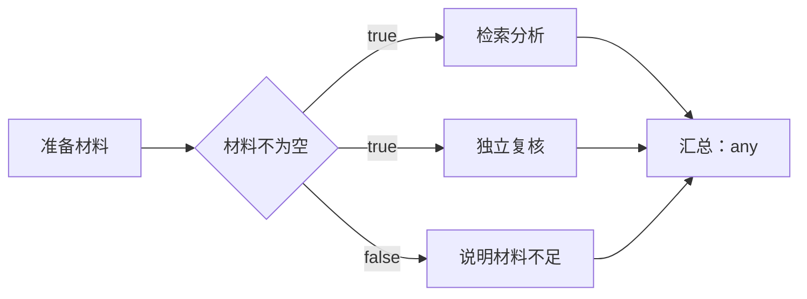

# 技能组合、工作流与 AI 依赖检查

本文说明技能组合与工作流的设计、使用方式与当前边界。尚未发布的依赖清单、免费预检、来源升级和对照评测用法见[技能包使用与维护](skill-manifests.md)。示例描述通用流程，不包含真实服务凭据，也不保证某个第三方 Skill 已具备可运行环境。

## 1. 三种能力分别解决什么问题

| 能力 | 执行方式 | 适用场景 |
| --- | --- | --- |
| 技能组合 | 一次模型会话，指定一个主技能，其他技能提供辅助说明和资源 | 主技能需要查询知识、使用格式规范或调用另一项专业能力，共同完成一个任务 |
| 技能工作流 | 每个技能节点是独立运行，程序按依赖、条件分支和并发规则调度 | A 的结果需要结合新提示词交给 B；多条分析并行后汇总；根据结果选择不同后续步骤 |
| 检查依赖 | 免费本地预检，可另发起只分析已提供材料的 AI 辅助运行 | 运行前了解缺少哪些技能、可能需要哪些包、配置、文件或外部服务 |

组合中的辅助技能不会各自启动一个独立任务，也不保证每个辅助技能都会用到。若要求“必须先运行 A，再运行 B”，应把它们建成工作流节点。工作流节点也可以使用一个技能组合，因此两种执行方式能够一起使用。

## 2. 创建和使用技能组合

1. 先把需要的技能导入技能库。
2. 在“技能组合”中创建组合，添加至少两个技能。
3. 指定唯一主技能，其余为辅助技能。可以选择跟随当前版本，或指定某个历史版本。
4. 保存组合。保存时会把所有成员解析到具体版本，并形成组合版本。
5. 从组合卡片运行，或在任务、运行表单、工作流节点的技能选择器中套用组合。

一个组合最多 16 个技能，包括主技能。重复技能、无效版本、多个主技能，以及实际调用名称冲突都会被拒绝，避免执行时悄悄覆盖某个成员。

保存组合时的“跟随当前”会被冻结为当时的具体版本。之后升级原技能不会自动改变已经保存的组合；要采用新版本，需要编辑并重新保存组合。把组合套用到任务或节点时复制成员绑定，并记录来源组合与版本。后续修改组合不会自动改写这些对象；使用与升级预览可以查看引用和变化，再明确采用新版本或回退。已在本地修改的绑定不会被升级操作覆盖。旧任务没有来源字段时保留独立绑定，不反推来源。

单个任务或节点仍可直接设置跟随当前版本。真正开始运行前，Tidebot 会解析并记录实际使用的版本；工作流会在第一个节点启动前解析整个图的技能绑定，同一引用在本次运行中保持一致。

运行时，技能被复制到 Tidebot 自己的临时目录中。主技能负责主要流程，辅助技能的说明和资源目录随本次运行提供；不会把多个 slash 命令直接拼接并假定它们都已加载，也不会把组合安装进用户的 `~/.claude/skills` 或项目技能目录。

组合可导出为带有 `skill-set.json` 的 ZIP，并在另一处导入。包包含固定成员版本的技能文件。导入遇到同名但不同内容的技能时会创建独立的导入副本，不直接推进原技能的当前版本。若导入中途失败且已经创建了部分成员，界面会明确显示部分导入结果，不把它当作完整成功。

## 3. 从画布创建工作流

进入“工作流”并新建：

1. 填写名称、并行上限和总超时。
2. 从左侧技能库或组合列表拖到画布，也可以点击条目添加节点。
3. 拖动节点调整布局。布局位置只影响显示，不决定执行先后。
4. 从节点右侧输出圆点拖到下一个节点建立依赖。条件节点有真、假两个出口。
5. 选择节点，在右侧编辑名称、前置依赖、汇合规则、主辅技能及版本、提示词或条件。
6. 用“插入输出”选择输入变量；引用某一步输出前，必须先建立相应的上游依赖。
7. 可以先“检查依赖”，再保存。保存后再运行，输入本次任务内容并选择服务商。

右侧前置依赖表单是拖线的等价入口，适合精确选择条件出口或删除依赖。画布也提供自动排列、缩放和键盘操作：节点获得焦点后，Enter/空格选择，方向键微调位置，Escape 取消尚未完成的连线。

示例画布只是结构模板，不会替用户挑选某个已有技能。需要为每个技能节点选择主技能或组合，然后才能保存运行。

工作流保存为版本化定义。不同页面同时编辑同一工作流时，过期版本不能覆盖新版本；需要刷新后再处理冲突。画布有未保存修改时，切换页面会提示处理这些修改。保存期间新增的编辑仍属于未保存内容。

## 4. 输入与输出如何传递

支持两种模板变量：

| 写法 | 含义 |
| --- | --- |
| `{{input}}` | 本次启动工作流时填写的输入 |
| `{{steps.A.output}}` | 节点 ID 为 `A` 的上游节点最终输出 |

例如 B 的提示词可以写成：

```text
根据下面的分析结果，生成一份中文修复建议。
保留证据，按影响程度排序，并列出仍需确认的问题。

用户原始要求：
{{input}}

A 的分析结果：
{{steps.A.output}}
```

这里的 `A` 是稳定的节点 ID，不是界面显示名称。重命名节点不会改变 ID。

传递的是上一步最终结果文本，不是整个会话、实时日志或所有工具消息。程序只进行一次变量替换；上一步结果里出现的 `{{...}}` 不会被再次当成模板执行。模板不会执行 JavaScript、Shell 或表达式。

只能引用当前节点的上游祖先。引用不存在的节点、下游节点、没有依赖关系的节点，或者写出环路，都会在保存或启动检查中被拒绝。画布位置不能替代依赖边。

当前没有 JSON 字段路径、文件对象或自动摘要传递。上游输出较大时，应让该节点直接给出下游所需的精简结果；不会静默截取一段文字继续执行。

## 5. 条件、并行与汇合

条件节点不调用模型。它先替换“判断内容”中的输入变量，再按选定规则得到 `true` 或 `false`。

| 操作符 | 界面含义 | 规则 |
| --- | --- | --- |
| `contains` | 包含 | 判断内容包含指定文本 |
| `not_contains` | 不包含 | 判断内容不包含指定文本 |
| `equals` | 等于 | 两段文本完全相等 |
| `not_equals` | 不等于 | 两段文本不完全相等 |
| `empty` | 为空 | 去掉首尾空白后为空 |
| `not_empty` | 不为空 | 去掉首尾空白后不为空 |

文本比较区分大小写；除空值检查外，不自动去掉空白。包含判断的比较值为空时，遵循普通字符串规则，会匹配任何文本。首版没有数值比较、正则表达式、复杂布尔表达式或模型自动选路。

同一节点可以连接多个后续节点。依赖满足的技能节点可并行启动；无需另外添加“并行”节点。

汇合规则有两个选项，**两者都会等待所有直接前置节点结束**：

| 规则 | 何时执行 | 何时跳过 |
| --- | --- | --- |
| `all`：全部前置成功 | 每条前置边都被选中，且对应前置节点成功 | 任意前置节点被跳过，或条件出口未被选中 |
| `any`：任一分支成功，等待其他分支结束 | 所有前置节点结束后，至少有一条被选中的成功路径 | 没有被选中的成功路径 |

`any` 不会收到第一个结果就抢先执行，因此并行结果不会因完成顺序不同而被遗漏。它适合互斥分支重新汇合，也适合“部分路径被条件跳过”的汇总；它不是忽略失败继续运行的容错选项。实际节点失败仍会终止整个工作流。

例如：



真分支下，检索分析和独立复核可并行，说明材料不足节点标记为跳过；汇总等待它们都结束。假分支下，两条分析路径跳过，只执行说明材料不足，再进入汇总。

汇总提示词可以依次引用 B、D、E 的输出。`any` 节点引用被跳过的上游时，替换为空文本。若使用 `all`，带有被跳过前置节点的汇总也会跳过。普通未完成、失败或不存在的输出不会被当成空文本继续运行。

## 6. 运行记录、失败和停止

一次工作流运行会保存以下内容：

- 工作流版本、完整定义快照、用户输入和服务商。
- 每个节点实际使用的技能版本和主辅角色。
- 节点状态、条件判断出口、开始与结束时间、最终输出或错误。
- 技能节点对应的普通运行 ID，可进入原有运行页查看日志和费用。

修改工作流或更新技能不会改变已经启动的运行快照。节点按依赖调度，不按画布排列顺序或模型返回顺序执行。

任一技能执行、模板渲染或持久化步骤失败时，工作流停止安排后续节点，并取消仍活跃的子运行。点击“停止”会取消整个工作流的排队和执行链；已完成的结果保留。取消不会撤回外部已经完成的操作。

退出程序或进程意外中断后，未完成工作流会标记为“已中断”。再次启动不会自动重放。首版也没有从失败节点自动恢复或自动重试：需要用户明确发起新运行，新运行重新取得当前已保存定义和技能绑定。

总超时覆盖工作流从调度开始到结束的时间；技能子运行还受软件已有的单次运行超时约束。总超时会终止工作流并记录超时原因。

## 7. 工作目录、权限与费用

工作流的每个技能节点使用独立临时目录和技能副本。本地文件工具按只读方式运行，禁用编辑、写文件及 Shell 类执行工具；首版不提供多个节点共享一个可写项目目录的模式，也不直接执行 Skill 附带的 Python/Shell 脚本。

**工作流仍沿用现有已批准的 MCP 连接器。** 本地只读约束不等于外部系统无副作用，连接器操作仍取决于已有授权。正因为外部操作可能已经生效，中断后不会自动重放工作流。

模型节点共用软件已有的全局并发、费用统计和预算准入。工作流不占一个模型执行槽再等待它的子节点；真正的子运行参与全局排队。单个工作流设为并行 4，不会绕过软件全局并发上限。条件判断本身不调用模型。

这一版没有单独的“整个工作流总预算”编辑项；模型调用仍受已有全局预算及每次子运行的费用控制。工作流模型运行计入生产运行费用，依赖分析计入辅助分析费用。

## 8. 本地预检与 AI 依赖检查

“检查依赖”可分析已保存任务、单技能、技能组合、工作流、按钮，以及未保存的提示词/技能绑定和工作流草稿。后端分别使用 `task`、`skill`、`skill_set`、`workflow`、`button`、`draft`、`workflow_draft` 类型收集材料。

检查分为两层：

1. **免费本地预检**：技能或版本能否找到、绑定和依赖清单是否有效、工作流是否有缺失节点、环路或非法输出引用，以及目标运行权限、部分环境元数据与技能正文大小。不调用模型，不产生模型费用；这些发现不会被 AI 的结论覆盖。
2. **AI 静态分析**：根据提示词、`SKILL.md` 和受限的源文件材料，推断还需要哪些运行时、软件包、工具、配置、文件或外部服务，并给出依据和处理建议。

报告中的状态应这样理解：

| 状态 | 含义 |
| --- | --- |
| 已确认缺少 | 程序在明确的检查范围内未找到引用、声明依赖或所需文件/元数据 |
| 已确认存在 | 程序找到对应的技能、文件索引、命令或元数据；不代表外部运行环境已就绪 |
| 目标环境禁用 | 目标执行方式明确禁止所需工具；存在可执行文件不能解除该限制 |
| 待核实 | AI 根据静态材料提出的依赖判断，或分析覆盖不完整 |

AI 声称某项依赖“已安装”或“缺失”，也会作为未实际验证的推断呈现。导入成功、组合保存成功、依赖分析完成，都不等于第三方服务调用成功。

AI 分析不会执行目标任务、运行技能脚本、安装依赖、测试网络连通性或读取用户工作目录中的文件内容。其源文件材料只来自技能库中允许的类型，例如 `SKILL.md`、`requirements.txt`、`pyproject.toml`、`package.json`、`go.mod` 和 Python 源文件；凭据类路径被排除，材料中的常见密钥和认证值会脱敏。AI 分析使用独立空目录，禁用全部模型工具与 MCP，与上一节工作流沿用已批准 MCP 的行为不同。本地预检还会核对目标目录是否存在、命令路径、明确选择的 Python 环境元数据、环境变量是否声明及插件授权状态；只报告证据范围，不读取密钥值或调用服务。详细边界见[技能包维护指南](skill-manifests.md)。

材料原文累计最多 128 KiB、最多 96 份，每份最多 32 KiB；序列化后的整次提示词最多 256 KiB。超出覆盖范围会明确显示待核实提示，不能据此断言没有其他依赖。JSON 报告缺字段、格式错误或被截断，会显示“报告格式不符合要求”，仍保留已完成的确定性检查。

只有明确发起 AI 分析才会调用当前选择或默认服务商并产生辅助分析费用，受到已有预算约束；本次检查额外限定 3 分钟超时和最高 1 美元的单次调用预算，已有更严格的预算仍有效。可以查看对应运行日志或主动停止。关闭结果面板只关闭展示，不等于停止后台检查。

## 9. 数据迁移与旧功能兼容

技能组合、工作流及其后续维护能力使用以下新增数据库表：

| 迁移 | 新增数据 |
| --- | --- |
| `028_skill_sets.sql` | 技能组合索引、运行实际技能绑定；组合版本复用原有版本存储 |
| `029_workflows.sql` | 工作流索引、工作流版本、工作流运行和节点运行记录 |
| `030_run_skill_set_sources.sql` | 运行的技能包来源及声明状态 |
| `031_skill_set_evaluations.sql` | 固定版本的主技能/完整组合对照评测记录 |

迁移是新增表结构，不批量改写旧任务或原始 Skill 正文。旧任务的单技能绑定继续工作；旧多绑定没有主辅角色时，按原顺序把第一个作为主技能。旧运行记录不会补造当时没有保存的主辅快照。

任务 JSON 转移保留主辅角色及版本绑定；跨机器解析技能或固定版本失败时会明确报告，不能悄悄换成当前版本。导出的组合 ZIP用于携带实际技能内容，任务 JSON 的引用不等于技能内容包。

既有 `tidebot-pack/1` 工作流包是任务和技能的分发包，不是本次新增的 DAG 定义。它仍按技能名存一份目录：若多个任务把同名技能绑定到不同版本，导出会明确拒绝，并提示分开导出。缺少被引用的主技能或辅助技能时，导入会在写入前拒绝，避免得到残缺组合。本次没有新增 Pack/2，也没有把旧包格式悄悄改成 DAG 格式。

新安装包能理解新表和字段；旧安装包不能使用新增能力。这里不承诺把升级后的数据库直接交给旧版本运行属于受支持的降级方式。

## 10. 当前范围

| 项目 | 当前限制 |
| --- | --- |
| 技能组合 | 2–16 个成员，唯一主技能；任务/节点也可只选 1 个技能 |
| 技能正文 | 单次累计最多 256 KiB；Token 仅粗估正文，超限拒绝不静默截断 |
| 对照评测 | 最多 5 个样例，仅字面文本断言；只读、禁用全部 MCP，结果不自动改写绑定 |
| 工作流规模 | 1–32 个节点，仅有向无环图 |
| 节点类型 | 技能、条件；不提供循环和动态生成节点 |
| 并行 | 每个工作流 1–4；实际模型执行还受全局并发限制 |
| 时间 | 总超时 1–1440 分钟，默认 30 分钟 |
| 输入 | 工作流启动输入最多 128 KiB |
| 节点结果 | 最终结果最多 128 KiB，超出会失败，不静默截断给下游 |
| 提示词 | 节点模板最多 32 KiB；替换结果最多 256 KiB，经 stdin 传递 |
| 数据传递 | 最终文本；没有结构化 JSON 字段选择、共享可写目录或文件制品传递 |
| 调度 | 画布工作流手动启动；尚未接入现有定时任务或触发器 |
| 恢复 | 保存历史，重启标记中断；不自动恢复、重试或重放外部操作 |

这些是已实现功能的边界，不是新增的审批要求。

## 11. 参考来源与后续方向

本次借鉴公开设计模式，运行器、数据模型和画布均在 Tidebot 现有代码中实现，没有引入下列平台的运行时或复制其完整 UI：

- **Anthropic Skills / Claude Code**：参考独立技能目录、插件分组和主辅技能装载。官方明确 `claude -p` 不会像交互终端那样展开一行里堆叠的多个技能，因此不能靠拼接 slash 命令实现组合。[技能仓库](https://github.com/anthropics/skills)、[多技能调用说明](https://code.claude.com/docs/en/skills#stack-several-skills-in-one-message)
- **LangGraph**：参考显式节点依赖、并行汇合、每步状态和运行快照。其恢复能力只是设计参考，Tidebot 首版不声称已实现同等的检查点恢复和重放。[Graph API](https://docs.langchain.com/oss/python/langgraph/graph-api)、[检查点](https://docs.langchain.com/oss/python/langgraph/checkpointers)
- **Dify**：参考变量选择、条件节点和互斥分支汇合的交互。官方也区分互斥路径聚合与并行结果合并；Tidebot 的 `all`/`any` 规则以本文为准，不直接照搬另一平台的节点名称。[条件节点](https://docs.dify.ai/en/cloud/use-dify/nodes/ifelse)、[变量聚合](https://docs.dify.ai/en/cloud/use-dify/nodes/variable-aggregator)
- **Dagu**：参考本地 Go 工作流中的依赖、显式输出和独立运行记录，保留 Tidebot 自己的 SQLite 与执行队列。[仓库](https://github.com/dagucloud/dagu)、[依赖控制](https://docs.dagu.sh/writing-workflows/control-flow)、[输出契约](https://docs.dagu.sh/writing-workflows/outputs)

后续可按以下顺序推进，均不属于当前已实现能力：

1. 结构化输出契约、JSON 字段引用和文件制品传递，提供数值条件。
2. 工作流定时/触发器、整条工作流费用上限及更完整的版本比较。
3. 在外部副作用与幂等边界明确之后，实现显式断点续跑和受控重试。

验证应区分程序逻辑、浏览器交互和真实服务商行为。单元测试及 mock 执行可以检查主辅绑定、分支、并行、取消和快照；本地浏览器检查验证画布与操作流程。它们不能替代真实 Claude、DeepWiki、MCP 或第三方脚本环境的集成验收，也不意味着完整浏览器回归已经接入 CI。
