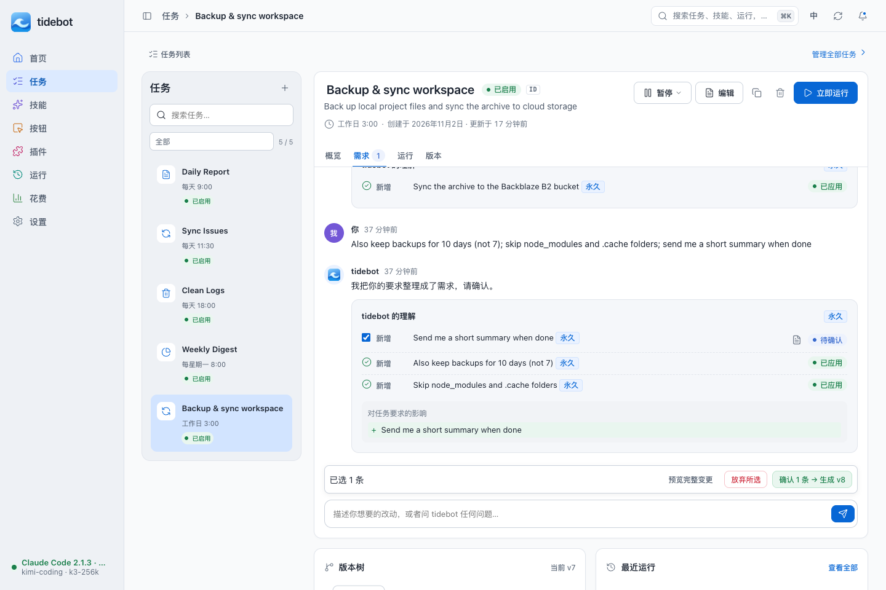
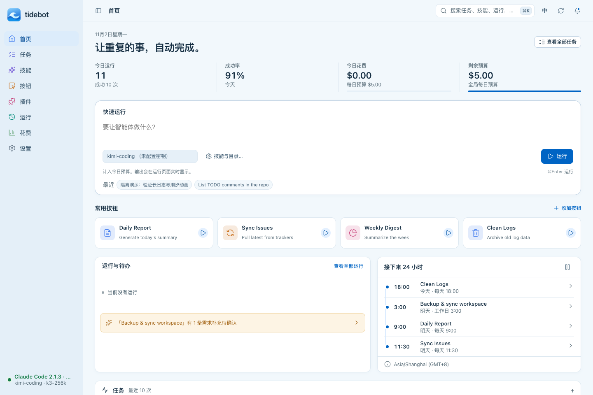
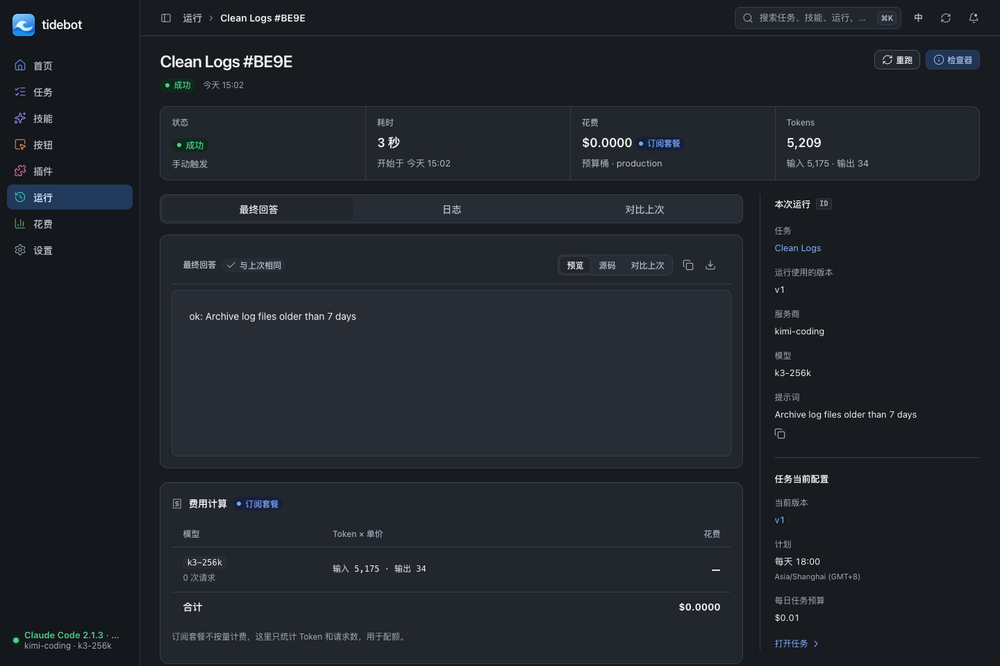

# 三主题工作区

三套主题共用页面、路由和操作；切换主题只调整配色与材质。现有 `graphite / tide / midnight` 偏好键保持兼容，每套仍支持浅色、深色和跟随系统。

| 主题 | 视觉方向 | 页面示例 |
| --- | --- | --- |
| 石墨 | 银白原生、蓝色强调、清晰分栏 | 任务需求工作区 |
| 潮汐 | 冰蓝背景、轻磨砂导航、实底正文 | 今日首页 |
| 午夜 | 石墨层次、克制蓝色、高对比正文 | 运行结果与检查器 |

## 页面

首页可以直接输入提示词并选择服务商运行一次；“技能与目录…”打开完整运行表单。两处共享草稿，快捷键入口同样同步。常用按钮以卡片呈现，下方集中显示运行、待确认需求和下一次计划；任务最近状态保留在可展开区域。

任务详情增加可收起的任务列表，支持搜索和状态筛选。筛选只更新列表，不重建正在编辑的需求；输入按任务保存会话草稿。需求确认、仅下次生效、冲突处理和版本回滚沿用原逻辑。宽屏分栏，窄屏默认收起任务列表。

运行详情将最终回答、日志和答案对比分成页签；切换保留日志连接和阅读位置。检查器明确区分“本次运行”的版本与“任务当前配置”，按需读取调度、预算及待处理需求。停止、移出队列、重跑、改后重跑、存为任务、文件变更与费用明细仍可使用。

## 动态 logo

`waveMark()` 更新为蓝色圆角底与简洁卷浪，和 `branding/mark.svg` 共用几何造型；应用图标、favicon 及各平台打包图标同步更新。全局运行状态映射保持不变：普通状态缓慢流动，运行状态加快；窗口隐藏时暂停，系统要求减少动态效果时停用动画。托盘 normal/running/error 保持三种独立状态，并提供 macOS 单色模板与其他平台彩色图标。

## 适配与维护

- 1024×655 下任务确认栏和输入框可见；运行检查器默认收起，展开时进入纵向布局。
- 潮汐玻璃仅用于导航及顶栏，提供纯色背景和减少透明度回退；正文不使用透明玻璃。
- 主题 token 从 `scripts/gen-themes.py` 生成。修改页面底色时同步 `appearance.go` 的桌面预涂背景。
- 文字、图标和磨砂合成背景的对比度由测试检查；保留中英翻译与键盘操作。

## 连续窗口缩放

1180×780 是桌面窗口的初始尺寸。页面按可用宽度重排：≤960px 默认图标导航，≤640px 展开的导航转为顶部网格；任务列表和检查器按断点自动收展，宽屏用 `clamp()` 分配辅助栏宽度。窄屏表格在可聚焦的独立区域横向滚动，保留原表格节点、事件和语义。低高度窗口允许纵向滚动，不把主要内容锁在固定高度内。

参考以下高 star 项目的布局原则，使用现有原生 JS/CSS 实现，未引入新布局依赖（stars 查询日期：2026-11-02）：

- [VS Code：splitview.ts](https://github.com/microsoft/vscode/blob/main/src/vs/base/browser/ui/splitview/splitview.ts#L41)，194,470 stars：分栏最小/最大尺寸与折叠。
- [Open WebUI：Sidebar.svelte](https://github.com/open-webui/open-webui/blob/main/src/lib/components/layout/Sidebar.svelte#L718)，157,510 stars：辅助栏宽度约束及窄屏自动收起。
- [Joplin：ResizableLayout.tsx](https://github.com/laurent22/joplin/blob/dev/packages/app-desktop/gui/ResizableLayout/ResizableLayout.tsx#L84)，56,979 stars：按父容器可用空间约束分栏并响应 resize。

## 实际界面（隔离演示数据）

## 验证范围

本轮完成 WebUI 测试、Go vet、gofmt、翻译检查，以及 Chromium 中三主题六配色、中英文、草稿同步、模拟运行与停止、日志阅读位置、动态 logo、主题持久化及系统跟随检查。窗口适配覆盖 320 / 384 / 480 / 640 / 800 / 1024 / 1440 / 1920 像素宽度的 64 个页面组合，并验证连续缩放过程中任务草稿、需求 DOM 与日志 DOM 保持不变。

已修复 `internal/claudebin` 测试受到本机 Claude 安装污染的问题：使用现有版本探测注入点，只执行临时 fixture 目录内的候选。生产 Homebrew/npm/nvm 查找行为保持不变。修复后根模块全套 `go test ./...` 通过；桌面模块测试也通过。

这些结果不代表 macOS/Windows/Linux 原生桌面交互、真实模型服务商或生产数据的验收；本轮浏览器运行使用独立数据目录和模拟执行器。
